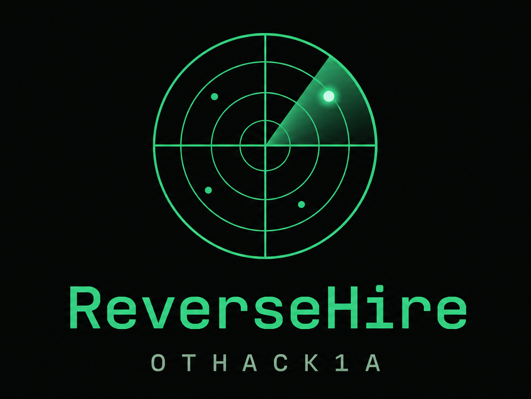
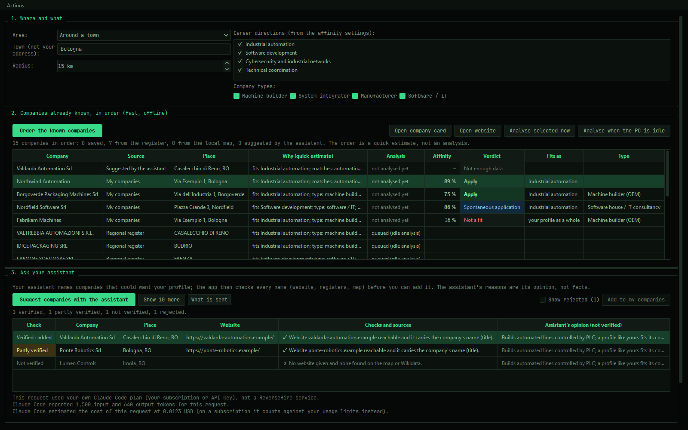
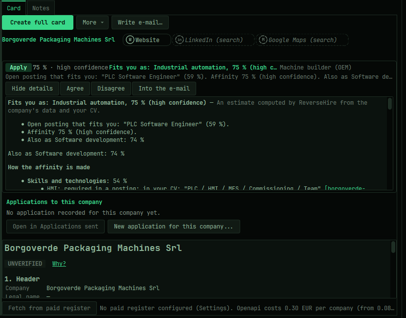

# ReverseHire

**A desktop app that starts from your CV and tells you which companies around you are worth writing to, whether or not they have an open job advert.**

Most job tools start from a job advert and look for candidates. ReverseHire goes the other way. You give it **one CV**; it builds your profile, finds the companies in the area you choose, studies them, and tells you for each one what to do: **apply** to an open posting, send a **spontaneous application**, **keep an eye on it**, or skip it, with the evidence behind the verdict. It also shows how recruiters' screening software would read your CV, and keeps track of the applications you send.

It is for job seekers who are willing to read the reasons behind a score, and who want to look beyond job boards. It is built for Italy first (Italian map data, registers and company categories), with an interface in English, Ukrainian or Italian and CVs in the same three languages.

*The pictures use invented companies and an invented CV.*

## System requirements

| | Minimum |
|---|---|
| Windows | Windows 10 version 1809 or later, or Windows 11; 64-bit (x64) only |
| Linux | Ready-made build: x86_64, glibc 2.35 or later (Ubuntu 22.04+, Debian 12+, Fedora 36+). Source installation: Python 3.12 or later, a graphical desktop and glibc 2.34 or later (needed by PySide6 6.12) |
| macOS | Ready-made build: Apple Silicon only (no Intel Macs); macOS 14.4 or later declared by Qt 6.12, started only on macOS 15. Source installation: macOS 14 or later (PySide6 6.12 wheels), Apple Silicon |
| From the sources | Python 3.12 or later (the ready-made builds use Python 3.14) |
| Memory and disk | about 4 GB of free RAM; about 1 GB for the program plus 0.5 GB for the scoring model |
| Screen | 1366 × 768 or larger |

Details, the optional downloads and the optional programs: [System requirements in detail](#system-requirements-in-detail).

## The workflow in six steps

1. **Load your CV.** Choose or drop a PDF, DOCX or image; it is read at once on your computer (scans and photos go through a local text recognition). Correct the profile if needed: every edit is saved immediately and can be undone.
2. **Find who could be interested in your profile.** One button orders the companies the program already knows (fast, offline), can ask your own AI assistant for more names (each one is checked before it is listed) and analyses the best ones, then the rest later while the PC is idle.
3. **Judge the companies with the affinity.** Each company gets a score, a verdict, a confidence and the evidence, per career direction of your profile. You can say Agree or Disagree and let the program adapt a little. The company card gathers links, identity, contacts and, when you paste them, financial figures with the revenue trend.
4. **Search postings and spontaneous targets.** Search a radius, a province or a region; use the job search (by meaning, with typos and synonyms tolerated) for open postings, and a second list of companies for a spontaneous application.
5. **Simulate the screening.** Twenty simulators of applicant-tracking systems and CV parsers show what each would extract and where your CV could be lost.
6. **Apply and track.** Prepare an e-mail draft or an application document, and follow every application in the **Applications sent** tab (status, cover letter, the exact CV sent with a preview, appointments, follow-up notice). The program never sends anything itself.

Every table sorts by clicking a column header, and every list has one search box that works by meaning and by exact words.

## Download

Ready-made builds for Windows, Linux and macOS are on the [Releases page](https://github.com/OTHack1A/ReverseHire/releases/latest): no Python needed.

| System | Download | Start |
|---|---|---|
| Windows 10/11, 64-bit | `ReverseHire-<version>-windows-x64.zip` and installer `ReverseHire-<version>-setup.exe` | unpack the folder, double-click `ReverseHire.exe`; or run the installer |
| Linux x86_64 | `ReverseHire-<version>-linux-x86_64.tar.gz` | `tar xzf` the file, run `ReverseHire/reversehire`; `ReverseHire/install-desktop-entry.sh` adds a menu entry. Needs the Qt desktop libraries listed in the [installation guide](docs/INSTALLATION.md#download-a-ready-made-build) |
| macOS, Apple Silicon | `ReverseHire-<version>-macos-arm64.dmg` | open the disk image and drag `ReverseHire.app` to Applications |

Check the download against `SHA256SUMS.txt` if you like. Where the data goes and what is downloaded later: [installation guide, section "Download a ready-made build"](docs/INSTALLATION.md#download-a-ready-made-build).

**The builds are not code-signed**, so the system warns you the first time:

- **Windows SmartScreen** shows "Windows protected your PC / unknown publisher": click **More info**, then **Run anyway**.
- **Windows with Smart App Control on** blocks the program outright: use the source installation below (`start.bat`) there.
- **macOS Gatekeeper** refuses the app the first time: open System Settings, Privacy & Security and click **Open Anyway** (on macOS 14 a Control-click on the app and **Open** also works). In Terminal: `xattr -dr com.apple.quarantine /Applications/ReverseHire.app`.

**How the builds were checked.** All three were built on GitHub's machines and started there with the automatic self-test (locales, bundled models, main window, web map) and an MCP `initialize` check. No person has run the downloaded builds on a real desktop yet: please report problems on the [Issues page](https://github.com/OTHack1A/ReverseHire/issues).

**Intel Macs are not supported by the ready-made build** (only Apple Silicon is built; the ONNX runtime has no current release for Intel Macs). The source installation with Python 3.12 or 3.13 may still work there, untested.

## Quick start (from the sources)

Python 3.12 or later is needed. No administrator rights are needed. The first start creates a `.venv` folder and installs the dependencies (internet, a few minutes); later starts open the app at once.

| System | How to start |
|---|---|
| Windows | Double-click `start.bat` (see the [installation guide](docs/INSTALLATION.md)) |
| Linux | `bash start.sh` (on Debian or Ubuntu first `sudo apt install python3-venv`; the installation guide lists the Qt libraries) |
| macOS | Double-click `start.command` (if macOS refuses: `chmod +x start.command start.sh` once) |

By hand, in the project folder: create a virtual environment, `pip install -r requirements.txt`, `pip install -e .`, then `python -m reversehire`. The interface starts in English every time.

### What is created or downloaded, and how big

None of this is in the repository; it is created on your PC at installation or on first use ([details](docs/INSTALLATION.md#10-first-run-and-what-is-recreated-or-downloaded)).

| What | When | Size |
|---|---|---|
| Python environment and packages | first start | about 1.4 GB |
| Data folder `userdata/` (settings, searches, cards, applications, log) | first start | grows with use; the log is capped at 100 MB |
| Scoring model `intfloat/multilingual-e5-small` | first use that needs it (without it the app still works, with lower accuracy) | about 470 MB |
| Map data of a region | only when you click **Download / refresh map data** | about 205 MB for Emilia-Romagna |
| Advanced text recognition (optional) | only if you accept | about 147 MB |
| Regional register, four free official sources (optional) | only when you click **Download / update**; the program shows the size first | from several hundred MB to a few GB for the raw files |
| Translation models for Italian and Ukrainian CVs (optional) | on request | see the installation guide |

### System requirements in detail

| Item | Requirement | Where it comes from |
|---|---|---|
| Windows | Windows 10 version 1809 (build 17763) or later, or Windows 11; x64 only (no 32-bit, no ARM build) | Python 3.14 supports Windows 10 and newer; Qt 6.12 (PySide6 6.12) supports Windows 10 1809 or later. Built and started with the self-test on GitHub's Windows Server runner; never run by a person on a real desktop. |
| Linux | Ready-made build: x86_64 only, glibc 2.35 or later (Ubuntu 22.04+, Debian 12+, Fedora 36+). Source installation: Python 3.12 or later, X11 or Wayland desktop, glibc 2.34 or later (Fedora 35+) | The highest glibc symbol version the build's binaries need is GLIBC_2.35 (measured); PySide6 6.12 itself needs glibc 2.34. Built and started with the self-test on GitHub's Ubuntu 22.04 runner (virtual X server); never run by a person on a real desktop. |
| Linux libraries | `libegl1 libgl1 libxkbcommon-x11-0 libxcb-cursor0 libxcb-icccm4 libxcb-keysyms1 libxcb-shape0 libnss3 libxcomposite1 libxdamage1 libxrandr2 libxtst6 libasound2` (Debian/Ubuntu names; `libasound2t64` on Ubuntu 24.04) | What Qt and Qt WebEngine load at start; a desktop installation normally has them. |
| macOS | Ready-made build: Apple Silicon only; macOS 14.4 or later declared by Qt 6.12; started only on macOS 15 (GitHub runner), not verified on a real Mac or on macOS 14. Source installation: macOS 14 or later (PySide6 6.12 wheels), Apple Silicon | Qt 6.12's frameworks in the build declare macOS 14.4 as minimum and PySide6 6.12's own libraries declare 26.0, yet the build runs on the macOS 15 runner. Built and started with the self-test there; never run by a person on a real Mac. |
| Python (from the sources) | 3.12 or later (`requires-python`); the ready-made builds and the tests use 3.14 | `pyproject.toml` |
| Processor | 64-bit | all builds are 64-bit |
| Memory | about 4 GB of free RAM for normal use (8 GB of RAM recommended); more while the advanced text recognition runs | installation guide, section 1 |
| Disk | program: about 1 GB unpacked (ready-made build) or 1.4 GB (source environment); scoring model about 470 MB; optional: advanced text recognition about 147 MB, map data about 205 MB per region (Emilia-Romagna), translation models (size not stated by the program), regional register from several hundred MB to a few GB of raw files | measured sizes and the table above |
| Screen | 1366 × 768 or larger | the window is designed for 1366 pixels (the ten tab labels fit) |
| Internet | only for searches (maps, company websites) and the first-time downloads | |
| Optional programs | Claude Code or Codex CLI for the assistant strip and the suggestions; classic or new Outlook for e-mail drafts on Windows (otherwise Thunderbird, Apple Mail, the default mail program or Gmail in the browser) | |

## Privacy

- **Your CV never leaves your computer.** Reading, text recognition, translation, scoring, the affinity, the search by meaning and the screening simulators all run locally; no online language model is involved.
- **What does leave it, and when:** ordinary web requests to company sites (while searching, building a card or analysing); the address you type (Nominatim); map data and map pictures (only when a map shows its background); registers and models, only when you download them; identity lookups (VIES, GLEIF, Wikidata, filings.xbrl.org) for a company you build a card for; the job sources you enable.
- **Your own AI assistant** (Claude Code or Codex, optional) receives something only when you press the button: the **assistant strip** gets your question and what ReverseHire's tools return, and the **suggestions** get an **anonymised brief** that you can preview first (roles, skill families, sectors, languages, seniority; no name, contact, employer or home town) plus the names of companies you already know in the area (at most 60), which the preview also shows.
- Nothing is sent when the program starts, apart from an optional monthly check of the register once you have downloaded it.
- The full list of destinations is in [section 17 of the manual](docs/USER_MANUAL.md#17-privacy-what-leaves-your-computer).

## Data sources and licences

Companies and places come from OpenStreetMap (ODbL) and Wikidata (CC0); company categories from ISTAT ATECO 2025 (CC BY 4.0); occupations and skills from ESCO; the regional register from four open official sources (RNA and OpenCoesione and AGCM under CC BY 4.0, the GLEIF golden copy under CC0); listed companies' figures from ESEF reports on filings.xbrl.org. Local models include multilingual-e5-small, OPUS-MT and PP-OCR through RapidOCR. Two small model files are bundled in the repository (a face detector and a Cyrillic text recogniser) with their licences. The complete list, with licences and required attributions, is in [ATTRIBUTIONS.md](ATTRIBUTIONS.md).

## Limits

The project works but it is **not tuned on many real cases**. The manual has the full list ([section 20](docs/USER_MANUAL.md#20-known-limits)); the main points:

- **Scores and verdicts are estimates** computed from public data and your CV, with weights chosen on invented examples. They cannot know whether a vacancy really exists, the pay, or the culture. Read them with their reasons.
- **Company lists are incomplete.** OpenStreetMap is not a register; the free registers cover roughly a quarter to a third of the machinery companies of a province in the study behind the feature, the province is sometimes presumed and most companies have no exact ATECO code. The complete list (Registro Imprese "Elenco") is paid and you import it yourself.
- **Financial figures are entered by paste**, because the company-information sites forbid automated reading; only listed companies get free figures automatically.
- **Recruiter simulators are approximations** built from public documentation (none has high confidence). The AI-written-text bar is an estimate, not proof.
- **Tried on a real PC:** Windows, classic and new Outlook drafts, Excel opening the exports, Claude Code and Codex through the MCP tools. **Not tried:** Linux and macOS on real machines (only the automatic start-up test of the ready-made builds ran there, on GitHub's machines), Thunderbird, Apple Mail, Gmail compose, a real printer, the paid Openapi lookup, the Adzuna, Jooble and Careerjet services with a real key, Claude Desktop and Gemini CLI, and the newest functions (affinity, suggestions, idle analysis, applications tracker, register manager) on other PCs than the developer's.
- **The assistant may not know small local companies:** in the real check it never named a well-known local cybersecurity company that the local map data did find, so use the fast ordering together with the suggestions.
- **The idle analysis pause** (it stops when you use the PC) was verified only with simulated idle signals. **Two short stalls of the window (about 5 seconds)** were seen during heavy background work and are **not fixed yet**.
- Italy first: the place selectors, registers and categories are Italian.

## Documentation

- [User manual](docs/USER_MANUAL.md): how to use the app, step by step; also as a [PDF edition](docs/manual/reversehire_manual.pdf) (LaTeX).
- [Installation guide](docs/INSTALLATION.md): the ready-made builds, installation from source on Windows, Linux and macOS, the data folder, first run, optional downloads, troubleshooting.
- [Plan and progress](docs/PLAN.md): what each phase did, with its short decision tables.
- [Interfaces](docs/INTERFACES.md): module contracts. [MCP](docs/MCP.md): using ReverseHire from Claude, Codex and Gemini.
- [Publishing checklist](docs/PUBLISHING.md) and [attributions](ATTRIBUTIONS.md).

## Tests

The automatic tests and the sample files they use are not part of this repository, which carries only the program sources. They are kept by the developer and run before every release.

## Version and build

The version is in `src/reversehire/_version.py` (the single place); its third number is the build number, raised by `tools/build.py`. The About window shows it.

## Licence

MIT, see [LICENSE](LICENSE). The ready-made builds also contain third-party open-source components (Python, Qt/PySide6 under LGPL-3.0 with Chromium through Qt WebEngine, onnxruntime, OpenCV and others), each under its own licence: `THIRD-PARTY-NOTICES.txt` and the `licenses` folder are inside every package (sources in `tools/packaging/`), and [ATTRIBUTIONS.md](ATTRIBUTIONS.md) lists data, models and services.

## Author

ReverseHire was conceived and is developed by 0THack1A, its creator and main contributor: [GitHub](https://github.com/OTHack1A)
