# ReverseHire - User Manual

This manual explains how to use ReverseHire, step by step, for people who are not technical. It does not explain how to install the program: for that, see the [Installation guide](INSTALLATION.md). The [README](../README.md) gives a short overview, and a formatted PDF edition of this manual is in `docs/manual/reversehire_manual.pdf`.

The names of buttons, tabs, menus and messages are written in **bold** exactly as they appear in the program when the interface language is English. The pictures in this manual were made with invented data (fictional people and companies), on a dark theme, with neutral PC details and without any online map tiles.

The manual follows the real workflow: sections 3 to 9 are the six steps (load the CV, find who could be interested, judge the companies, search postings and spontaneous targets, simulate the screening, apply and track); sections 10 to 20 are reference material. Section 20 lists the limits honestly.

## Contents

1. What ReverseHire does
2. Starting the program and the main window at a glance
3. Step 1 - Load your CV
4. Step 2 - Who could be interested in my profile
5. Step 3 - Judge the companies with affinity
6. Step 3 (continued) - The company card, favourites and "My companies"
7. Step 4 - Search postings and spontaneous targets
8. Step 5 - Simulate the screening
9. Step 6 - Apply and track
10. Tables: sorting, search by meaning, right-click menus, Country / Region / Province selectors
11. The regional register and the Register manager
12. Maps
13. Settings
14. Language and appearance
15. The "?" menu, the log and the safety net
16. The assistant strip and the MCP connection
17. Privacy: what leaves your computer
18. Where your data is stored
19. Troubleshooting and frequently asked questions
20. Known limits

## 1. What ReverseHire does

Most job tools start from a job advert and look for candidates. ReverseHire works the other way round: it starts from **you** and helps you find **the companies that could want you**, including the ones that have no open advert at all.

You give it **one CV** (always one at a time; it never compares or ranks several CVs). From that CV it builds a profile that you can correct. Then it helps you in six steps, from "who could be interested in my profile?" to a tracked application.

### 1.1 What it does

- It **reads your CV** on your own computer (PDF, DOCX, or a photo or scan) and extracts roles, skills, languages, degrees, work history, how much you are willing to travel, your home town and your seniority. A CV that is not in English is translated into English on your computer.
- It shows how a recruiter, and the screening software many companies use, would **read your CV**, with advice to improve it (the **Recruiter view** and **Recruiter analysis** tabs).
- It answers the question **"Who could be interested in my profile?"**: it orders the companies it already knows in a few seconds, can ask **your own** AI assistant (Claude Code or Codex) to name more, checks every name itself, and can analyse the best ones in depth (section 4).
- It judges every company with an **affinity** number and a **verdict** (apply, send a spontaneous application, keep an eye on it, not a fit, not enough data), always with the reasons and the evidence it found (section 5).
- It **searches** companies in an area (a radius, a province or a region) and **job postings** by meaning, and reads company websites for careers pages and adverts (section 7).
- It keeps **company cards**, your notes and your **applications**: it prepares an **e-mail draft** in your mail program, an exported PDF/Excel/Word, and a tracker with statuses, appointments and follow-up reminders (sections 6 and 9).

### 1.2 What it does not do (read this once)

- **It never sends anything for you.** It does not send e-mails (it opens a **draft** that you read and send yourself), does not fill in application forms and does not sign in to any job site for you.
- **It is not a job board.** It does not hold a database of adverts. Postings come from your own searches and from sources whose terms of use allow automated reading; the buttons for LinkedIn and Indeed only open your browser (see section 7 and section 20 for the one off-by-default setting that touches job boards).
- **The lists are incomplete.** The companies come from OpenStreetMap, Wikidata, a regional register you may import, files you import and the companies you add yourself, plus the names your assistant suggests. None of these is a complete business register (section 20).
- **The numbers are indications, not facts.** The scores and the affinity were calibrated with **invented examples** only, and the screening simulators are approximations built from the vendors' public documentation; none of it has been **tuned on a large set of real cases**. Always read the reasons and the confidence next to a number.
- **It does not guess.** When a source gives no value (a salary, a contract, a contact, a financial figure), the field stays blank.
- **It was developed and tested on Windows.** The Linux and macOS launchers exist but were not tried on real machines (section 20).

Your CV is analysed on your computer and is never sent to company websites. The only things that can leave your computer are listed in section 17; the main ones are the anonymised summary sent to **your own** assistant when **you** ask for suggestions, and the pages and registers the program reads when **you** start a search or an analysis.

### 1.3 The six steps

| Step | What you do | Where | Section |
|---|---|---|---|
| **1. Load your CV** | Choose or drop the file; check and correct the profile. | Tab **1. CV and profile** | 3 |
| **2. Who could be interested in my profile** | Press the big button: companies already known, in order, in seconds; optional assistant suggestions; optional deep analysis now or while the PC is idle. | Button on tab 1, **Search** menu, guided window | 4 |
| **3. Judge the companies** | Read the affinity and the verdict; open the company card; star the companies you like. | Affinity columns in the lists, box on the company card, tab **My companies** | 5 and 6 |
| **4. Search postings and spontaneous targets** | Choose where to search and start; or search postings by meaning; get a list of open postings and a list of companies for a spontaneous application. | Tabs **2. Location and start**, **3. Results**, **Job search** | 7 |
| **5. Simulate the screening** | See how screening systems would read your CV for a role, a posting or a company. | Tab **Recruiter analysis** | 8 |
| **6. Apply and track** | Write an e-mail draft or export an application; record it, keep its PDF, set appointments and follow-ups. | Companies, **Applications sent** | 9 |

You do not have to follow the steps in order. A typical first session is: load the CV (step 1), press **Who could be interested in my profile?** (step 2), open the best companies (step 3), and write a draft to one of them (step 6). The remaining sections explain the tables (section 10), the regional register (section 11), maps (section 12), the settings (section 13), language and appearance (section 14), the log and the safety net (section 15), the assistant strip and MCP (section 16), privacy (section 17), where the data is kept (section 18), troubleshooting (section 19) and the known limits (section 20).

## 2. Starting the program and the main window at a glance

### 2.1 Starting the program

- **Ready-made build** ([download](INSTALLATION.md#download-a-ready-made-build)): only the Windows build is published so far; double-click `ReverseHire.exe` in the unpacked folder (or use the Start menu entry made by the installer). Linux and macOS start from the sources, as in the next lines.
- **Windows, from the source code**: double-click `start.bat` in the project folder.
- **Linux**: run `bash start.sh` in the project folder.
- **macOS**: double-click `start.command` in the project folder (if macOS refuses, run `chmod +x start.command start.sh` once in a terminal).

The first start from the source code creates the program's own environment (the `.venv` folder) and installs what it needs: it needs the Internet and takes a few minutes, and the script stops with a message if Python 3.12 or later is missing. Later starts open the window at once, and no terminal window stays open (on Windows the program is started without a console). No administrator rights are needed. The details are in the [Installation guide](INSTALLATION.md). The launchers for Linux and macOS have **not** been tried on real machines (section 20).

There is no welcome wizard and no account. The first thing you see is tab **1. CV and profile**, asking you to choose a CV. Some things are downloaded only the first time they are needed, each with its own message: the scoring model used when you search for companies (about 470 MB, unless you copied it into a `models` folder) and, only if you use them, the optional advanced text reader, the translation models and the map data of a region.

**The program always starts in English.** The language chips (**EN**, **UK**, **IT**) change the language only until you close the program; the next start begins again in the **Start-up language** chosen in **Settings > General** (English unless you changed it, or **Language of the last session** if you prefer that behaviour). See section 14.

To close the program use **File > Exit** or close the window. If a search is running, ReverseHire first cancels it, waits for it to stop (at most about 30 seconds) and then closes; the results found so far are kept. The idle analysis (section 4.6) stops too, and what was still queued is kept for the next start.

### 2.2 The main window

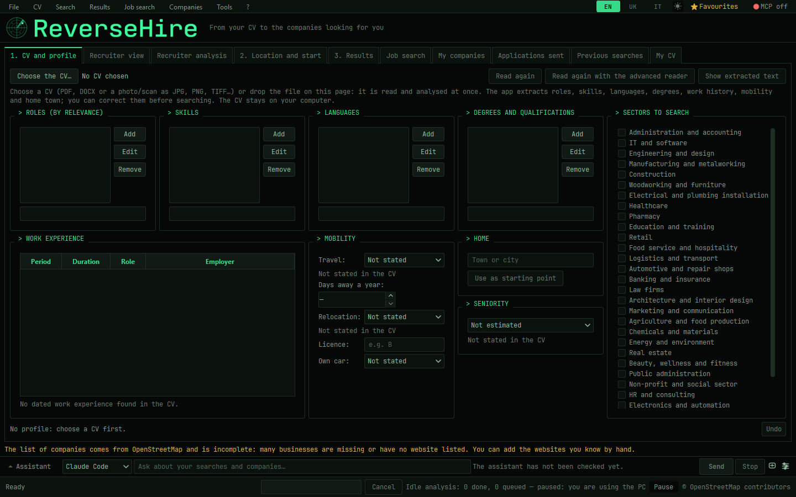

The window opens **1366 pixels wide** (less if your screen is smaller), the width at which the labels of the ten tabs fit; in a narrower window the tab bar shows small scroll arrows.

From top to bottom the window contains:

- **The menu bar**, with eight menus: **File**, **CV**, **Search**, **Results**, **Job search**, **Companies**, **Tools** and **?** (see 2.3).
- **At the top right of the menu bar**, always visible:
  - three small **language chips**, **EN**, **UK** and **IT** (English, Ukrainian, Italian): click one to change the language of the interface at once (section 14);
  - a small **sun or moon** button that switches between the dark and the light theme (section 14);
  - the **Favourites** button (with a star), which opens the window of your starred companies (section 6);
  - the **MCP dot**: a red dot with **MCP off** or a green dot with **MCP on**. It shows whether AI assistants may read your ReverseHire data; click it to change it (section 16). It is off unless you switch it on.
- **The header** with the ReverseHire logo and the line "From your CV to the companies looking for you".
- **Ten tabs**, in the order of the work:

  | Tab | What it is for | Section |
  |---|---|---|
  | **1. CV and profile** | Choose the CV, check and correct the profile, start step 2. | 3 and 4 |
  | **Recruiter view** | How a recruiter would screen your CV; the AI-written-text estimate. | 3.7 |
  | **Recruiter analysis** | Simulators of the systems that screen CVs. | 8 |
  | **2. Location and start** | Where to search, which sources to use, the start button. | 7 |
  | **3. Results** | The companies of a search, as a table or on a map, with the details of the selected one. | 7 |
  | **Job search** | Search job postings by meaning; a second list of companies for a spontaneous application. | 7 |
  | **My companies** | The companies you saved: company card, affinity box, notes. | 5 and 6 |
  | **Applications sent** | The tracker of your applications. | 9 |
  | **Previous searches** | All saved searches. | 7 |
  | **My CV** | The language versions of your CV. | 3.8 |

- **A yellow notice** reminding you that the list of companies is incomplete (section 20).
- **The assistant strip**, one row above the status bar, always visible on every tab: the name of your assistant, the question field, **Send**, **Stop** and two small buttons (section 16). It is collapsed to one row by default.
- **The status bar** at the bottom, from left to right:
  - a message that says what the program is doing (for example **Ready**);
  - the time elapsed since the search started (with **about 2 min left** once the program can estimate it);
  - **one progress bar shared by everything that takes time**: reading a CV (**page 2/5** for scanned pages), a company search (**10/15** companies analysed), the affinity (**Affinity with your CV: 12 of 40 companies** in its tooltip), the guided analysis of section 4, the recruiter analysis, the job search, the download of the advanced reader and of the map data. When two things run together it shows the one that started last;
  - the **Cancel** button (active only while a search or another cancellable job runs);
  - the **idle-analysis line**, for example **Idle analysis: 12 done, 240 queued — paused: you are using the PC**, with a small **Pause** / **Resume** button (section 4.6);
  - the "(c) OpenStreetMap contributors" credit.

### 2.3 The menus

Every button of the tabs is also a menu entry, so you can work from the keyboard or from the menus. A menu entry does the same as its button, shows the tab it belongs to, and is greyed out when the button is (for example **Open job ad** when no advert is selected). The menus are:

| Menu | What it holds |
|---|---|
| **File** | **Open CV…** (Ctrl+O), **Read again** (the same CV file, analysed again), **Export CSV…**, the submenu **Export** (**Export company card…**, **Export application…**), **Favourites…** (Ctrl+Shift+F), **Settings…**, **Exit** |
| **CV** | **Read again with the advanced reader**, the advanced reader's download offer buttons, **Show extracted text**, **Use as starting point**, **Add to My CV**, **Undo last profile change** (Ctrl+Z on tab 1), the submenu **Recruiter analysis** (**Run analysis**, **Stop analysis**, **My screening answers…**, the help for the score columns) and the submenu **My CV** (**Add version…**, **Replace file…**, **Remove**, **Set as primary**, **Use for analysis**, **Open externally**, **Show in folder**, **Save photo as…**, **Compare**, **Zoom out**, **Zoom in**, **Fit width**) |
| **Search** | **Check**, **Set starting point…**, **Start search**, **Cancel**, **Download / refresh map data**, **Import company list…**, **Register manager…**, the map button, and **Who could be interested in my profile?…** |
| **Results** | The buttons of the selected company (**Open website**, **Open careers page**, **Open LinkedIn**, **Write e-mail…**, **Open job ad**, **Simulate screening**), **Why is the accuracy reduced?**, **Export CSV…**, **Show on map** / **Show as table**, the Country/Region/Province filter, and the buttons of **Previous searches** |
| **Job search** | **Search**, **Stop**, **Paste posting / company page…**, the actions on a posting (open it, create a company card, **Who might be behind this ad?**, add to favourites, **Simulate screening**, map), the shortcuts to the same search on LinkedIn and on Indeed (they open your browser), the actions on saved searches, the actions on the list of companies for a spontaneous application, and **Job search settings…** |
| **Companies** | **Add company by hand…**, **Search**, **Save**, **Open website**, **Open LinkedIn**, **Find similar**, **Delete**, **Create full card**, **Write e-mail…**, the batch buttons (full cards for the selected companies or for all favourites), the actions of the card (register, financials, refresh a section, copy, export), the buttons of the affinity box (**Details**, **Agree**, **Disagree**, **Into the e-mail**) and the submenu **Applications sent** |
| **Tools** | **Switch to the light theme** / **Switch to the dark theme** (Ctrl+Shift+L), **MCP server…**, the submenu **Assistant** (**Show conversation**, **Send**, **Stop**, **New conversation**, **Assistant settings…**), the submenu **Advanced reader (OCR)** (**Download the advanced reader**, **Cancel the advanced reader download**, **Remove the advanced reader…**, **Text recognition settings…**) and **Pause the idle analysis** |
| **?** | **Diagnostics…**, **Open log folder**, **About** (section 15) |

When the mouse is over a button, or the keyboard focus is on it, the button is highlighted and grows very slightly. If your system has animations switched off (the Windows setting **Show animations in Windows**), the buttons only change colour and do not grow.

The exact set of entries can change from one version to the next, because a menu entry is created for every button; the buttons in the tabs are always the reference.

### 2.4 Keyboard shortcuts

| Keys | What they do |
|---|---|
| Ctrl+O | **File > Open CV…** |
| Ctrl+Z | On tab 1: **Undo last profile change** (3.5) |
| Ctrl+Shift+F | **Favourites…** |
| Ctrl+Shift+L | Switch between the dark and the light theme |
| Delete | In **My companies** and in **Previous searches**: the same as the **Delete** button of the selected row (the program asks before deleting a saved company or a saved search) |
| Quit key of your system | **File > Exit**, where your system has one (for example Ctrl+Q on Linux) |

Everything else is reached with the mouse, the Tab key and the menus. Right-clicking a row of a table opens a menu with the actions of the row (section 10).

## 3. Step 1 - Load your CV

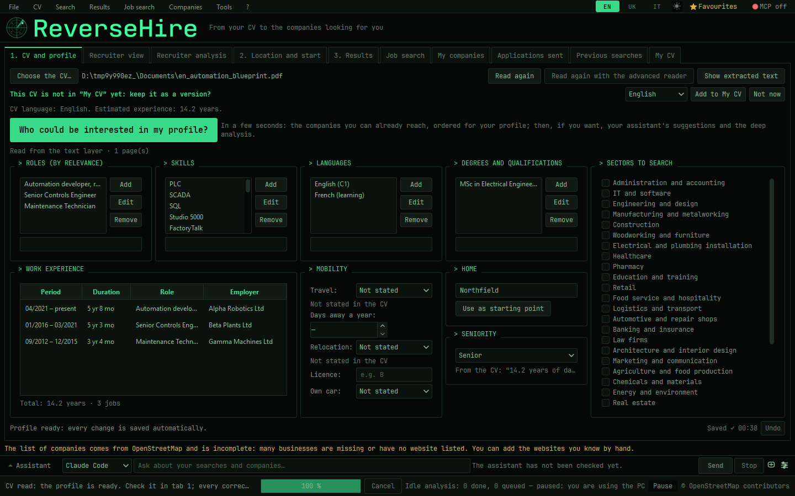

**In short**

1. Click **Choose the CV…**, or drop the file anywhere on the program window.
2. Wait for the progress bar at the bottom: a few seconds for a text PDF or a DOCX, longer for a scan or a photo.
3. Look at the boxes of the profile and correct what is wrong, starting with **ROLES (BY RELEVANCE)**: at least one role is needed to search.
4. Check the **MOBILITY** answers, the **HOME** town and the ticked **SECTORS TO SEARCH**.
5. Go on with step 2 (the big button **Who could be interested in my profile?**, section 4) or with tab **2. Location and start** (section 7).

There is nothing to save and nothing to confirm: every correction is saved by itself and the profile comes back the next time you start the program.

### 3.1 Choosing or dropping the CV

Open the **1. CV and profile** tab and do one of these:

- click **Choose the CV…** (or use **File > Open CV…**, Ctrl+O) and pick your CV file;
- or **drag the file from your file manager and drop it anywhere on the program window**, not only on this tab.

The CV is read and analysed **as soon as you choose or drop the file**. There is no **Load** button and no **Confirm profile** button: the profile is valid as soon as the CV is read, and the search only needs at least one job role in it (3.5).

Good to know:

- **Only one CV is used at a time.** Choosing another file replaces the profile; if the previous file was still being read, that reading is stopped.
- If you drop several files at once, only the first one is read. A dropped file that is not a CV format is simply ignored (nothing happens); choosing such a file with **Choose the CV…** shows the message **Unsupported format: choose a PDF, DOCX or image file (JPG, PNG, BMP, TIFF, WEBP).**
- **Accepted formats**: **PDF** (exported from Word, LibreOffice, Google Docs or a CV builder, and also a **scanned PDF**), **DOCX** (Microsoft Word) and **images** (a photo or a scan of a paper CV as JPG, JPEG, PNG, BMP, TIFF or WEBP). An old `.doc` or an `.odt` is not accepted: save it again as PDF or DOCX.
- The file itself is never changed. If the CV is not in your **My CV** library yet, a bar offers to keep it there as a version (see below and 3.8).

**Keeping the CV in "My CV".** When the CV you chose is a real file that is not in **My CV** yet, a bar appears under the file name: **This CV is not in "My CV" yet: keep it as a version?** Choose its language in the list and click **Add to My CV** (the same action is in the **CV** menu), or click **Not now**. Nothing is added unless you click.

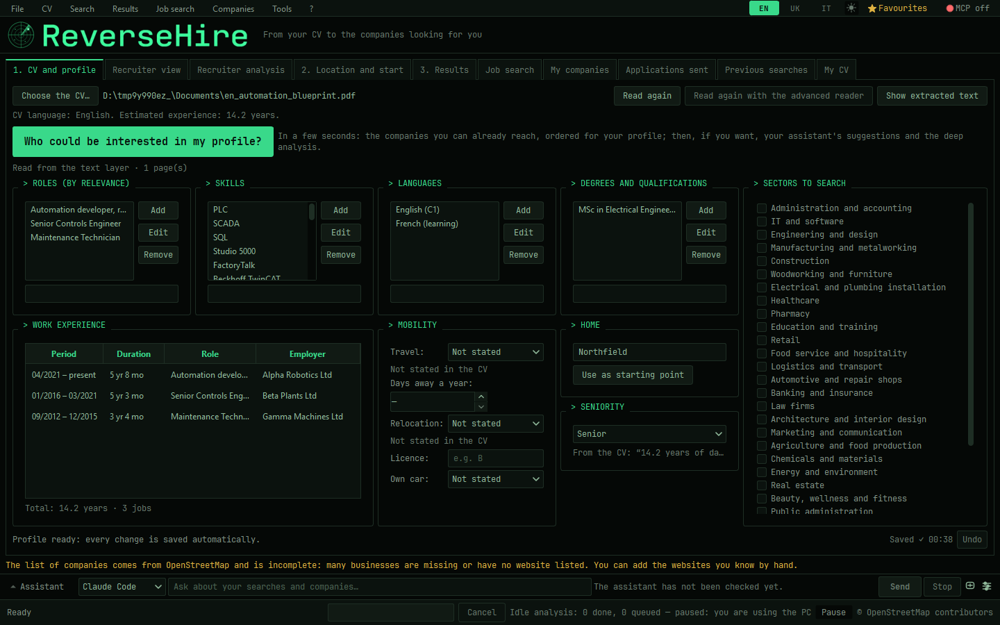

### 3.2 While the CV is read

While it is read, the progress bar at the bottom of the window shows the step (**Reading the CV, step 4 of 10: finding sections, experience and skills…**); for photos and scans it shows **page 2/5**. The steps are: reading the text of the file, recognising scanned pages, reading them again with the advanced reader (only when it is used), finding sections, experience and skills, matching the roles to ESCO occupations, translating the values into English, the recruiter view, the AI-writing signals, looking for a photo and preparing the CV lines for display. The bar never goes backwards, and when a search runs at the same time it shows the one that started last. When the reading ends the status bar says **CV read: the profile is ready. Check it in tab 1; every correction is saved at once.**

Under the file name you see how the CV was read: **Read from the text layer**, **Read with OCR (text recognition)** or **Read from text and OCR (some pages were scanned)**, with the number of pages and, after OCR, the **OCR confidence** and, when it was used, **advanced reader**. If the confidence is low (below 80 %), a warning asks you to check the extracted text.

**Messages you may see**

- **The PDF is password-protected: remove the password and try again.**
- **The CV cannot be read: the file may be damaged or protected.** - save an undamaged copy and try again.
- **The CV file was not found.** - the file was moved or deleted after you chose it.
- **No readable text was found, not even with OCR: the image is empty, too small or too blurred. Use a sharper scan, a text PDF or a DOCX.**
- **The CV is an image or a scan, but the local text-recognition (OCR) engine is not installed…** - see section 19.

**Show extracted text** (top right of the tab) opens the window **Text extracted from the CV**. It shows exactly what the program, and the software many companies use to sort CVs, can read from your file. After OCR, check names, numbers and dates there.

**CVs that are not in English.** The program recognises English, Italian and Ukrainian CVs. The profile is always shown in English: skills, languages and degrees are translated with built-in tables, and the other texts with a local translation model (Italian to English and Ukrainian to English) that runs on your computer. A line under the file name says so, for example **CV in Italian: fields translated into English (local translation)**. The original wording is kept (hover an entry to see it) and the search matches both. If the translation model is not installed, the entries that could not be translated stay in the original language and the program says how many (section 19).

**The photo.** If the CV has a portrait, a small copy appears next to the file name. The program only detects that there is a face; it never recognises or identifies anyone. The photo stays on your computer.

### 3.3 Photos and scans: the normal reading and the advanced reader

**The normal reading** is always there, needs no download and works offline. It finds the lines of text on each page and reads them with text recognition (OCR). It reads **Latin and Cyrillic** text, so English, Italian and **Ukrainian** scans work (a small Cyrillic model of 8 MB comes with the program). At most **10 pages** are read this way. A CV laid out in **two columns** is read column by column when the program finds a clear empty gap between the columns, and row by row otherwise: if the order of a two-column CV looks wrong in **Show extracted text**, correct the profile by hand.

**The advanced reader** is a second, more accurate and slower set of models for photos, rotated pages and low-quality scans. It is **optional** and has to be downloaded once: **about 147 MB**, from Hugging Face (Apache-2.0 licence), checked file by file against a fixed fingerprint, stored in the `models` folder. After that it works **offline**.

- **When it is used.** After the normal reading the program checks whether the result looks poor: OCR confidence below 97 %, a scanned page with very little text, no **Experience** section found, fewer than three section headings, or Cyrillic text that was not read as Cyrillic. If any of these is true, it reads the scanned pages **again** with the advanced reader and **keeps whichever reading is better** (what counts first is the skills and jobs found, then the headings, then the confidence); on a tie it keeps the normal one. The line under the file name then says **advanced reader**, and a notice says **The scan was read again with the advanced reader.** The advanced pass stops after 4 minutes, or at once when you cancel, and the normal reading is kept.
- **The offer.** The first time a scan needs it and it is not installed, a bar asks **This scan was hard to read. Download the advanced reader (… MB, from Hugging Face) and read it again?** with **Download (… MB)** and **No, don't ask again**. A download shows its progress in the bar (**Advanced reader: … of … MB**), can be cancelled (**Tools > Advanced reader (OCR) > Cancel the advanced reader download**) and **resumes where it stopped** the next time. When it finishes, the scan is read again at once.
- **Read again with the advanced reader** (button at the top of the tab, active only when the CV was read with OCR; also in the **CV** menu) reads the scan again whenever you like, even if the normal reading looked fine; it offers the download first when the reader is missing.
- **Settings > General > Text recognition (OCR)** shows whether the reader is installed and has **Download**, **Cancel download** and **Remove**, and the choice **Advanced reader**: **Ask once before downloading it** (the default), **Use it automatically when a scan reads poorly** or **Never use it**. **Tools > Advanced reader (OCR)** has the same actions; **Remove the advanced reader…** deletes the files after a confirmation.

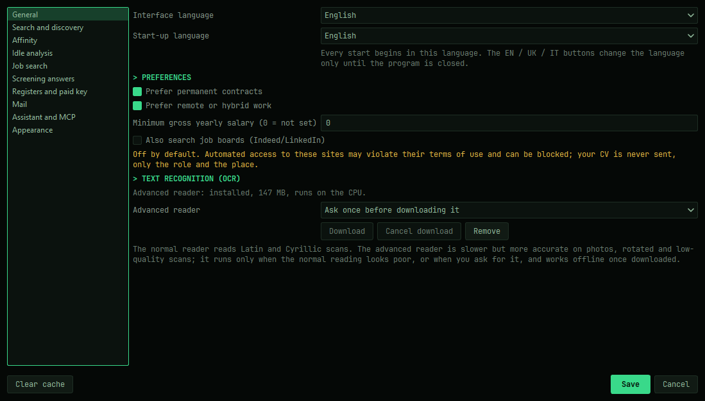

On Windows the advanced reader can run on the graphics card (DirectML), about three times faster, if you swap one component of the program's Python environment; this is an optional manual step described in the [Installation guide](INSTALLATION.md) and was tried on a single PC only. **How much it helps:** on a test with invented CVs the normal reading already recovered most of the skills on clean pages and, with the Cyrillic model, on Ukrainian pages; the advanced reader's gain is **modest** on clean pages and clearer on phone photos. It does not make a blurred or tiny picture readable: a sharp scan or, better, a text PDF is always the best input.

### 3.4 What the program understood: the profile boxes

Under the file name a line says, for example, **CV language: English. Estimated experience: 14.2 years.** (or that the experience cannot be estimated when the dates cannot be interpreted). The page then has these boxes:

| Box | What it contains |
|---|---|
| **> ROLES (BY RELEVANCE)** | The job titles found in the CV, the most important first. The search ranks companies by these roles: at least one is needed. |
| **> SKILLS** | Technical and professional skills. |
| **> LANGUAGES** | The languages you speak, with the level when the CV states it. |
| **> DEGREES AND QUALIFICATIONS** | Diplomas, degrees and certificates. |
| **> WORK EXPERIENCE** | Your jobs, most recent first, with **Period**, **Duration**, **Role** and **Employer**. Pauses of more than 6 months between two jobs are shown as a **— gap —** row. Under the table: total years, number of jobs and number of gaps. This table is read-only. |
| **> MOBILITY** | Business travel, relocation, driving licence and car (3.6). |
| **> HOME** | Your town, read from the contact details of the CV. |
| **> SENIORITY** | **Junior**, **Mid-level**, **Senior** or **Not estimated**, estimated from your years of experience and job titles, with the line of the CV it comes from. |
| **> SECTORS TO SEARCH** | The kinds of companies to look for. The sectors deduced from your CV are already ticked and marked **(from the CV)**. |

**Correcting a list** (roles, skills, languages, degrees):

- **To add an entry**: type it in the empty field below the list and click **Add** (or press Enter). A duplicate (same text, upper or lower case) is ignored.
- **To change an entry**: click it in the list (its text is copied into the field), change the text in the field, then click **Edit**.
- **To delete an entry**: click it in the list and click **Remove**.

The mobility answers, the home town, the seniority and the ticked sectors are changed directly in their boxes. Everything you correct is used from then on by the search, the recruiter analysis, the affinity and the summary sent to your assistant (section 4); the CV file itself is never changed.

### 3.5 Saved as you type, undo, and restored at the next start

There is nothing to confirm. At the bottom of the tab the program says **Profile ready: every change is saved automatically.** (or **No profile: choose a CV first.**, or **Still needed for the search: job role (at least one is needed).**).

- **Every edit applies at once** and is **saved** after a pause of half a second: next to the message you see **Saving…** and then **Saved ✓ 14:05**. If it cannot be stored you see **Not saved: see the log**.
- **Undo.** The **Undo** button (or **CV > Undo last profile change**, or Ctrl+Z on this tab) takes the profile back to the state before your last change, and the result is saved again. The program keeps the last 30 states of the current session.
- **Restored at start-up.** When you close the program and open it again, the **profile as you left it** (with your corrections) is back in tab 1, and the other tabs follow it (the company-category proposals of tab 2, the match with the CV, the affinity and the recruiter analysis). What is **not** restored: the line that says how the CV was read, the OCR confidence and the photo, the undo history, the **Recruiter view** tab (it stays empty until you click **Read again**) and the offer to keep the file in **My CV**.
- **Read again** (top of the tab, also **File > Read again**) reads and analyses the same CV file once more. It replaces the profile with a fresh reading, so **your corrections are lost** (use **Undo** immediately if that was not what you wanted); it needs the file to still be where it was, otherwise the program says **The CV file is no longer at …: choose it again.** The profile restored at start-up is never re-read by itself.
- **If a search cannot start**, the tab 2 start button explains why. Without a CV the missing item is the **analysed CV (choose a CV first)**; without a role it is the **job role (at least one is needed)**, with the button **Go to tab 1**. Nothing is ever invented to fill a gap.

### 3.6 Mobility, home, seniority and sectors

**Mobility: business travel, relocation, licence, car.** Many jobs ask for some travel. Interviewers often ask: "Out of about 220 working days a year, how many days are you willing to spend away?" ReverseHire asks the same question.

- **Travel:** **Declared** (the CV says you are willing to travel), **Likely** (the CV suggests it, for example past jobs with travel), **Excluded** (the CV says you are not), or **Not stated**. Under it you see the line of the CV it comes from, or **Not stated in the CV**.
- **Days away a year:** a number from 0 to 220 (about the working days of a year); the program shows what it means, for example **= 18% of the working days (about 8 weeks)**. Leave it at "—" if you do not want to say. A percentage written in the CV is converted on 220 days.
- **Relocation:** whether you are willing to move home for a job (**Declared**, **Excluded**, **Not stated**). It is a different question from travel.
- **Licence:** the categories of your driving licence, for example `B`. **Own car:** **Yes**, **No** or **Not stated**.

These answers are used when job adverts are checked against you (for example an advert that asks for frequent travel while you answered **Excluded** gets a lower score; section 7).

**Home and starting point.** The **> HOME** box shows your town. Correct it if needed, then click **Use as starting point**: the town is copied into the location field of tab **2. Location and start**, and the status bar says **Starting point set to "…" (tab 2).** Your street address is never sent to your assistant; the town you use as the centre of the area is (section 4.4).

**Seniority** is estimated, but you can change it in the drop-down list if the estimate is wrong.

**Sectors.** Tick the sectors you want to search and untick the ones you do not want. The list scrolls. If you leave every sector unticked, all kinds of companies are searched; this gives many more companies and a much longer search. When sectors are ticked, companies whose map entry says only "company" or "office" (without a sector) are also included, but listed after the companies of your sectors (section 7).

### 3.7 The Recruiter view

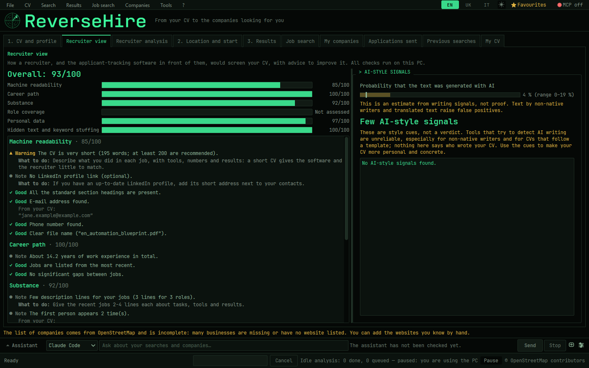

The **Recruiter view** tab shows how a recruiter, and the applicant-tracking software in front of them, would screen your CV, with advice to improve it. It is filled in when the CV is read (not when the profile is restored at start-up: click **Read again** to fill it); all checks run on your computer. The simulators of real screening systems are a different tab, **Recruiter analysis** (section 8); the score of this tab is a general review, **Overall: …/100**, not a simulated system.

At the top you see **Overall: …/100** and a bar for each area:

| Area | What it checks |
|---|---|
| **Machine readability** | Whether software can read the CV: readable text, standard section headings, e-mail, phone, town, length, layout (columns and tables), odd characters, file name. |
| **Career path** | Dates of each job, order (most recent first), gaps, very short jobs, overlapping jobs, date formats. |
| **Substance** | Results with numbers, action words instead of "responsible for", generic buzzwords, use of "I", long paragraphs, repeated words. |
| **Role coverage** | How many of the essential skills of your occupation (from the European ESCO classification) appear in the CV. It shows **Not assessed** when ESCO could not be reached or the role has no ESCO match. |
| **Personal data** | Data a recruiter does not need or that may cause bias: date of birth, age, marital status, nationality, tax code, full street address, photo; and whether the consent line for personal data (common in Italy) is there. |
| **Hidden text and keyword stuffing** | Invisible, white, tiny or off-page text, keywords repeated too often, long keyword lists, repeated blocks, text copied from a job advert. |

The overall score is a weighted average of the areas. If the file contains hidden text, the overall score cannot go above 60, and a note says so. Below the bars each area lists its findings, marked **Problem**, **Warning**, **Note** or **Good**. Each finding shows the lines of your CV it comes from (**From your CV**) and, when there is something to improve, **What to do**. In an English interface, when an entry was translated, a **Show original** tick shows the CV wording.

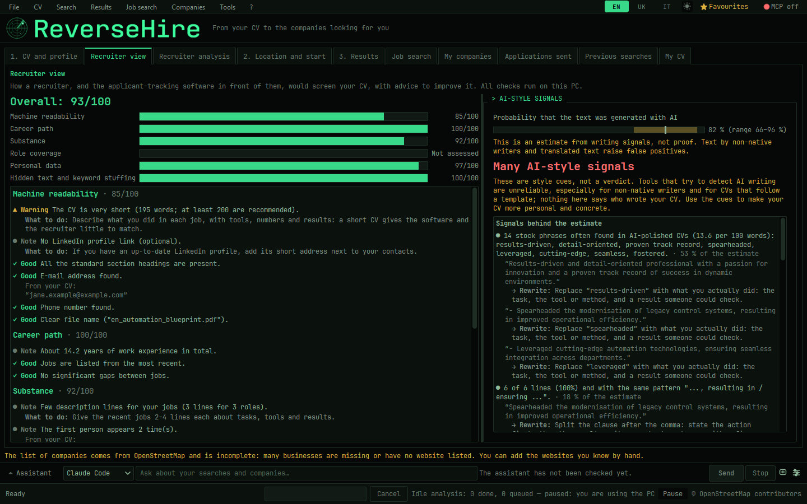

**The AI-written-text estimate and the AI-style signals.** On the right, the box **AI-STYLE SIGNALS** starts with a bar: **Probability that the text was generated with AI**. (The picture shows an invented text made of stock phrases, to show what a high reading looks like; the sample CV used in the other pictures reads as written by a person and gets a low estimate.)

- The **marker** is the estimate and the **lighter area** around it is the **confidence band**; the value is written beside the bar, for example **82 % (range 66-96 %)**.
- The number is computed on your computer from **writing signals**: stock phrases, lines of very similar length, many lines ending the same way ("…, resulting in …"), lines with no name, number, tool or date, some typographic habits (long dashes, curly quotes), the similarity of lines to typical AI-polished CV sentences, and file information that names an AI writing tool or an online CV builder. The program never shows less than 3 % or more than 85 %.
- **It is an estimate, not proof**, and a fixed caption under the bar says so: **This is an estimate from writing signals, not proof. Text by non-native writers and translated text raise false positives.** The signals were not calibrated against a set of CVs whose authors are known; CV templates, career-service phrasing and a CV written in a second language raise them too. The band is wider when the text is short, when few signals could be computed and when the CV is not in English. Nothing here says who wrote your CV, and no employer or tool should treat it as proof.
- Under the bar, a level: **Few AI-style signals**, **Some AI-style signals** or **Many AI-style signals**, and, when there are signals, **Signals behind the estimate**: the (up to) three signals that weigh most, each with its share of the estimate, the lines of your CV that show it and a **Rewrite:** suggestion (replace a stock phrase with what you actually did: the task, the tool or method, and a result someone could check). **All the signals found** lists the others. If the CV is very short, the program says the text is too short for a meaningful reading and the band is wide.

Use all this only to make your CV more personal and concrete.

### 3.8 My CV: the language versions of your CV

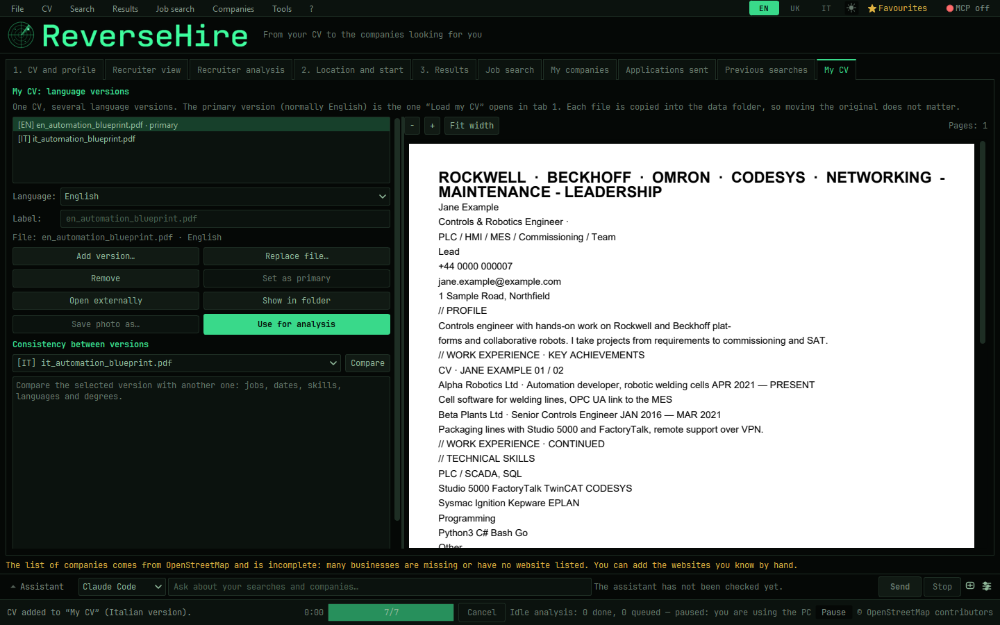

The **My CV** tab keeps **one CV in several language versions**, for example an English one and an Italian one. English is meant to be the primary version.

- Each version is a **copy** of the file kept in the data folder (section 18), so moving or deleting the original does not matter. PDF, DOCX and images are accepted.
- **Add version…** adds a file (choose its language and an optional label). **Replace file…** changes the file of a version. **Remove** removes a version and its copy after a confirmation (the original file is not touched).
- **Set as primary** makes a version the primary one. **Use for analysis** loads the selected version in tab 1 (it is the same as choosing the file there). When tab 1 is empty and you have a primary version, it tells you to select one in **My CV** and press **Use for analysis**. The primary version is also the CV attached to an e-mail draft when you have not set another attachment in the mail settings (a PDF is needed; section 9).
- **Open externally** opens the file in your usual program; **Show in folder** shows the copy in your file manager.
- A viewer shows the selected version: PDF pages and images with **Zoom in**, **Zoom out** and **Fit width**; for a Word document the extracted text is shown (layout and images are not).
- The photo found in a version is shown as a small picture; **Save photo as…** saves it as a PNG file. The photo is kept only on your computer.
- **Consistency between versions** - select a version, choose another one and click **Compare**. The program reads both and lists the differences in jobs, periods, years of experience, skills, languages and degrees, or says that the two versions agree. It is a check that your CVs tell the same story, not a judgement.

The analysis in the other tabs still uses one CV at a time: the one you loaded.

### 3.9 What stays on your computer

- **Reading is local.** The text extraction, the text recognition (OCR), the translation, the recruiter view and the AI-style estimate all run on your computer; the CV file is not sent anywhere. The only downloads linked to this step are the optional ones you accept (the advanced reader, the translation models, the scoring model).
- **The profile is stored.** To bring it back at the next start, the program keeps the **profile, including the text extracted from the CV**, in the database of the data folder (`store.sqlite`, section 18). The copies of the CV files in **My CV** are in the `cv` folder of the same data folder. If you share or back up that folder, you share the CV text too. Section 18 explains how to start from scratch.
- **Nothing is sent to a company or to an assistant from this tab.** Step 2 sends a short anonymised summary to your assistant only when you ask (section 4.4); section 17 lists everything that leaves the computer.

## 4. Step 2 - Who could be interested in my profile

Step 2 answers one question: **given my CV, which companies around me are worth looking at, and in what order?** It works even when no company has an open advert, and it does not need you to start a search first. It has four parts, always in this order and always under your control: a **fast ordering** of the companies the program already knows, **suggestions from your own AI assistant** (optional), a **deep analysis** of the best ones (optional) and, later, an **idle analysis** of the rest.

**In short**

1. On tab 1, press the big button **Who could be interested in my profile?** (or **Search > Who could be interested in my profile?…**).
2. Check the area in box 1 and wait a few seconds: the companies already known appear in box 2, in order.
3. If you want more names, use box 3 (**Suggest companies with the assistant**): read **What is sent** first, and add the companies you like.
4. If you want the best ones studied in depth, press **Analyse the best now** (box 4). The others are studied later, while you are away from the PC.
5. Select a company and click **Open company card** to read its affinity (section 5) and its card (section 6).

### 4.1 Starting it

Once a CV has been read, the big button **Who could be interested in my profile?** appears on tab 1, under the file name (see the picture in section 3). The same action is in the **Search** menu (**Who could be interested in my profile?…**). It opens one guided window (a normal window of its own, not a pop-up that blocks the program; only one can be open at a time). If the profile is there, **the fast ordering starts at once**; without a CV the window tells you to read your CV first.

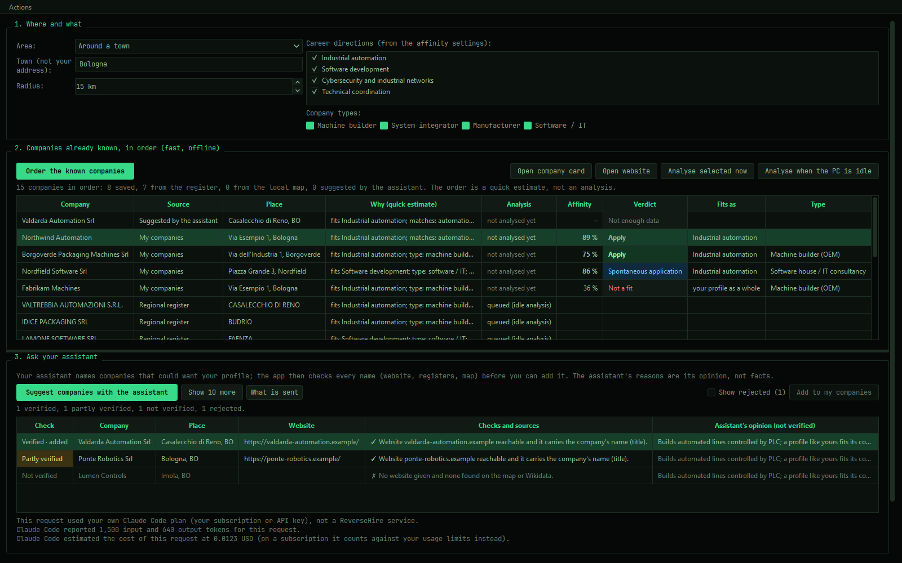

The window has four numbered boxes, from top to bottom, and a small **Actions** menu at its top with the same actions as the buttons. The **Cancel** button of the last box stops whatever is running in the window (the ordering, the analysis or the assistant request). You can close the window at any time: closing it cancels what it was running; companies already queued for the idle analysis stay queued.

### 4.2 Box 1 - Where and what

- **Area**: **Around a town** (type the town, **not your address**, and a radius from 1 to 300 km), **Province**, **Region** or **Whole country (Italy)**. It starts from the choice you made on tab 2; you can change it here without touching tab 2. The program is built for Italy first: the provinces and regions are Italian ones.
- **Career directions (from the affinity settings)**: the directions you want to be judged in, ticked as in **Settings > Affinity** (section 5.6). Ticking or unticking here applies to this window only.
- **Company types**: **Machine builder**, **System integrator**, **Manufacturer** and **Software / IT**. Unticking a type puts the companies of that type last in this window; it does not change your settings.

### 4.3 Box 2 - Companies already known, in order (fast, offline)

**Order the known companies** (it runs by itself when the window opens) takes everything that is already on your computer, with **no network request**, and puts it in order for your profile in a few seconds:

- your saved companies (**My companies**);
- the **regional register**, if you imported it (section 11) - at most 400 companies of the area;
- the **local OpenStreetMap map data**, only if you have already downloaded it (this window never downloads anything) - at most 1,500 companies of the area;
- the companies your assistant suggested and you added (box 3); they are placed at the top.

A company that is in several places appears once. A line under the buttons says how many there are and where they come from, for example **15 companies in order: 8 saved, 7 from the register, 0 from the local map, 0 suggested by the assistant. The order is a quick estimate, not an analysis.** If nothing is known yet for the area it says so and suggests asking your assistant, importing the register or running a search.

Each row shows: **Company**, **Source**, **Place**, **Why (quick estimate)**, **Analysis**, and the four affinity columns (**Affinity**, **Verdict**, **Fits as**, **Type**, section 5). The **Why** column is one line made of cheap signals, for example **fits Industrial automation; type: machine builder; matches: automation, plc**: the words of your roles and skills that appear in the company's name and tags, the likely kind of company (from its name, its ATECO code and its map tags), how well that kind suits each of your directions, and the general ranking used by the search. When there is no matching word and no known kind of company, the direction is only a guess from the name and the map tags, and the line says so: **maybe Industrial automation (to be confirmed when the site is read)**. **It orders; it never hides anything**: a company of a type you excluded stays in the list, last, with that reason. The affinity columns are filled for saved companies; for the others they stay empty until the deep or idle analysis has run.

**Analysis** says where each company stands: **not analysed yet**, **queued (idle analysis)**, **analysing…** or **analysed** (its card was built and its affinity computed). The header sorts the table (section 10), and a right-click gives the actions below. With a row selected you can use **Open company card** (saved companies and analysed ones), **Open website**, **Analyse selected now** (box 4) and **Analyse when the PC is idle** (puts the selected not-yet-analysed companies in the queue of 4.6).

### 4.4 Box 3 - Ask your assistant

The map and register data miss companies: a map entry may be missing or badly tagged, and a small company may not be in any register you have. So you can ask **your own AI assistant** to name real companies that could want your profile. **This is optional and only happens when you press the button.**

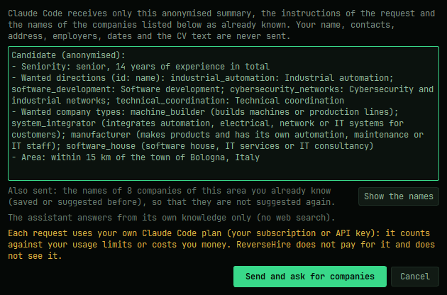

**Which assistant.** The one you set in **Settings > Assistant and MCP**: **Claude Code** or **Codex**, installed on your computer and signed in with your own account. ReverseHire does not provide, install or pay for any assistant, and does not see its account. **Every request uses your own plan** (a subscription counts against its usage limits; an API key costs money). If no assistant is ready, the window says so (**No assistant is ready: install and sign in to Claude Code or Codex (Settings > Assistant).**) and nothing is sent. The assistant is started in a locked-down way: without access to your files, without any tool, and without the ReverseHire MCP server, answering from its own knowledge only. If you tick **Allow web search** in **Settings > Idle analysis** it may use the search tool of its vendor, and nothing else; the app still checks every company.

**What is sent: the anonymised summary.** The first time, and again whenever you tick **Show what is sent and the cost notice before the next request** in **Settings > Idle analysis**, a window opens before anything is sent. It shows the summary and the cost notice, and **Send and ask for companies** is the only way to go on. The **What is sent** button of box 3 shows the same window at any time, without a send button. The summary (built from your corrected profile and the choices of box 1) contains only:

- your **roles** (at most 6), your **seniority** and total years of experience;
- **skill families with the skills and the years** you used them (at most 8 families);
- your **jobs as titles and durations**, with every employer replaced by **undisclosed employer** (at most 6);
- the **sectors** of your experience, your **spoken languages**, and whether you are willing to travel;
- the **career directions and company types** you want;
- the **area** (for example **within 15 km of the town of Bologna, Italy**).

It never contains your name, e-mail, phone, postal address, employers' names, dates, the date of birth or any raw CV text. The program builds it only from structured profile fields, removes e-mail addresses, phone numbers, links, your employers' words and address words, and then runs **its own leak check**: any line that still contains one of those strings is **dropped** (so a line may be missing from the preview; the picture shows a sample whose wanted roles were dropped). Two honest limits: the **town you chose as the centre of the area is sent** (if it is your home town, your home town is sent), and job titles and skill names are sent as they are, so an unusual title could still say something about you. Read the preview before you accept.

Besides the summary, the request carries the fixed instructions, and **a list of company names to leave out** so the assistant does not repeat itself: the companies already suggested, then the companies of **My companies** that are in the area, **60 names at most**. **The preview window shows this list too**: a line says how many names are sent (**Also sent: the names of N companies of this area you already know (saved or suggested before), so that they are not suggested again.**, or **No company names are sent besides the summary.**) and **Show the names** lists them. When you press **Show 10 more**, the names the assistant already gave in the conversation are added, and the program never sends more than 300 names.

**What the assistant is asked.** To name up to **10 real companies**, best fit first, that could want the anonymised candidate in the area, **only companies it believes exist there today** ("fewer is better than invented"), with for each: the name, the town and province, the website **only when sure**, the kind of company, which of your directions it fits, **one sentence** on why (in your interface language) and its own confidence from 0 to 1. It must not read files or run commands. The answer is read tolerantly; items without a usable name are dropped, a bad website becomes empty, and a company you already have is dropped.

**Suggest companies with the assistant** asks for the first 10. The line under the buttons shows **Waiting for the answer of Claude Code…** (the program waits at most 4 minutes for the answer, and the whole request including the checks at most 15 minutes; **Cancel** stops it). When the answer arrives, **Show 10 more** asks the assistant for the next ten of the same conversation, and is available after a batch that gave results, unless the assistant said it has no more to name.

**Every name is checked by the program before you can add it.** For each company the program uses at most 8 requests (about 80 for a batch of 10), always politely (public websites only, `robots.txt` respected):

1. **Website.** The suggested site must be reachable, be a real company site (not a parked or for-sale domain) and carry the company's name. If the assistant gave no site, the program looks for one only in the OpenStreetMap map data you already have and in Wikidata (never a search engine).
2. **Regional register.** If you have imported the regional register (section 11), the program looks for a company of the same name in the province (**Listed in the regional register as "…" in …**). This works on your computer, with no request.
3. **Identity.** A VAT number printed on the site is checked in the European VIES register, a company tax code in GLEIF; the facts are judged by the same rule as the company card.
4. **Place.** The registered office, the map position or the suggested town is compared with the area you asked for.

The result is one of four statuses, in the column **Check**:

| Status | What it means | Can you add it? |
|---|---|---|
| **Verified** | The website is reachable, carries the company's name, and a register or the map data confirms the company. | Yes |
| **Partly verified** | The website is reachable and carries the company's name, with no register or map confirmation yet; **or** no website could be read but the regional register lists a company of that name in the area. | Yes |
| **Not verified** | The program could not confirm that the company exists (shown greyed). It does **not** mean it does not exist. | No |
| **Rejected** | A check contradicted the suggestion: the site belongs to another company, or the company is outside the area. Hidden until you tick **Show rejected (N)**. | No |

The other columns are **Company**, **Place**, **Website** (the one the app read, or the one the assistant named and the app could not confirm), **Checks and sources** (what was confirmed with a tick, contradicted with a cross, and where) and **Assistant's opinion (not verified)**: the assistant's one sentence, always labelled as its **opinion, not a fact**. Hover a cell for the full text.

Select the verified or partly verified companies you like and click **Add to my companies** (or double-click a row): each becomes a saved company in **My companies**, with the tag **suggested by assistant** and notes that say who suggested it, when, and by which checks it was verified, followed by the assistant's opinion, labelled as such. It then appears in box 2 marked **Suggested by the assistant**.

**When the plan is used up.** If your assistant's plan has reached its usage limit, the window says so in plain words (**Your Claude Code plan has reached its usage limit; try again after …**, or **…try again later…** when no time is known) instead of a generic failure; nothing is added and ReverseHire charges nothing.

**What it costs you.** After each request the window shows lines such as **This request used your own Claude Code plan (your subscription or API key), not a ReverseHire service.** and, when the assistant reports them, the number of tokens and an estimated cost. If the assistant reports nothing, the window says so. The checks themselves cost nothing but a few web requests.

### 4.5 Box 4 - Deep analysis

**Analyse the best now** analyses the first **N** companies of the list that are not analysed yet, where N is the number in **Companies to analyse now (best first)** (10 by default, from 1 to 50). For each of them, in order, the program:

1. creates the company card if it does not exist (so the company becomes a saved company in **My companies**);
2. builds the card the way **Create full card** does (section 6): it reads the company's website and identity pages and queries the free registers (VIES, GLEIF, Wikidata) and the free financial sources; **the paid register provider is never called from here**;
3. computes the **affinity** with your CV (section 5).

The progress bar shows **Deep analysis: 3 of 10 companies**. This part **does make web requests** (to the companies' sites and to the free registers), politely and slowly, like a search; one run stops on its own after an hour at most. **The other not-yet-analysed companies of the list, at most 200 (the best first), are put in the queue of the idle analysis (4.6) at the same moment, but only after you agree: the first time, the program asks whether to also analyse the next companies in the background and tells you when it works (after how many minutes without input, on mains power, with how many requests a day at most). Your answer is remembered (if you say no, nothing is queued and the question comes again next time)** (the line says, for example, **Analysing 10 companies now; 390 queued for the idle analysis…**), so they will be analysed later, a few at a time. If you do not want the rest queued, do not press this button: use **Analyse selected now** on the rows you want instead (it analyses only the selected rows and queues nothing).

### 4.6 The idle analysis: the rest, later

Companies in the queue are analysed (website, registers, affinity) **only while you are not using the computer**, in the background, one at a time, with the same steps as the deep analysis. The status bar always tells you what is going on, for example **Idle analysis: 12 done, 240 queued — waiting: the PC is not idle yet**, with the reason: **you are using the PC**, **the PC is not idle yet**, **on battery**, **the PC is busy**, **no network**, **a search is running**, **by you** (paused), **today's request budget is used up**, **per-site daily limit reached**, **retrying later after an error**, **nothing in the queue** or **ready** (it is analysing).

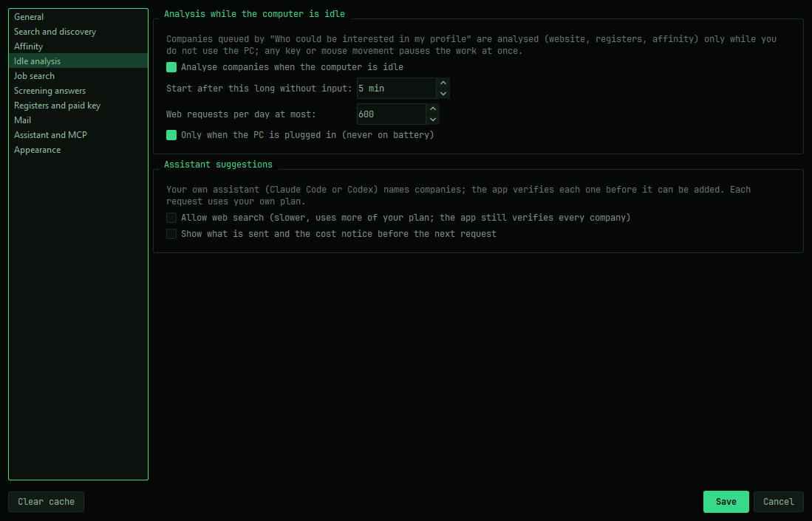

**It runs only when all of these are true** (checked twice a second):

- you have not touched the keyboard or the mouse for the time set in **Settings > Idle analysis > Start after this long without input** (**5 min** by default, from 1 to 240). On Windows the program reads the time since your last input from the system. Where the system does not tell (for example Linux under Wayland), it waits instead until the program window has been in the background for at least 10 minutes (or your minutes, if more);
- the PC is **plugged in**, when it can tell (ticked **Only when the PC is plugged in (never on battery)** by default; if the power state cannot be read, the program carries on);
- the processor is **less than half busy** and there is a **network connection** (when it cannot tell, it carries on);
- no search, job search, company-card build, assistant request or guided analysis is running in the program, and you have not paused it;
- **today's request budget** is not used up: **600 web requests a day** by default (**Web requests per day at most**, from 25 to 20,000, counted from midnight), and the same site has not been asked more than **60 times today**. A company starts only when at least about 25 requests of the day's budget remain.

**Any key, click, scroll or mouse movement stops the work at once**, and the interrupted company goes back to the queue without penalty. A company that fails (for example its site is down) is tried again later, after 5 minutes, then after longer and longer pauses (up to 6 hours), and given up after 5 attempts.

**Pause and switch off.** The small **Pause** / **Resume** button in the status bar, or **Tools > Pause the idle analysis**, pauses and resumes the analysis; the pause stays until you resume it, even after a restart. **Settings > Idle analysis > Analyse companies when the computer is idle** switches it off altogether (the line then says **Idle analysis: off**; the queue is kept). The queue is saved in the data folder and survives a restart; when the program closes, a running company goes back to the queue. As companies are analysed, **My companies** and its affinity columns update by themselves within a few seconds.

**It only works on your request.** Nothing is queued unless you pressed **Analyse the best now** (for the rest of the list, after the question of 4.5 and at most 200 companies) or **Analyse when the PC is idle** (for the rows you selected). With an empty queue the idle analysis does nothing and makes no request.

### 4.7 What is sent, and when

| What | When | Where it goes |
|---|---|---|
| The fast ordering (box 2) | When the window opens and when you press **Order the known companies** | Nowhere: it uses only what is on your computer. If you typed a town that the local map data does not know, the town name is looked up with the same address service as tab 2. |
| The anonymised summary and the names to leave out (box 3) | Only when you press **Suggest companies with the assistant** or **Show 10 more** (the first time after you accept the preview) | To **your own** assistant (Claude Code or Codex) and, through it, to its vendor. Never to ReverseHire's authors. |
| The checks of the assistant's answer | After an answer, automatically, up to 8 requests per company | To the suggested company's website, the map data on your computer, Wikidata, VIES and GLEIF. Your CV and your summary are **not** part of these requests. |
| The deep analysis (box 4) | Only when you press **Analyse the best now** or **Analyse selected now** | To the companies' websites and the free registers, as when you build a card. Your CV is **not** sent. |
| The idle analysis | Only for the companies you queued, only when the PC is idle | Same as the deep analysis. |

Your CV text, your name and your contacts are never sent in any of these. Section 17 lists everything that leaves the computer.

### 4.8 What this step cannot do

- **The fast order is a rough estimate.** It is made of names, tags and a few words, without reading any website. A good company with a poor map entry may sit low; a company of the wrong kind may sit high. That is why the next steps exist.
- **It only knows what is on your computer** plus what the assistant names. With no register imported, no map data and no saved companies, the list can be empty.
- **The assistant can be wrong.** It may name a company that does not exist, has moved, closed or does not fit. The checks remove many of these, but **Verified** only means that a company of that name exists near there, **not** that it is hiring or that it fits you. **Not verified** is not proof that it does not exist: small sites, sites that load their content with JavaScript and sites that block automated reading look empty to the program.
- **The opinions are the assistant's.** The reasons it gives are its opinion, labelled as such, and they are not part of the affinity.
- **Nobody is contacted.** None of the steps sends anything to a company.
- **Italy first.** The areas, the register and the checks are built for Italy. Companies abroad are not covered.
- **Not tested on many real cases.** The ordering, the checks and the idle rules were built and tested mostly with invented examples. How they behave with other assistant versions, other websites and other operating systems has not been verified (section 20).

### 4.9 Questions you may have

- **I pressed the button and the list is empty.** The program only knows your saved companies, the regional register you imported, the map data you downloaded and what your assistant names. Import the register (section 11), download the map data of your region or run a company search (section 7), or ask your assistant (box 3).
- **Nothing happens when I click "Suggest companies with the assistant".** The first time, a window with the summary opens and waits for **Send and ask for companies**. If instead you read **No assistant is ready…**, install Claude Code or Codex, sign in once in a terminal, and choose it in **Settings > Assistant and MCP**.
- **Is this using my subscription?** Yes, only for the request to your assistant, and only when you press the button. The window shows what the assistant reported about it. The fast ordering, the checks, the deep analysis and the idle analysis do not use any assistant.
- **The assistant named a company that I know does not exist or is not in my area.** The checks reject many of these (**Rejected**, **Not verified**), but they cannot catch everything: that is why nothing is added without your click.
- **The idle analysis never seems to run.** Read the reason in the status bar. The most common ones are **you are using the PC**, **on battery** (untick **Only when the PC is plugged in** in **Settings > Idle analysis** if you want it on battery), **nothing in the queue** (nothing was queued) and **paused**.
- **I do not want anything to run in the background.** Click **Pause** in the status bar, or untick **Analyse companies when the computer is idle** in **Settings > Idle analysis**. Nothing is ever analysed in the background unless you queued it.
- **Can I stop an analysis that is running?** Yes: **Cancel** in the guided window stops the ordering, the deep analysis and the assistant request; what was already done is kept.

## 5. Step 3 - Judge the companies with affinity

Once a company is known to the program (saved, found by a search, or analysed in step 2), you want to know one thing: **is this a company to send my CV to?** The **affinity** answers it with three things together: a **number** (0 to 100 %), a **verdict** (what to do) and the **evidence** behind both. It is computed on your computer, from your corrected profile and from what the program knows about the company: no network request and no assistant is involved.

**In short**

1. Load your CV (section 3): the affinity needs your profile.
2. Open a company: select it in **My companies**, or in **3. Results**, or in the list of step 2.
3. Read the **verdict** first (**Apply**, **Spontaneous application**, **Keep an eye on it**, **Not a fit**, **Not enough data**), then the percentage and the confidence.
4. Click **Details** to see why: which skills, roles and requirements matched, and where each piece of evidence comes from.
5. Tell the program when you disagree (**Agree** / **Disagree**); after a few judgements you can let it adapt (5.5).

### 5.1 Where you see it

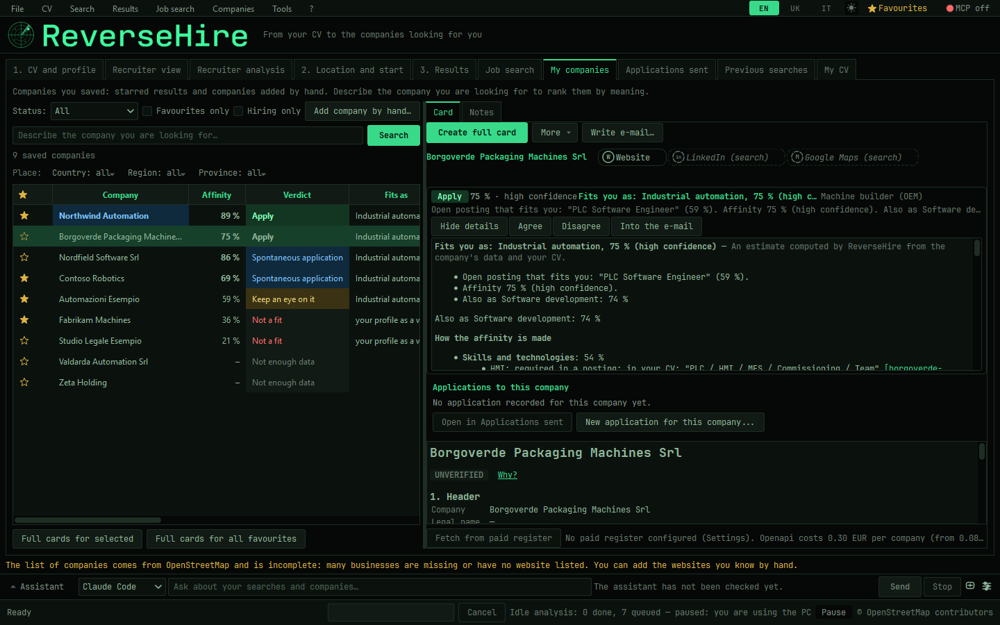

- **On the company card** (tab **My companies**), in a box at the top: the **verdict** badge, the score and its confidence (for example **75 % · high confidence**), **Fits you as: Industrial automation, 75 % (high confidence)**, the kind of company, a short reason, and the buttons **Details** (**Hide details** when open), **Agree**, **Disagree** and **Into the e-mail**.
- **In the lists**, as four columns: **Affinity**, **Verdict**, **Fits as** and **Type**. They are in **3. Results**, **My companies**, the **Favourites** window, the guided window of step 2 and the list **Companies for a spontaneous application** of the **Job search** tab (there the affinity is judged for the direction of your search). Hover a cell to read the reasons; the header of each column has a tooltip too.
- **In the e-mail draft**: the button **Into the e-mail** puts the talking points in the body of a draft (5.4).

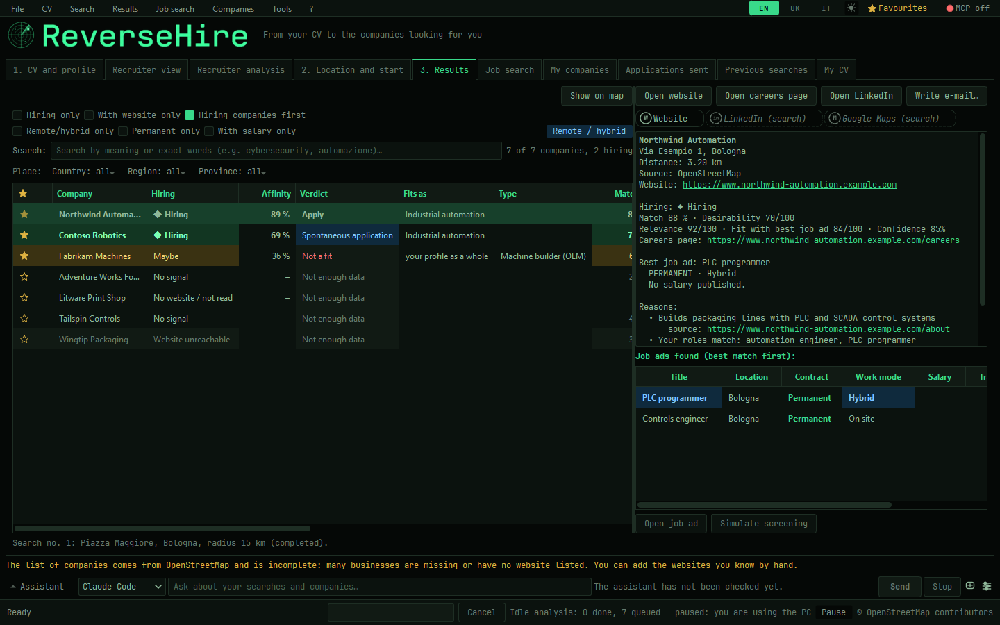

The affinity is computed for every company shown, as soon as a CV is loaded, a few at a time in the background (the bar shows **Affinity with your CV: 12 of 40 companies**); the results are kept and recomputed only when your profile, the company's data, the affinity settings or the calibration change. A cell shows **…** while it is being computed. Without a CV the box says **Affinity: load your CV to see how well it fits this company.**, and if the company's data cannot be read it says **Affinity: not computed (the company data could not be read).** The affinity also depends on the **month**, because how recent a skill is counts: the same CV and company can give a different number a month later.

The affinity columns are different from the older company-level columns of a search (**Match**, **Desirability**, **Relevance** and so on, shown muted): those rank the company **for the search**; the affinity says whether **your CV fits what the company seeks**, and gives a verdict.

### 5.2 The five verdicts

| Verdict | What it means | Rule (default numbers) |
|---|---|---|
| **Apply** | There is an open posting that fits you: send your CV for it. | A posting fits (it scores at least 55 % against your CV, and neither a hard requirement nor a screening answer of yours rules you out) **and** the affinity is at least 50 %. |
| **Spontaneous application** | No fitting posting now, but the company plausibly needs your profile: an open application makes sense. | The affinity is at least 55 %, there are signs that the company needs your kind of profile (its products, its kind of business, or roles close to yours), and the confidence is not low. |
| **Keep an eye on it** | It fits you, but there is nothing open and the signals are weak or the data thin: check again later. | The affinity is 40 % or more but neither of the two rules above is met. |
| **Not a fit** | Low affinity or a requirement you cannot meet. | The affinity is below 40 %, or a hard requirement fails (the score is then capped at 25 %), or the company type is one you excluded (5.6), or - only if you ticked the option - it matches none of your directions. The reason is always written. |
| **Not enough data** | Too little is known about what the company looks for to give a score. | Less than 45 % of the expected information is available, or there is nothing at all about its skills and roles. The box then lists **What to collect**, for example **Build the full company card (site, products, presentation).**, **Paste one of their postings, if you have one.**, **Add the ATECO code from registroimprese.it (free search).** |

Two details about postings. A posting known **only by its title** (for example a careers page that lists "Back-end developer" with no text) is **not scored 0 %**: its title is compared with the roles of your CV, so a matching opening can still count as a fitting posting. An **internship, apprenticeship or graduate programme** (the words intern, stage, tirocinio, apprendistato, apprentice, trainee and similar in the title) **never counts as fitting** a CV with **five or more years of experience**; the reason says so (**"…" is an internship or entry-level position: your experience is well beyond it.**).

The numbers are the defaults of this version; the calibration of 5.5 can move the three affinity limits by at most 10 points each. They were chosen with invented examples, not on a large set of real cases. A verdict is a **suggestion to look at the reasons**, not a command.

### 5.3 How the number is made

The affinity is a weighted average of up to six parts, each from 0 to 100 and each with its own data quality:

| Part | Weight | What is compared |
|---|---|---|
| **Skills and technologies** | 35 % | What the company asks for or uses against what your CV shows. |
| **Role** | 20 % | Your roles against the roles it hires, or plausibly needs. |
| **Sector experience** | 15 % | Your experience in its sector, or a close one. |
| **Seniority** | 10 % | The years or level asked against yours (it also notes if you may be over-qualified). |
| **Hard requirements** | 10 % | Requirements of a posting (language, degree, years of experience, licence, car, travel, right to work, relocation, location, availability, shifts) and your screening answers (Settings > Screening answers); a distance limit when you set one. |
| **Practical fit** | 10 % | Contract, remote work and salary, **only when a posting states them** and according to your preferences in **Settings > General**. |

Seniority, hard requirements and practical fit exist only when there is a posting; a part with no data is left out and the others count proportionally. The program also keeps a **data quality** for each piece of evidence: **required in a posting** is the strongest (1.0), **named on their site** counts less (0.8) and **inferred from their products or from the kind of company** least (0.5 or less), and inferred needs are shown as such and **never treated as a requirement**.

**Per direction.** The affinity is computed for the whole profile and for each of your enabled **career directions**. The score shown is the best direction in which the company is relevant, and **Fits as** names it; when one direction has an open posting that fits you, it wins the headline over a direction that scores a little higher without one (it gets the same 15-point bonus as **Apply** in 5.7). The tooltip lists the others, for example **Also as Software development: 74 %**. A company is never penalised for directions it has nothing to do with. If it is relevant to none of your directions, the headline is **your profile as a whole**.

**Confidence.** Next to the score: **high confidence** (at least 75 % of the expected data and a posting whose requirements could be read), **medium confidence** (at least 55 %) or **low confidence**. A low-confidence score means little is known: look at the evidence before trusting it.

**Company type.** The program also guesses the kind of company from its name, products, ATECO code and map tags, always quoting the evidence: **Machine builder (OEM)**, **System integrator**, **Manufacturer with its own technical staff**, **Software house / IT consultancy**, or none of these.

### 5.4 The evidence: Details, strengths, gaps, talking points, signals

Click **Details** on the card box. You see, in this order:

- **The reasons** of the verdict, for example **Open posting that fits you: "PLC Software Engineer" (59 %).**
- **How the affinity is made**: each part with its score and the evidence lines. A line says what was compared, **where each side comes from** (the line of **your CV** and the company's text with its source: a link to the page on its website, a field of the card, or the map data) and its origin: **required in a posting**, **a plus in a posting**, **named in a posting**, **named on their site**, **inferred from their products (not a requirement)** or **inferred from the company type (not a requirement)**. Click a link to open the page.
- **Strengths** (what you have that they look for), **Gaps** (for example **HMI is required ("…"): if you have it, state it in your CV.**) and **More you can offer** (in your CV, not asked).
- **Points for the cover letter**: up to three sentences that connect something specific of your CV to something specific the company says. **Into the e-mail** opens the draft to this company with these sentences in the body; **edit them before you send anything** (the program never sends).
- **Opportunity signals**, with a level (**weak signals**, **some signals**, **strong signals**): **Hiring now: N open postings** or hiring signals on the site, **Hiring for your role**, **They invite open applications**, **They have a careers page**, **Revenue growing / stable / shrinking** (from the financial figures of the card, section 6) and **About N employees** (50 or more). These signals matter when you decide where to put your time, **but they are shown separately: they never change the affinity number or the verdict.**
- **What to collect**, when data is thin.

Everything the program writes here is **an estimate computed by ReverseHire from the company's data and your CV**, and says so.

### 5.5 Agree, Disagree and the calibration

You can tell the program when you think a verdict is right or wrong: click **Agree** or **Disagree** on the card box. Your judgement is saved at once, stays on your computer and appears as **Your judgement: agree** / **disagree**. **Nothing changes by itself**: the verdicts are not adjusted behind your back.

Your judgements are used only when you ask, in **Settings > Affinity > Personal calibration**:

1. The line **Judgements recorded with Agree / Disagree: 11 (at least 8 needed).** shows how many you have. **Calibrate from my judgements** is enabled from 8 on.
2. Only judgements of companies that had a number count, and the latest one per company wins. If fewer than one in five of them is a disagreement, the program says **Your judgements mostly agree with the verdicts: weights kept.**
3. Otherwise it moves the part weights a little, in the direction that would have given you the verdicts you wanted (**Disagree** with a positive verdict is read as "too generous", with **Not a fit** as "too strict"; a disagreement with **Keep an eye on it** or **Not enough data** gives no direction and is skipped). Each part stays between 3 % and 45 %, so none can take over, and the three affinity limits of 5.2 move by at most 10 points from their defaults.
4. It then shows **Weights now**, **Calibrated weights**, and **Past verdicts that would change: N**. Nothing is saved yet. **Apply these weights** saves them at once and recomputes every affinity; **Default weights** goes back to the defaults at any time.

Each run moves a part weight by at most 5 points, so the effect is small by design. The calibration is a personal adjustment for your taste, not a way to make the program accurate for everyone.

### 5.6 Settings > Affinity

- **Career directions**: the four shipped ones are **Industrial automation**, **Software development**, **Cybersecurity and industrial networks** and **Technical coordination**, all ticked by default. Untick the ones you do not want. To add your own, type a name and keywords (roles and skills, separated by commas) and click **Add direction**; your own directions can be removed, the shipped ones only switched off. Each direction is judged separately (5.3).
- **Companies outside every chosen direction are "Not a fit"**: off by default. Off means a company that matches none of your directions is judged on the profile as a whole.
- **Kinds of company**: one percentage for each of the four kinds, **100 %** by default (no preference). A lower value moves that kind down in the lists (it does not change the affinity number); **0 %** excludes it, and its companies get **Not a fit** with the reason.
- **Distance limit**: off by default, so you "can work anywhere" and the distance is only shown as information. On (1 to 2,000 km), a company farther away is judged as failing a hard requirement: its score is capped and the verdict is **Not a fit**.
- **Personal calibration** (5.5).

The practical preferences used by the practical-fit part are in **Settings > General** (**Prefer permanent contracts**, **Prefer remote or hybrid work**, **Minimum gross yearly salary**), and your answers to the usual screening questions in **Settings > Screening answers** (section 13).

### 5.7 The default order

In **3. Results**, **My companies**, the guided window and the **Companies for a spontaneous application** list, when you have not clicked a column header, the companies are ordered by affinity, **postings first, then spontaneous**:

1. **Apply** and **Spontaneous application** come first, ordered by their value: the affinity, **plus 15 points for Apply**, multiplied by the percentage you gave to the company's kind (so an Apply at 60 % comes before a Spontaneous application at 74 %, but after one at 76 %);
2. then **Keep an eye on it**, then **Not a fit**, then **Not enough data**;
3. companies with no result yet come last. Ties are broken by the confidence (high first) and then by the name.

In **3. Results** the **Hiring companies first** tick (on by default) keeps the companies the search found hiring on top, and the order above applies inside each group. Click a header to sort by anything else: **Affinity** sorts by the percentage, **Verdict** from Apply to Not enough data (section 10).

### 5.8 What the score cannot know

- **It knows only what the program has.** The company's website text, its card, the postings found or pasted, its map tags and its ATECO code. A company with a thin website, a site that loads its content with JavaScript or no site at all tends to get **Not enough data**, not a low score: **absence of data is not a negative judgement**.
- **Inferred needs are guesses.** "A packaging-machine maker probably needs PLC programmers" comes from a table of rules, is labelled **inferred** and counts less. It can be wrong for a given company.
- **It does not know whether the company is really hiring**, whether an advert is still open, what the salary is when none is published, the working atmosphere, the people you would work with, or how many others applied. The opportunity signals are hints, not facts.
- **It is not a probability of being hired.** It says how well what **your CV states** matches what **the company states or plausibly needs**. A strong CV that does not state a skill scores lower on it; the box then tells you to state it **if you have it**.
- **It does not read your mind.** Your motivation, the commute you accept, the sector you would like to move to: set them in the preferences (5.6) and the screening answers, or judge with **Agree** / **Disagree**.
- **It is not tuned on many real cases.** The weights, thresholds and the rules about company kinds and needs were calibrated on invented examples only, and in one field. The four shipped directions and the four company kinds are about **industrial automation, software and IT**: for another field, add your own directions (they are matched by the keywords you give), but the company-kind guesses (machine builder, system integrator, manufacturer, software house) stay the same and other kinds of company have no kind at all.
- **Language.** An Italian CV against an English website (or the reverse) is matched less reliably. The meaning-based part uses a local language model only if it is already on your computer; without it the program falls back to matching words.
- **The score is not the company's score of you.** A real employer weighs things the program cannot see. Use the affinity to decide where to look first, and the reasons to decide what to write.

### 5.9 A worked example

In the first picture of 5.1 the open card is **Borgoverde Packaging Machines: Apply, 75 %, high confidence**, with the reason **Open posting that fits you: "PLC Software Engineer" (59 %)**. Read it like this: the company has a posting whose match with your CV is 59 %, above the 55 % a posting needs to "fit", and the overall affinity of 75 % is above the 50 % needed for **Apply**. In **Details** the part **Skills and technologies** is 54 %, with one line per skill that says where it was required and which line of the CV answers it.

The list on the left of the same picture is in the default order of 5.7. **Northwind Automation** (Apply, 89 %) is first, then **Borgoverde** (Apply, 75 %), and only then **Nordfield Software** (Spontaneous application, 86 %), although 86 is more than 75: the Apply gets 15 points for the open posting, so 75 + 15 = 90 against 86. After the Spontaneous applications come **Keep an eye on it** (59 %), then **Not a fit** (**Fabrikam Machines**, 36 %, below the 40 % limit) and last the companies with **Not enough data** (no number): for those, the program could not read enough about what the company looks for, and the box says what to collect.

### 5.10 Questions you may have

- **A company I know well says "Not enough data".** The program has not read enough about it. Build its full card (section 6), paste one of its postings, or add its website or ATECO code, as the box suggests; the affinity is then recomputed.
- **The verdict says "Not a fit" but I would like to work there.** Open **Details**: the reasons say what failed (a low score, a requirement, a kind of company you excluded). Click **Disagree** if you think it is wrong, or change the settings (5.6) if the reason is one of your own preferences.
- **Why is the same company slightly different from last month?** The recency of a skill counts, and the affinity is computed with the current month.
- **Do Agree and Disagree send anything?** No. They are stored on your computer and used only when you press **Calibrate from my judgements**.
- **Can the affinity change by itself?** Only when your profile, the company's data, your settings or the calibration change, or when the month changes. It is never changed by the assistant or by the idle analysis, except that the idle analysis may add the data that makes it computable.

## 6. Step 3 (continued) - The company card, favourites and "My companies"

Section 5 tells you how to judge a company with the affinity. This section is about what you do with the companies you like: you star them, you keep a **card** for each of them, you read what the program found about the company, you add the financial figures you can find, and you write your own notes.

### 6.1 The star and the Favourites window

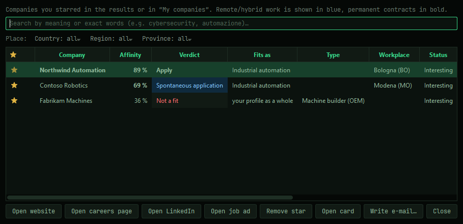

Click the **star** in the first column of the results (or of **My companies**) to add a company to your favourites; the status bar says **"... added to the favourites."** Click it again to remove it (**"... removed from the favourites."**). Your favourites are also one of the company sources of later searches.

Open the **Favourite companies** window with the **Favourites** button at the top right of the window, with **File > Favourites...** or with Ctrl+Shift+F. It lists the starred companies. The columns are the star, **Company**, the four affinity columns (**Affinity**, **Verdict**, **Fits as**, **Type**, see section 5), **Workplace**, **Status**, **Hiring**, **Best job ad**, **Salary**, **Contract**, **Work mode** and **Revenue trend**. Remote and hybrid work is shown in blue and permanent contracts in bold. Click a column header to sort the list (section 10); the search box above the table looks for meaning and for exact words, and the **Country / Region / Province** selectors filter by place.

**Workplace** says where the job is: the location of the best job advert when it states one, otherwise the town (and province) of the company, taken from its card or from the discovery data. It stays blank when neither is known. The same column is in **My companies** and in the CSV file (section 7.3).

Select a company, then:

- **Open website**, **Open careers page**, **Open job ad** - open them in your browser;
- **Open LinkedIn** - opens LinkedIn's company search for the name without its legal form, in your browser (the program reads nothing there);
- **Remove star** - removes it from the favourites (its card stays in **My companies**);
- **Open card** (or double-click the row) - opens its card in the **My companies** tab;
- **Write e-mail...** - prepares a draft e-mail (section 9.1);
- **Close**.

### 6.2 The "My companies" tab

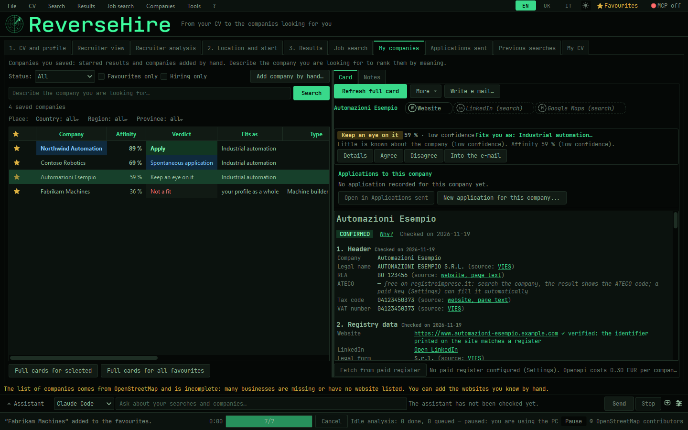

**My companies** keeps a **card** for each company you starred, and for each company you add by hand with **Add company by hand...** (a name and, optionally, a website that must start with `http://` or `https://`). A card keeps a copy of the last evaluation, so it stays useful after the search it came from is deleted.

On the left there is the list of cards. Its columns are the star, **Company**, **Affinity**, **Verdict**, **Fits as**, **Type**, **Score**, **Workplace**, **Hiring**, **Salary**, **Work mode**, **Status**, **Revenue trend** and **Matched text**. **Score** and **Matched text** are filled in only after a search by meaning (section 6.3). **Revenue trend** is filled in for the companies whose card has at least three years of revenue (section 6.8). Click a header to sort; blanks always go last (section 10). Above the list:

- **Status:** shows **All** cards or only those with one status;
- **Favourites only** and **Hiring only**;
- **Add company by hand...**;
- the **Country / Region / Province** selectors (section 10);
- the search box, **Describe the company you are looking for...**, and the **Search** button.

Under the list, **Full cards for selected** and **Full cards for all favourites** build several cards one after the other (section 6.5). You can select several rows with Ctrl or Shift.

On the right two tabs show the selected company: **Card** (the card, section 6.4 onwards) and **Notes** (yours alone, section 6.9). Under the search box a line says how many companies are saved (**N saved companies**).

When the same company is found again in a later search, its evaluation is updated; your status, notes, contacts and tags are never overwritten.

### 6.3 Searching your companies by meaning

The search box of **My companies** (and of the Favourites window) does not look only for exact words: it ranks your saved companies **by meaning** and by exact words together, using the same local language model as the other lists (section 10). Type a sentence that describes the company you want and click **Search** (or press Enter). Two examples:

- `software company with remote work`
- `small engineering firm near home that builds machines for food packaging`

The list is sorted from the closest company; the **Score** column shows how close it is and **Matched text** shows the part of the card that matched best (name, sectors, tags, description, notes or job titles). A company name you type is always found, even if the model knows nothing about it. Your tags and notes take part in the search, so writing good notes makes it work better. The line under the box says **N companies ranked for "..."**.

The first search may show **Loading the language model (first search only, it may take a minute)...**. If the search cannot run you see **The search could not run; the plain list is shown.** To go back to the plain list, empty the search box. **Find similar** (on the **Notes** tab) lists the saved companies most similar to the selected one (**N companies similar to "..."**).

### 6.4 What is on the card

On the **Card** tab the top row has **Create full card** (**Refresh full card** once it was built), **More** (section 6.5) and **Write e-mail...** (section 9.1). Under it come, on one line, the **name of the company with its links** (section 6.7), then the **affinity box** (section 5: the verdict, the confidence, **Details**, **Agree** and **Disagree**), then a small box **Applications to this company** (section 9.5), and then the card itself. Below the card there is **Fetch from paid register** (section 6.12) with a line that says what it needs.

The card has nine sections:

1. **Header** - company name, legal name, **REA**, **ATECO**, **Tax code** ("codice fiscale") and **VAT number** ("partita IVA").
2. **Registry data** - the company's own website, legal form, registered office and operating sites, town, province and postcode, PEC, phone, e-mail, share capital, founding year, a size hint (employees), the LEI and Wikidata identifiers, and when the website says so: the company that directs and coordinates it, a single shareholder, a company in liquidation, the VAT numbers of other group companies, the SDI code, the LinkedIn page and other social profiles (kept as links: the program reads nothing there).
3. **Profiles sought** - the job adverts found on the site (with their contract, work mode, salary and travel), whether spontaneous applications are accepted (by e-mail or through a form on the site) and the date the site was last checked. If there are none, the card says **No open positions found on the site.** When a CV is loaded, each posting shows a small **Match with my CV** badge, and a link lets you simulate a screening system on that posting (section 8).
4. **Products and services** - what the website says the company makes or offers, with the address of the page.
5. **Selection system** - the applicant-tracking system (ATS) that the company's careers page uses, if one was detected, and what that platform offers according to its vendor. This describes the platform, not proof that this employer uses a given feature.
6. **CV screening** - whether CVs are likely to be parsed automatically, and whether the employer **states** automated or AI processing on its own pages (**declared by the employer**), the platform is only **capable** of it, or there is **no evidence**. Quotes from the employer's pages are shown with their address. Practical **Advice for the CV** follows (for example to send a text PDF or DOCX, never a scan).
7. **Presentation and history** - sentences taken from the company's own pages (section 6.5).
8. **People and contacts** - role mailboxes and named people found on the company's pages (section 6.5).
9. **Financials** - a chart and a table of revenue, net profit and employees by year, and a revenue trend (sections 6.8 to 6.11).

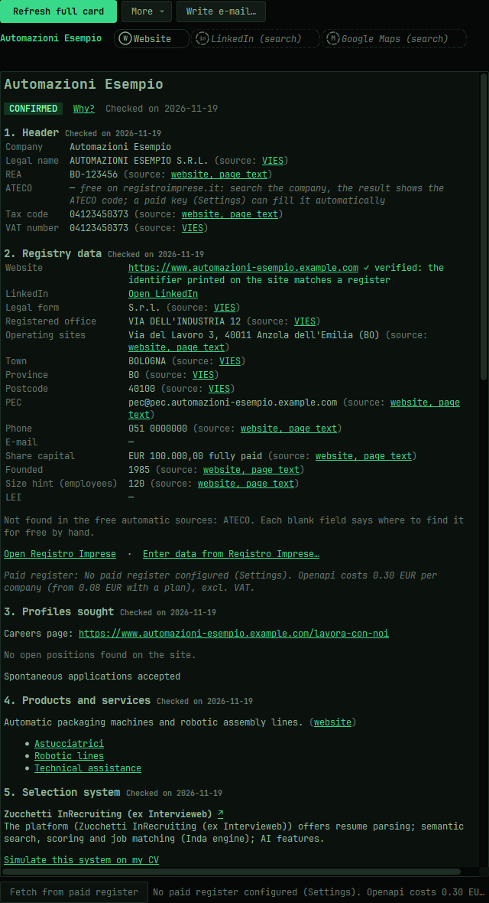

**The identity status.** Under the header the card shows how sure the program is that the data belongs to the right company:

- **CONFIRMED** - an identifier printed on the company's own website (for example the VAT number) equals the one in an independent register (VIES, GLEIF or register data you typed or imported) and the names agree;
- **PROBABLE** - there are signs but not enough for a confirmation;
- **UNVERIFIED** - nothing could be checked yet;
- **CONFLICT** - two sources give a different value for the same kind of identifier.

Click **Why?** to see the table of fields and sources, and the reasons (**Hide details** closes it). Every value on the card shows where it comes from (**source**, with the address of the page, and where on the page it was read) and the date it was checked. When two sources give different values for the same field (for example the town), the card says **Sources differ for ...** and lists the values; nothing is silently overwritten. The free sources are the company's own website, **VIES** (the European VAT number check; a "not registered" answer only means the company is not an intra-EU trader), **GLEIF** (legal entity identifiers) and **Wikidata**.

**Blank fields.** A field that no source gives stays blank (**-**). The program never guesses a REA, an ATECO code, a tax code or a VAT number. ATECO and REA come only from a register list you imported or from register data you typed in (the REA can also be printed on the company's site); section 11 explains the regional register lists. A blank field tells you where to find the value for free by hand (for example **free on registroimprese.it: search the company, the result shows the ATECO code**) and, for the fields a paid register can fill, that **a paid key (Settings) can fill it automatically**.

### 6.5 Creating the full card

Click **Create full card** (or **Refresh full card**). The program reads a few pages of the company's site and asks the free registers, then fills the sections. It is slow on purpose, polite to the site (it follows `robots.txt` and the pauses between requests), and runs **only when you click**: nothing is built automatically after a search. The status line shows the step:

1. **reading the website**;
2. **legal notice, contacts, about and careers pages**;
3. **VIES, GLEIF and Wikidata registers**;
4. **presentation and history**;
5. **people and contacts**;
6. **financial figures (ESEF, Wikidata)**;
7. **selection system and privacy notices**;
8. **products and services**.

Every finished step is saved at once. **Stop** stops the build and keeps what was read (**Stopped: what was read so far is saved.**). Without a website only the register data can be checked (**No website: only the register data can be checked.**). The build never calls the paid provider (section 6.12), and a rebuild within one day keeps the free financial figures it already has.

**What is read from the website.** The home page and, at most, a few internal pages chosen by their link text: legal notice or company information, contacts, about ("chi siamo"), history, careers, team or management, and privacy. If the home page is not Italian but the site has an Italian version, that version is read too. The program looks for the VAT number and the tax code (a number with a wrong check digit is discarded), the Registro Imprese number, the REA, the share capital, PEC, e-mail, phone, the registered office (street, postcode, town, province), operating sites, founding year and size hints. It reads the page text, the footer and the header, `<address>` blocks and the structured data that sites publish for search engines (schema.org: legal name, VAT number, LEI, address, links to social pages). Every value keeps the page it came from and where on the page it was found (**footer**, **page header**, **page text**, **schema.org data**, **address block**, **link**).

**Cross-checking.** The VAT number or tax code found is checked with VIES and GLEIF, and Wikidata is searched with an identifier, never with the name alone (names are ambiguous). Most small Italian companies are not on Wikidata, and many have no LEI: that is normal. The status of the check is shown in **Why?** (for example **VIES: valid**, **GLEIF: not found**).

**Presentation and history (section 7 of the card).** The text is taken word for word from the company's own pages, cut at a sentence boundary and never rewritten. Cookie banners, navigation and the legal data block are left out. Each sentence shows its source. With the English interface the text is shown in English, translated on your computer, and the original is kept.

**People and contacts (section 8 of the card).** The program collects what the company itself publishes: role mailboxes on the careers, contacts, team, about and legal pages (for example an HR or recruiting address), named people with their role when the page states them together, contacts named in up to three job adverts, and the chief executive from Wikidata. Each contact is marked **HR**, **Management**, **General** or **Privacy / data protection (not for applications)**; HR contacts come first. A privacy mailbox is shown for completeness but is **never proposed as the recipient of an application**. E-mail addresses are never guessed from a name. Each contact has a **delete** link (after a confirmation, and a deleted contact is not added again). Under the list, the links **HR people**, **recruiters**, **talent acquisition**, **"risorse umane"** and, when the company's LinkedIn page is known, **company page: people in HR** open LinkedIn's search in your browser; the program reads nothing there. Contacts are stored only on your computer. Large companies usually take applications only through their careers portal: then the card says **No contact found on the pages read.**

**The "More" menu:**

- **Open Registro Imprese**, **Enter data from Registro Imprese...** - section 6.6;
- **Enter register data...** - type the data of a register extract that you obtained yourself (a "visura"); invalid identifiers are refused and not saved. The window also has **Import register CSV row...**;
- **Open company-information sites**, **Paste figures...**, **Import balance-sheet CSV...**, **Add figures by hand...** - section 6.9;
- **Refresh section** - rebuilds one part only: **2. Registry data**, **3. Profiles sought**, **4. Products and services**, **5. Selection system**, **6. CV screening**, **7. Presentation and history**, **8. People and contacts** or **9. Financials**;
- **Copy as text** and **Export card (Markdown)...** - the card as plain text or as a Markdown file (for a PDF, Excel or Word file see section 9.3).

The same entries are in the **Companies** menu of the menu bar.

**Several cards at once.** **Full cards for selected** and **Full cards for all favourites** build the cards one after the other, never in parallel, one site at a time. The status line shows **Card 2 of 5: (company) (step)**, and the bar of the card view reads **2/5** (hover it for **Building card 2 of 5**). **Stop** ends the batch after the current step and keeps what was done (**Stopped after ... of ... cards: what was read is saved.**). A card that fails is skipped. These buttons never call the paid provider. If no selected company has a website you see **No card to build: select one or more companies with a website.**

### 6.6 Registro Imprese, by hand

The Italian Registro Imprese has a free search that shows, among other things, the ATECO code, the PEC and the legal form. ReverseHire does **not** read that site by itself; you copy the values:

1. In the card, click **Open Registro Imprese** (in the **More** menu, or the link in the registry data). Your browser opens `registroimprese.it` and ReverseHire copies to the clipboard what to search for: the tax code when known, otherwise the VAT number, otherwise the legal name or the company name. The card says **Registro Imprese opened in the browser; "..." copied: paste it in the search field.**
2. Search the company on that site and read what the result shows.
3. Back in ReverseHire, click **Enter data from Registro Imprese...** and copy the values into the form: **ATECO**, **PEC**, **REA**, **Tax code**, **Legal form** and **Registered office**. Leave blank what you did not see.
4. Click **Save**. The values are checked before they are saved: the tax code and REA must have a valid format, the ATECO must be a code of the ATECO 2025 table (for example `62.10.00`) and the PEC must look like an e-mail address. A wrong value is refused with a message (**Not saved: ...**) and nothing is saved.

Saved values appear on the card with the source **Registro Imprese (entered by hand)** and the date. They count as register data for the identity status. The site may ask you to register for some data (the REA and the tax code, for example): that is your choice, outside ReverseHire.

**Register data in the card, in general.** Register data reach a card in four ways: typed here, typed in **Enter register data...**, taken from a register list that you imported or that comes from the regional register, and from the paid provider. The lists, their licences and what they cover are in section 11.

### 6.7 The links next to the company name

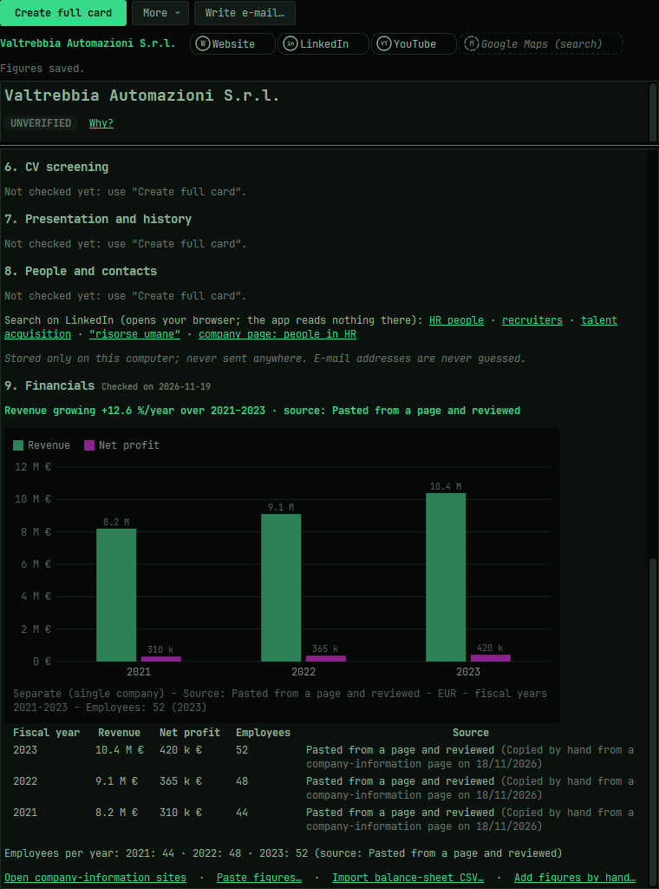

Right of the company name (above the card, and also in the detail panel of the results) there is a row of small round buttons, one for each link the program knows. Click one to open it in your browser; the program reads nothing there. The same buttons are in the **Links of this company** submenu of the **Companies** menu (and of the **Results** menu, for the selected result). When there is little room the buttons show only their icon; hover one to see its name and where it comes from.

There are two kinds of button:

- **Links that were found** - drawn with a solid border. The program lists a link as a page **only when it found it**: on the company's own website (a link in the page or the structured data), in Wikidata, in the OpenStreetMap record of the place, or in the data of the card. The possible networks are **Website**, **LinkedIn**, **Facebook**, **Instagram**, **X (Twitter)**, **YouTube**, **TikTok**, **GitHub**, **XING**, **Glassdoor**, **Indeed**, **Wikipedia** and **Wikidata**. The tooltip says **Found on the company website** (or Wikidata, OpenStreetMap, the card data), where on the page, and the address of the page it was read from.
- **Searches** - drawn with a dashed border and italic text, with **(search)** after the name. When no LinkedIn page of the company is known, a **LinkedIn (search)** button opens LinkedIn's company search for the name without its legal form. A **Google Maps (search)** button is always there and searches the name and the town on the map. The tooltip says **Search (opens your browser; nothing is read by the app)**.

A profile address is never guessed from the company name: if the page was not found, you get the search instead. Only company pages are accepted as found links: share buttons, posts, photos, personal profiles and the networks' own pages are discarded. When nothing is known the row says **No links known**.

### 6.8 The Financials section

Section **9. Financials** of the card is **always visible**, also when no figure exists yet. It has, from top to bottom:

- a link **Scope:** (only when figures of two scopes exist, section 6.10);
- the **revenue trend** line (only when at least one figure is stored), see below;
- the **chart**: bars of revenue and net profit by fiscal year (a **net loss** is hatched, so it does not depend on colour) and, in the caption, the scope, source, currency and years, for example **Separate (single company) - Source: Pasted from a page and reviewed - EUR - fiscal years 2021-2023**; the caption also says **Employees: 52 (2023)** for the latest year that has them. The chart follows the dark and the light theme and shows at most the last five years. With no figure it shows **No financial data available.** or the reason why (section 6.11);
- the **table** with **Fiscal year**, **Revenue**, **Net profit**, **Employees** and **Source** of every year. For figures you pasted, the source line also shows the note you wrote (section 6.9). A figure known only as a range is shown as `low-high` and is **not drawn in the chart**;
- the line **Employees per year: 2021: 44 - 2022: 48 - 2023: 52 (source: ...)**, from the stored figures. A size hint taken from the company's pages (or a register) is shown separately as **Employees: N**;
- the four links **Open company-information sites**, **Paste figures...**, **Import balance-sheet CSV...** and **Add figures by hand...** (also in the **More** menu).

Every figure keeps its source, fiscal year, currency and scope. A figure that is unknown stays blank; it is never turned into zero.

**The revenue trend.** The line above the chart is the **compound annual growth rate** of the revenue between the first and the last year of the stored figures (at most the last ten years), for **one scope and one currency**. It needs **at least three years that have a revenue value** (they do not have to be consecutive); otherwise the card says **Revenue trend: not enough data (at least 3 years needed)**. Only the first and the last of those years are compared, so a bad year in the middle does not change the number. The result is one of three sentences:

- **Revenue growing +12.6 %/year over 2021-2023** when the rate is +2 % per year or more;
- **Revenue stable (+0.5 %/year over ...)** between -2 % and +2 %;
- **Revenue declining -4.1 %/year over ...** at -2 % or less.

The sentence ends with **source:** and the name of the source of the figures. Nothing is estimated: the trend is computed only from the stored figures, which is why a company with three years of figures that you pasted from a page will show it, and a company with none shows nothing.

**What the trend is used for.** It appears in the **Revenue trend** column of **My companies** and **Favourites** and, for the companies of the results that you already have a card for, in the **Revenue trend** column of the results (for example `+6.3 %/year (2021-2024)`); an empty cell means "no trend", and those rows always sort last. It also gives a **small bonus** in one place: when you start a search, the program puts the discovered companies in a "promising first" order before it reads their websites (this order decides which sites are read first when the number of companies is limited, section 7). A company whose card shows growth of **+2 % per year or more** gets **+0.05** in that order, and one with **+10 % per year or more** gets **+0.10**. For comparison, having a website already gives +0.10 and the whole scale is about 0 to 2, so the bonus can move a company a few places, no more. **It is never negative:** a company with declining revenue, or with no figures, is neither pushed down nor hidden. The reason is written next to the company in the "why selected" note. In the affinity (section 5) the revenue trend is also one of the opportunity signs, with its own rule, because it is computed there from two or more years and with a threshold of 3 % per year.

### 6.9 Why the figures are pasted, not downloaded

For a company that is not listed there is **no free official source** of revenue and profit. The balance sheet filed with the Registro Imprese can be bought there (the program's messages mention about 2.50 EUR per year), and several public company-information sites summarise it, often as ranges ("between 10 and 50 million"). **Those sites forbid automated reading**, and most of the figures are behind a login. ReverseHire therefore does **not** read them, not even "politely". It only opens a search in your browser, and you decide what to copy. There is no automatic download of figures from these sites and none is planned.

**Open company-information sites** opens, in your browser, a web search (a DuckDuckGo search) for the company on five public company-information sites (reportaziende.it, ufficiocamerale.it, informazione-aziende.it, companyreports.it, registroaziende.it). The search uses the **VAT number** when the card has it, otherwise the **tax code**, otherwise the **company name in quotation marks**, together with the words "fatturato dipendenti". The card says **Search opened in the browser.** If the card has neither a VAT number, a tax code nor a name you see **Neither the VAT number nor the name of this company is known.** and nothing opens. The program does not look at the search results or at the pages: you do.

**Paste figures...** opens a window in which you copy the text of a page you found and let the program read the numbers out of it. You then check them. Nothing is saved before you confirm.

1. On the company-information page, select the text that shows the figures (select everything if you are unsure), copy it, and paste it into the big box of the **Paste figures** window.
2. Click **Read the figures**. The grid below the box fills with one row per fiscal year, with the columns **Year**, **Revenue**, **Net profit** and **Employees**. The line above it says **Figures found for N year(s). Check and correct them in the grid.** If nothing was found: **No figure with a year was found in the pasted text.**
3. **Check every cell.** You can correct a cell, **Add a year**, or select a row and **Remove the year**. Type plain numbers: `12345678`, or a range as `10000000-50000000` (a range is kept as a range). Leave a cell empty when the figure is unknown.
   The amounts in the grid are shown with the thousands separators of the interface language (for example `12,345,678` in English); you can type them with or without separators.
4. Write where the figures come from in **Source (site or document)**, for example `reportaziende.it, page of 18/11/2026`. The source is **required** (**Write where the figures come from.**), because it is shown on the card next to the figures.
5. Check **Currency** (three letters, **EUR** by default) and **Scope** (**Separate (single company)** by default; **Consolidated (group)** and **Scope not stated** are the others).
6. Click **Save...**. A question shows the years and the source (**Save the figures of N year(s) (...) on the card of ...? Source: ...**); only **Yes** saves. The card shows **Figures saved.** and redraws the chart.

The window does not block the program: you can keep it open next to the page you are copying from.

**How the pasted text is read.** The reader is a set of fixed rules, not an assistant; it works on your computer and sends nothing anywhere. It reads the text line by line.

- **Labels it knows** (Italian and English): for the revenue **Fatturato**, **Ricavi** (**delle vendite**), **Valore della produzione**, **Volume d'affari**, **Revenue(s)**, **Turnover**, **Net sales**, **Sales**; for the profit **Utile** (**netto**, **d'esercizio**), **Perdita**, **Risultato** (**d'esercizio**, **netto**), **Net income**, **Net profit**, **Profit**, **Net loss**, **Loss**, **Earnings**; for the employees **Dipendenti**, **Numero dipendenti**, **Addetti**, **Employees**, **Staff**, **Headcount**, **Workforce**. A figure after **Perdita** or **Loss** becomes negative.
- **Where the year comes from:** on the same line (`Fatturato 2023: EUR 12.345.678`), on a line **before** it (`Bilancio 2023` then `Ricavi: 1,2 mln`), on one of the next two lines, or from a **table header** (`Anno 2021 2022 2023` and then `Fatturato 10 11 12 mln`, where the unit written once at the end applies to every cell). Years between 1980 and 2100 are accepted.
- **Amounts it understands:** `1.234.567`, `1,234,567`, `1.234.567,89`, `1,2 mln`, `850 mila`, `120 k`, `3 M`, `2 mld`, `5.4M`, a currency sign before or after (EUR, a euro sign, USD, GBP, CHF), negative as `-120` or `(120)`. A lone group of three digits after a point or comma is a thousands mark (`1.234` is 1234) unless a unit follows (`1,2 mln`).
- **Ranges** are kept as ranges: `tra 10 e 50 milioni`, `between 10 and 50 million`, `da 2 a 5 mln`, `10-50 M`, `10 - 49 dipendenti`.
- **Currency:** the first currency sign or code found anywhere in the text; **EUR** when none.
- **If a figure appears twice for the same year**, the **first** one is kept.

**What can go wrong.** This is why the grid exists: look at every row before you save.

- **Percentages are ignored.** A number followed by `%`, `percent` or `per cento` (`+12%`, `12,5 %`) is a growth rate or a share, never an amount: in `Fatturato 2023: +12% rispetto al 2022` the 12 is skipped. Other numbers that are not amounts (a rank, a count) can still be taken for amounts, so check every cell.
- **A year that comes only after the figure, on a later line, is not used**, and a figure with no year at all is dropped silently (the reader notes it, but the window does not show the note). If you see fewer years than the page has, that is the reason.
- **Labels mean different things on different sites.** **Valore della produzione** (value of production) is read as revenue, although it is not exactly the revenue; **Risultato** (result) can be an operating result, not the net profit; **Utile** may be a gross figure. The program cannot know which one a site means: if it matters, compare with the page.
- **The columns of a table that was copied badly** (cells in a different order, "n.d." in the middle) can shift a figure to the wrong year. When a row has fewer cells than the header has years, the program assumes the **missing cells are the oldest years**.
- **Units can be wrong** when the page states them far from the number ("amounts in thousands of euro" in a title). The reader sees only the unit next to the number, so a page in thousands may give a revenue a thousand times too small. Check the order of magnitude.
- **Ranges are not exact figures.** A year known only as a range is shown in the table, is **not drawn in the chart** and **does not take part in the revenue trend**.

You are responsible for what you confirm. The card does not mark pasted figures as uncertain beyond their source line: **Pasted from a page and reviewed** with your note.

**How pasted figures rank among the other sources.** If the same year and scope come from two sources, the more authoritative one is shown and the other is kept as a conflict (section 6.10). In order: figures you typed or imported yourself, ESEF reports, the paid provider, **figures you pasted**, Wikidata. A new paste of the same year **replaces** your earlier pasted figures for that year and scope without a conflict.

**Other ways to enter figures.**

- **Add figures by hand...** opens a window with **Fiscal year**, **Revenue**, **Net profit (negative for a loss)**, **Amounts in** (units, thousands or millions), **Employees**, **Scope**, **Currency** and a **Document** note (for example "balance sheet 2024"). They are shown with the source **Entered by hand**.
- **Import balance-sheet CSV...** reads a CSV file with one row per fiscal year and a header row. The column names can be English or Italian (year/anno, revenue/ricavi/fatturato, profit/utile, employees/dipendenti, scope/ambito, currency/valuta) and the separator can be `;`, `,` or a tab. A blank cell stays blank. Numbers such as `1234567`, `1.234.567,89`, `1,234,567.89`, `(1.250)` and `-1250` are understood; an ambiguous number such as `1.234` is refused with a message instead of guessed. Rows that cannot be read are listed (**Some rows were not imported: ...**).

### 6.10 Figures from free sources, scopes and conflicts

Two free sources are asked when you build the card (step **financial figures (ESEF, Wikidata)**):

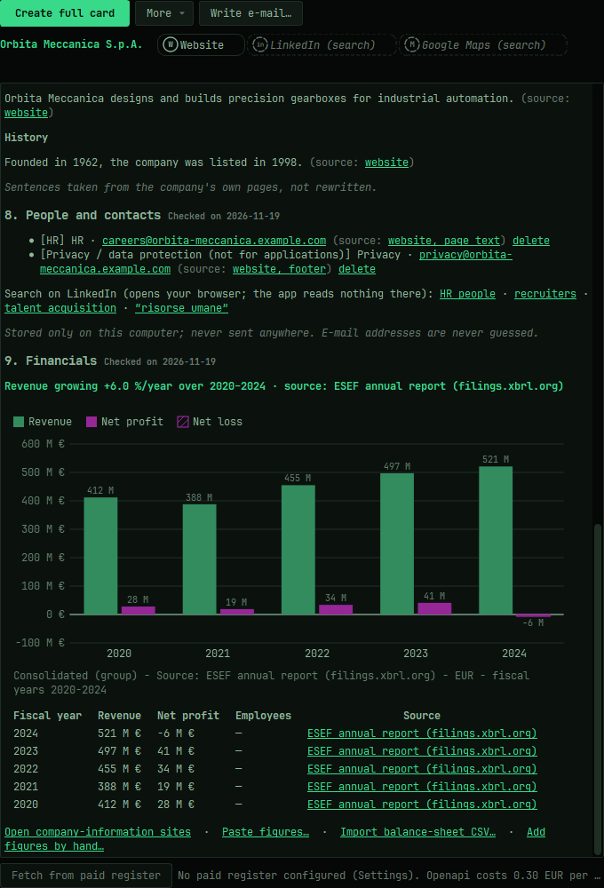

- **ESEF annual reports** (filings.xbrl.org): listed companies must file their annual report in a machine-readable format, and the program reads up to the last five years of **revenue**, **net profit** and, rarely, **average employees**. It needs the **LEI** of the company (a company without a LEI is not looked up) and finds nothing for a company that is not listed. The scope is **consolidated** (group figures). Only the standard IFRS items are used; a blank is preferred to a figure that means something else.
- **Wikidata**: revenue, profit and employees when volunteers entered them. The scope is not stated (**Scope not stated**), the data may be outdated, and it is used only when nothing better exists (the card says **Only Wikidata figures are available (volunteer data, scope not stated).**). Most Italian companies have none.

These two are the only sources the program reads by itself: the ESEF service publishes its data for machine use (it has an interface for that), and Wikidata is open data. The company-information sites are not like that (section 6.9). There is **no free official source for an unlisted company**: the card then says **Not a listed company: there is no free official source for its revenue and profit.** and suggests a balance sheet you buy yourself or a paid-provider key. Other reasons are shown in plain words: no LEI known, no Wikidata item, no VAT number, the data services could not be reached, a paid provider configured but not asked.

**Scopes and conflicts.** Consolidated (group) and separate (single company) figures of the same company can differ a lot, so they are **never mixed** in one chart: when both exist, the link **Scope:** lets you choose which one to see. If two sources disagree on a figure, the more authoritative one is shown, the other is kept as a conflict, and the card says **Sources differ for ...** with a note (**Sources disagree for 2022.**). Amounts in different currencies are never converted or compared; the chart says **N year(s) in another currency are not shown.**

### 6.11 When there are no figures

An empty Financials section is normal for most small companies. The card tells you why in the empty chart (for example **No LEI known for this company, so the ESEF filings of listed companies cannot be looked up.**) and adds a short note on where the figures of non-listed Italian companies are published and how to bring them in: the balance sheet at the Registro Imprese, the company-information sites, and the three entry ways above. Typical sequence for a small company: **Open company-information sites**, find the page, copy it, **Paste figures...**, check the grid, write the source, **Save...**.

### 6.12 The paid provider (Openapi), with your own key

The program can ask one paid service, **Openapi** (company.openapi.com, the "IT-full" product), for the register data and the latest revenue and employees of one company. **It is optional, off by default, and it costs money that you pay to Openapi.** It works like this:

1. In **File > Settings...**, page **Registers and paid key**, in the group **Paid company register (optional)**, write the provider (`openapi.it`, `openapi.com` or `openapi`) and **your own API key**. ReverseHire does not sell or provide any key.
2. In the card, **Fetch from paid register** becomes available (without provider and key it stays greyed out; the line next to it says what is missing and what it costs).
3. Click it: a window **Paid lookup** shows the provider, the company and **the cost** (the price the program knows: 0.30 EUR per company, from 0.08 EUR with a plan, excluding VAT, charged to your own account) and asks you to confirm. Only **Yes** makes the call.

The call is made **only** on that button, **only** after your confirmation, for one company at a time. It is never made automatically, never in a batch of cards and never when you build a card. The register fields it returns (tax code, VAT number, REA, ATECO, legal form, PEC, registered office, share capital, employees, founding date) are checked like hand-entered data and shown with the source **Openapi (paid)**; the latest revenue and employees go to the financials (scope: separate). That product has no net-profit figure, so the profit stays blank. The key is sent only to Openapi, is never logged and is stored in `config.json` in plain text (section 18). The settings page says the key is used only on that button after you confirm the cost.

**This part has never been tested against the live service.** No key was available during development: the code was written from Openapi's documentation and tested only with invented answers; the source code itself is marked as untested. Before relying on it, try one lookup and compare the answer with the Openapi site. If the service answers in an unexpected way, the card shows **Paid lookup not done: ...** and nothing is changed. Other messages you may see: the provider refused the key, the provider has no record for the company, or it returned no revenue or employee figure.

### 6.13 The "Notes" tab

The **Notes** tab is yours alone:

- **Status:** where you are with that company: **Interesting**, **Applied**, **Interview**, **Offer**, **Closed**. Choosing a status saves it at once;
- **Favourite** (the star), also saved at once;
- **Tags (comma separated):**, for example `near home, startup`;
- **Notes:** and **Contacts:** - free text, for you only;
- **Save** - saves now. Tags, notes and contacts are also **saved automatically** about half a second after you stop typing: the line under the list then says **Card of "..." saved automatically** with the time. If it cannot be saved you see **Card of "..." not saved: see the log.**;
- **Open website** and **Open LinkedIn**;
- **Find similar** - lists the saved companies most similar to this one;
- **Delete** - deletes the card after a confirmation (**Delete the card of "..."? Notes, contacts and tags are lost.**).

What you write here is used by the search by meaning (section 6.3), but it is **not** part of the application letter or of the e-mail, and the export of an application keeps the card only as a private appendix (section 9.3).

## 7. Step 4 - Search postings and spontaneous targets

This step has two halves that work together:

- the **company search**: you choose a place and press **Start search** in tab 2 (**2. Location and start**), the program lists the companies of that area, reads their websites and shows the result in tab 3 (**3. Results**). Sections 7.1 to 7.4 describe it;
- the **Job search** tab: you type what you want, like on a job site, and the program lists open postings from the sources that allow it, plus a second list of companies that could suit you even without an open posting. Section 7.5 describes it.

Both need the profile of step 1 (section 3). The "judging" of the companies found (affinity, section 5) and the company card (section 6) come after the search; this section only points to them.

### 7.1 Tab 2: where to search

Open the **2. Location and start** tab. The page scrolls when the window is small and has four parts: the starting point and radius, the company sources, the categories of interest and the websites you add by hand. At the bottom, the **Start search** button.

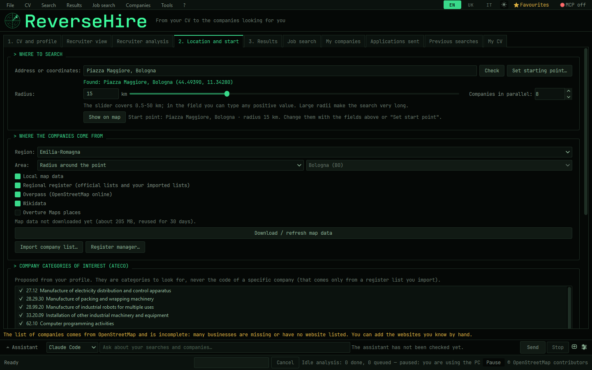

#### The starting point

In the **Where to search** box, the field **Address or coordinates:** accepts:

- **An address or a place name**, for example `Piazza Maggiore, Bologna`, or a street, number and town. Be as precise as you can. The home town of tab 1 can be copied here with **Use as starting point** (section 3).
- **A pair of coordinates** in decimal degrees, latitude first, for example `44.4939, 11.3428`. A semicolon or a space can also separate them, and a decimal comma is accepted (`44,4939; 11,3428`).

Click **Check** (or press Enter) to verify the place. While it is being checked you see **Checking…**, then a green line such as **Found: Piazza Maggiore, Bologna (44.49390, 11.34280)**. Checking is optional: if you do not do it, the place is checked when you press **Start search**. If you change the text after checking, you see **Location changed: it will be checked when the search starts.**

If the place cannot be found you see **Location not found (or network unavailable).** with the advice to use a more precise address or coordinates. Turning an address into a point needs the Internet (it is asked to the OpenStreetMap place-name service, at most one request per second).

#### The "Set starting point…" window

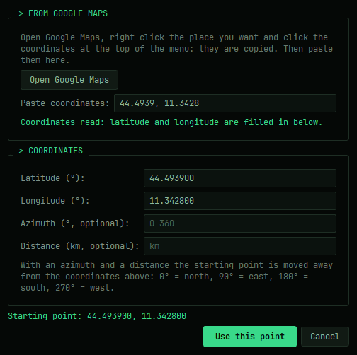

Click **Set starting point…** to open the **Starting point** window. It is useful when you know the exact point on a map, or when you want to start from a point at a certain distance from a known place.

**From Google Maps**

1. Click **Open Google Maps**: Google Maps opens in your web browser.
2. Right-click the place you want and click the coordinates shown at the top of the menu. They are copied.
3. Paste them in the field **Paste coordinates:**.

If the text is understood you see **Coordinates read: latitude and longitude are filled in below.** Accepted forms are `44.4937, 11.3430`, `44,4937; 11,3430`, a degrees-minutes-seconds form such as `44°29'37.3"N 11°20'34.8"E`, and a Google Maps link that contains `@44.4937,11.3430`. Otherwise a red message lists the accepted forms.

**Coordinates**

- **Latitude (°):** a number between -90 and 90.
- **Longitude (°):** a number between -180 and 180.
- **Azimuth (°, optional):** a direction between 0 and 360 (0 = north, 90 = east, 180 = south, 270 = west).
- **Distance (km, optional):** greater than 0 and at most 1000 km.

Azimuth and distance go together: fill in both or leave both empty. When both are filled in, the starting point is moved by that distance in that direction, and the line at the bottom shows the result. Invalid values are shown in red with an explanation and the button stays disabled until they are corrected.

Click **Use this point** to copy the point into **Address or coordinates:** (it counts as already checked, no Internet is needed), or **Cancel** to close the window without changes.

#### Radius and companies in parallel

The **Radius:** field is in kilometres. You can type a value or move the slider:

- the slider goes from 0.5 to 50 km in steps of 0.5 km;
- in the field you can type any positive value, also with decimals (for example `2.5`);
- the radius is **15 km** every time the program starts (it is not remembered).

Larger radii find many more companies and make the search much longer. In a city centre, start with 1-5 km.

**Companies in parallel:** (from 1 to 16, default **8**) sets how many companies are analysed at the same time. Higher values finish sooner but use more memory. Each website is still read politely: the delay between requests to the same site and the site's `robots.txt` rules are always respected. The value is remembered.

#### The area: radius, province or region

In the **Where the companies come from** box:

- **Region:** the Italian region whose map data is used. The choices are the 20 Italian regions; the default is Emilia-Romagna.
- **Area:** three modes, with a province box next to it:
  - **Radius around the point** (the default): the companies within the **Radius:** of the starting point. The province box is greyed out.
  - **Whole province**: every company of the province chosen in the province box (written like **Bologna (BO)**). The radius is not used.
  - **Whole region**: every company of the chosen region. The radius is not used.

The province box lists the provinces of the chosen region. When you change the region, a province you had chosen is dropped if it belongs to another region (the box then stays empty until you choose one).

**The address is optional in province and region mode.** Without one, the search starts from the chief town of the province (or the capital of the region); if you did type an address that cannot be found, it is ignored and the chief town is used, with a note next to the button (see "The Start search button", below). In **radius** mode you normally give an address, but if you leave it empty the program does not refuse: it starts from the chief town of the province shown in the (greyed) province box, or from the chief town of the region (its capital) when that box is empty, and says so (**No address given: the search covers 15 km around Bologna (chief town).**). Check that name before you confirm the estimate.

Two honest limits of the area modes:

- a province or region can contain thousands of companies: use the categories (below) and **Maximum companies** (section 13) to keep the search manageable;
- if you choose **Whole province** but no province is selected in the box, the search does not start: the program asks you to choose one (see the table below).

**Country, Region, Province elsewhere.** Tab 2 only has **Region** and **Province**, because the company search covers Italian regions. The three linked filters **Country:**, **Region:** and **Province:** that you see on the line **Place:** belong to the lists (Results, Job search, Previous searches and others): they narrow a list you already have, and are described in section 10.

#### Where the companies come from

Each source has a tick box and, after a search, a line saying what happened to it:

| Source | What it is |
|---|---|
| **Local map data** | A file with the companies of your region taken from OpenStreetMap. You download it once; it is reused for 30 days. Searching it is instant and needs no Internet. This is the main source. |
| **Regional register (official lists and your imported lists)** | The one register of companies kept on this computer: the free official lists and the lists you imported. It is **ticked by default**; tab 2 shows the same **coverage note** under the register's controls for the province you chose (nothing while the register is empty). What the official lists cover, what they do not (roughly a third of the machinery companies, the province sometimes presumed, no exact ATECO code for most) and how you correct them is in section 11. |
| **Overpass (OpenStreetMap online)** | The public OpenStreetMap service. It runs **only when the local map data could not answer** (for example because it is not downloaded yet). It is often slow or busy. |
| **Wikidata** | Companies with a website and a head office in the region, with identifiers such as the VAT number when Wikidata has them. |
| **Overture Maps places** | An extra source, **off by default**, searched by radius only. It needs an optional component (see the [Installation guide](INSTALLATION.md)). |
| **My companies (favourites)** | Always used, no tick box: the companies already on your cards. |

If a source fails or is not available, the search goes on with the others and the line of that source says why (**not available**, **failed**, **skipped**, **off**). Only when no source answers and you added no website by hand does the search stop; it is saved so that you can resume it (section 7.2).

Below the tick boxes:

- a line says whether the map data is there and how old it is, for example **Map data: 24,563 companies and places, 3 days old (205 MB file).**, or **Map data not downloaded yet (about 205 MB, reused for 30 days).**;
- **Download / refresh map data** downloads and prepares the map data of the chosen region (about 205 MB for Emilia-Romagna). A progress bar shows **Downloading map data: … of … MB…** and then **Preparing map data (…%)…**; the same button becomes **Stop download**. The download is resumable and slow on purpose (it does not use all your connection). Do it once before your first search and refresh it when it is old;
- **Import company list…** adds a list of yours (CSV or XLSX, up to 50,000 rows) to the register: you choose the kind of list (**Registro Imprese list**, **Innovative start-up register** or **Generic list**), check the automatic matching of the columns and click **Save**. The line **Imported lists: … (… companies).** shows what is stored. An imported company needs at least a name. The program never buys or downloads a register list for you: you obtain it yourself and must respect its terms of use;
- **Register manager…** opens the window where the register is browsed, corrected and refreshed (section 11).

#### Company categories of interest (ATECO)

The **Company categories of interest (ATECO)** box lists activity categories (ATECO 2025, the Italian classification of economic activities, with English titles when the interface is in English) that the program proposes from your profile. They are **categories to look for, never the code of a specific company**: the code of a company comes only from a register list.

- Untick a category to leave it out. Hover over a category to see why it was proposed.
- To add one, type its code or a word of its name in the field **Search a category or code…** (suggestions appear as you type) and click **Add**.
- Once you change the list, the program keeps your choice and stops replacing it with new proposals.

The categories decide the order in which companies are read (section 7.2); they do not hide companies.

#### Company websites to add by hand

OpenStreetMap does not list every company and many listed companies have no website. In the **Company websites to add (optional)** box you can add the websites of companies you already know:

- one address per line, for example `www.company.com` (the `https://` part is optional);
- invalid lines and duplicates are ignored;
- these websites are analysed first;
- in the results their **Distance (km)** shows **added by hand**;
- if a source already lists the same website, the company appears once.

#### Seeing the area on a map

**Show on map** (then **Hide map**) in the box **Where to search** shows your starting point and the radius on a map and follows your changes; the line under it repeats the place and the radius. See section 12.

A yellow strip at the bottom of the window always reminds you that **the list of companies comes from OpenStreetMap and is incomplete**: many businesses are missing or have no website listed. That is why the register, the imported lists and the websites added by hand exist.

#### The "Start search" button and why it may not start

**Start search** is at the bottom of the tab (the same command is in the **Search** menu). It is greyed out only while a search, or its estimate, is running. In every other case it can be clicked, and when the search cannot start the reason is written **next to the button** (and, for most reasons, also in a message window), so you do not have to scroll up to find it:

| What you see | Why |
|---|---|
| **Before searching, tab 1 needs: analysed CV (choose a CV first).** or **...: job role (at least one is needed).** | There is no usable profile yet. This note is always visible next to the button. On click, a window **Profile needed** says **The search cannot start: the profile in tab 1 has no ...** and offers **Go to tab 1**, which takes you to the right field. |
| **The radius must be a number of kilometres greater than zero.** | The **Radius:** field is empty or not a positive number (checked in radius mode only). |
| **Place not found: “…”. Correct the address or choose a starting point on the map.** | In radius mode the address could not be found, or the place service did not answer (no Internet). |
| **Enter an address or a pair of coordinates.** | No address was given and the program knows no chief town to start from. |
| **Choose the province to search, or set the area to "Whole region" or "Radius around the point".** | **Whole province** is selected but the province box is empty. |

Not every message next to the button is a refusal. Some are notes about what the search is going to do:

- **The search covers the whole province, starting from …** and **The search covers the whole region, starting from …** (province and region mode without an address);
- **No address given: the search covers 15 km around … (chief town).** (radius mode without an address);
- **“…” was not found and is ignored.**, written before one of the notes above (province or region mode with an address that could not be found).

Every refusal is also written in the log (section 15). The profile needs no confirmation: once the CV is read, the search can start (section 3).

### 7.2 Starting, following, cancelling and resuming a search

#### The estimate and the confirmation

Click **Start search**. Before anything is read, the program checks the place (if needed), counts the companies of the area and shows the **Confirm the search** window. Meanwhile the bottom bar says **Estimating the number of companies…**; the **Cancel** button of the bottom bar stops the wait (**Estimate cancelled.**), which matters when the online map service is slow.

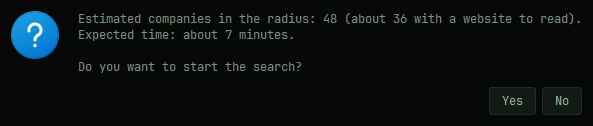

The window shows:

- **Estimated companies in the radius: … (about … with a website to read).** and **Expected time: about …** (the wording says "in the radius" also for a whole province or region: the number is the one of the area you chose);
- **No sector chosen: all kinds of companies will be searched.** when no sector is ticked in tab 1;
- **Limit set: at most … companies.** when **Maximum companies** is set in the settings (section 13);
- **WARNING: this is a long search...** when the expected time is more than 15 minutes.

Click **Yes** to start or **No** to go back and change the area, the sectors or the settings. When the search is long, no limit is set and more than 100 companies are expected, the window offers three buttons instead: **Limit to 100 companies** (the most promising ones, with the shorter time shown), **Search all** and **Cancel**.

The estimate is approximate: it assumes that about one company in five has a website to read, and some websites ask for longer pauses between requests, so the real time can be longer.

#### Which companies are read first

The companies are not read in map order. Before any website is read, every company is ranked with the free data the program already has: its name, its map tags, the industry on Wikidata, the ATECO code of a register list, whether it has a website, and, for a company you already have a card of, whether its revenue is growing (see below). Employers that fit your profile and the chosen categories come first; public offices, schools and universities, research institutes, shops, restaurants and associations go down (unless your profile is research). A short English note says why each company was selected, and it is kept in the CSV file (column **Why selected**, section 7.3). **Maximum companies** keeps the first companies of this ranking.

The revenue trend gives a **small bonus** in this internal ranking (+0.05 from a growth of 2 % a year, +0.10 from 10 % a year) to a company whose card of yours holds at least three years of revenue; it is never a penalty, so companies without figures are not hidden or pushed down. Revenue figures reach a card only by the pasting described in section 6.

#### While the search runs

The program moves to the **3. Results** tab. The bottom bar and the status line show what is happening, for example:

- **Company sources: …** - one line per source, such as **Local map data: … companies (… new) in … s**;
- **Preparing the local map data (…%)…** - the first time after a download;
- **Companies to evaluate: … (… with a website).**;
- **Reading website … of …: (company name)**;
- **Loading the scoring model (the first time it may take a few minutes)…** (section 19);
- **Still waiting for the online company sources: … s so far. Results from the sources that already answered are kept.** and, for Overpass, **Still waiting for the OpenStreetMap service (Overpass)...** when an online source is slow.

If you switched on **Also search job boards (Indeed/LinkedIn)** in the settings (an experimental, off-by-default feature, section 13), you also see **Searching job boards (Indeed, LinkedIn) for: …** and **Job boards: … new companies, … postings (… added to companies already found)**. When the job boards do not answer you see **Job boards did not answer (…); the search goes on without them.**, and the search continues normally.

Companies appear in the table as soon as they are evaluated, so you can start reading the results while the search continues.

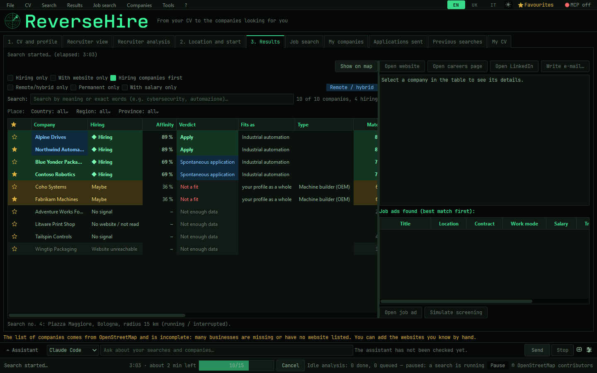

**The progress bar** at the bottom of the window shows the companies **analysed out of the total**:

- until the program has the list of companies it shows a moving bar and **Search started…**; while the local map data is being prepared it shows the percentage;
- as soon as discovery has the list, the total is an **estimate** and the bar reads for example **3/~15** (the **~** means "about"). The estimate is replaced by the real number when the companies have been ranked and limited, and the bar reads **10/15**. The bar never goes backwards; if the number changes, the tooltip says so (**The number of companies was revised from 18 to 15.**);
- next to the elapsed time you see the **time left**, for example **about 2 min left** or **less than a minute left**. It is computed from the pace measured on the companies already analysed and appears only after at least 3 companies and 20 seconds, so the first figures are rough. Hover the bar for **10 of 15 companies analysed.**;
- when the search ends the bar keeps the final count (for example **15/15**). The line under the results table shows the search number, the place, the radius and the state, for example **Search no. 1: Piazza Maggiore, Bologna, radius 15 km (completed).**

If one company cannot be evaluated the program shows **… could not be evaluated: moving on to the next one.** and continues. At the end the status says **Search completed: N companies evaluated (M could not be evaluated).** If none of them could be evaluated, the table says so and points to the diagnostics of the **?** menu (section 15).

If no company is found, a message above the table says why and what to try (a larger radius, other sectors or none, websites added by hand; or, when companies were found but none has a website, to tick **Include companies without a website** in the settings).

When the scoring model could not be loaded, a notice **Reduced accuracy: the scoring model could not be loaded (…)** appears above the table with a **Why?** button (also in the **Results** menu); the search goes on with approximate scores and lower confidence (section 19).

Only one company search can run at a time.

#### Cancelling

Click **Cancel** in the bottom bar. The status shows **Cancelling: waiting for the current operation to finish…**; the search stops after the pages being read at that moment. Then you see **Search cancelled: N companies evaluated and saved. You can resume it from the previous searches.**

Every company is saved as soon as it is evaluated, so nothing already done is lost.

#### Resuming

A cancelled or interrupted search is continued from the **Previous searches** tab with **Resume** (section 7.4). Companies already evaluated are skipped. The search continues with the profile, the place, the radius, the area (and province), the categories, the sectors and the websites added by hand that it was started with. The region and the sources ticked in tab 2 are not stored with a search: a resumed search uses the ones chosen at that moment.

### 7.3 Reading the results

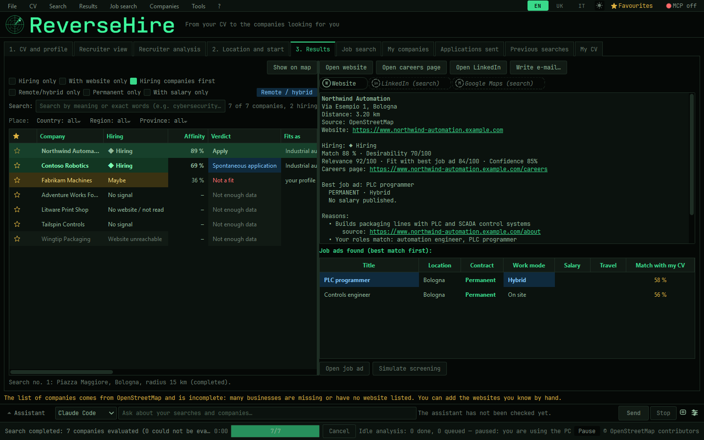

The **3. Results** tab has the table of companies on the left and the details of the selected company on the right; you can drag the divider between them. The table scrolls sideways: the most important columns come first. Above the table, the button **Show on map** replaces the table with a map of the same companies (below). The line under the table says which search is open, for example **Search no. 1: Piazza Maggiore, Bologna, radius 15 km (completed).**, and **No search open.** when none is.

#### The columns

| Column | Meaning |
|---|---|
| **★** (star) | Click the star to add the company to your favourites, click again to remove it (section 6). |
| **Company** | Company name. For websites added by hand, the website address is used. |
| **Hiring** | What was found on the website about hiring (see "Hiring status and colours"). |
| **Affinity** | 0-100 %: how well your CV fits what this company seeks, an estimate with its confidence. Hover a cell for the reasons. Section 5. |
| **Verdict** | What to do: **Apply**, **Spontaneous application**, **Keep an eye on it**, **Not a fit** or **Not enough data**. Section 5. |
| **Fits as** | The career direction in which your CV fits this company best (**Settings > Affinity**, section 13). |
| **Type** | The kind of company, inferred from its site, products and ATECO code; hover for the evidence. |
| **Match** | 0-100: the overall score of the search for this company (see "What the scores mean"). A red **⊘** before it means a must-have requirement is contradicted by your CV. |
| **Salary** | The salary **exactly as published** by the company whenever a job advert publishes one. It is never estimated. |
| **Contract** | **Permanent**, **Permanent possible**, **Fixed-term**, **Internship**, **Apprenticeship**, **Freelance**, **Temp agency**. If any advert offers a permanent contract, that is the one shown. |
| **Work mode** | **Remote**, **Hybrid** or **On site**. If any advert offers remote or hybrid work, that is the one shown. |
| **Fit** | 0-100: how well the best job advert matches your CV. Empty when no advert was found. |
| **Desirability** | 0-100: how well the company matches what *you* want. |
| **Relevance** | 0-100: how well the company's activity matches your profile. |
| **Distance (km)** | Straight-line distance from the starting point; **added by hand** for websites you added. |
| **Job ads** | Number of job adverts found. |
| **Confidence** | 0-100 %: how much information the scores are based on. |
| **Revenue trend** | For example **+12.6 %/year (2021–2023)**: the revenue growth per year found on **your card** of that company when the search ran (it needs at least three years of revenue on the card, section 6). Empty otherwise. A card created or updated after the search does not change an old result. |


The older scores (**Match**, **Fit**, **Desirability**, **Relevance**, **Confidence**) are shown in a muted colour: they rank the company for the search, while **Affinity** and **Verdict** say whether *your* CV fits what the company seeks. Many adverts do not state the contract, the work mode or the salary: the cell stays empty, which does not mean "no".

With the English interface, texts that come from websites (job titles, salaries, reasons) are shown in English, translated on your computer; where the translation model is not installed the original text is shown with the marker **(original language)** and a notice tells you how to install the model. A **Show original** tick box in the detail panel adds the original wording under each translated text.

#### What the scores mean, in plain words

- **Fit** - *"Would they take me?"* The program splits the best job advert into requirements, marks each one **must-have** or **nice-to-have**, and looks in your CV for proof of each one, from 0 to 4 (4 = clearly proven, 0 = your CV says the opposite). When your CV simply does not mention something it counts as "uncertain", never as a failure. Years of experience, languages, degrees, driving licence, own car and business travel are checked too.
- **Desirability** - *"Would I like it?"* It looks at what you want: a short distance, a **permanent contract**, **remote or hybrid** work, a **published salary** (and, if you set one, at least your minimum salary), and business travel within the days you accept. You can change these preferences in the settings (section 13).
- **Relevance** - *"Does this company work in my field?"* It compares your profile with what the company does: website, map category and name. A high relevance means "this company works in your field", even if it is not hiring.
- **Spontaneous application** - for companies **without** job adverts: how much it is worth sending a spontaneous application (relevance, your roles or skills on the website, a careers page or an invitation to "send your CV", the size of the company). It appears in the detail panel and in the CSV file.
- **Match** - the single value of the search to put the best companies first. With adverts it is half the fit, a quarter desirability and a quarter relevance (reduced when a must-have is contradicted); without adverts it is mostly the spontaneous-application score and counts a little less. Companies with low confidence are moved down a little.
- **Blocked** (**⊘**) - the best advert has a must-have that your CV **explicitly** contradicts, for example frequent travel required when your travel is **Excluded**, or a language level clearly below the one required. The company stays in the list, lower down. A requirement your CV does not mention never blocks a company.
- **Confidence** - how solid the scores are. It is low when the company has no website or the website could not be read, and higher when several pages, enough text and well-structured adverts were read. Without the scoring model it is lower.

The scores are indicators, not a verdict. Always read them with the reasons, gaps and confidence in the detail panel. Which of **Affinity** and **Match** to trust for a decision, and what the affinity cannot know, is explained in section 5.

#### Hiring status and colours

| Shown as | Meaning | Row colour |
|---|---|---|
| **◆ Hiring** | At least one job advert was found. | **Green**, bold |
| **Maybe** | No specific advert, but a careers page or an invitation to send a spontaneous application was found. | **Amber** |
| **No signal** | The website was read but nothing about hiring was found. | Normal |
| **Website unreachable** | The website did not respond or could not be read. | Grey |
| **No website / not read** | The company has no website listed (it is evaluated only from its name and map category) or its website was not read. | Normal |

Two more highlights: **remote or hybrid** work is shown in **blue** (the **Company** and **Work mode** cells; the small **Remote / hybrid** label above the table is the legend), and **permanent contracts** are written in **bold** in the accent colour.

"No signal" does not mean the company is not hiring: many small companies never publish adverts on their website. It can still be worth contacting them.

#### Sorting

Click a column header to sort by it: **the first click sorts ascending, a second click on the same header descending**, and a small arrow shows the column and the direction. So for a score a first click shows the lowest values first; click again for the best first.

- Numbers are compared by value (**9 %** comes before **10 %**, **2 km** before **10 km**), dates chronologically, text alphabetically without regard to case or accents.
- **Empty cells always go last**, in both directions.
- The star column puts favourites first; **Verdict** sorts **Apply**, **Spontaneous application**, **Keep an eye on it**, **Not a fit**, **Not enough data**.
- The order you chose is kept while new results arrive during a search and is remembered for the session.
- With **Hiring companies first** ticked (the default), hiring companies stay on top whatever the column. Untick it to see the pure order.

Before you click any header the order is by affinity (**Apply** and **Spontaneous application** first, by value; companies without an affinity result after them) and, if there is none, by **Match**, best first, with blocked companies after the others. Every other table of the program sorts the same way (section 10).

#### Filters and the search box

Above the table:

- **Hiring only** - only companies with status **Hiring**;
- **With website only** - hides the companies without a website;
- **Hiring companies first** - see above;
- **Remote/hybrid only**, **Permanent only**, **With salary only** - only companies with at least one such advert;
- **Search:** - one box that finds companies by meaning **and** by exact words (below);
- **Place:** **Country:**, **Region:**, **Province:** - three linked menus that narrow the list by the place of the companies (section 10).

All filters combine. A counter at the right of the search box shows for example **7 of 7 companies, 2 hiring** (shown, total, hiring).

**Search by meaning.** Type a word or a short sentence in Italian or English, for example `cybersecurity` or `automazione`. The exact words are looked for at once; a moment later the program adds the companies whose texts are about the same subject even with other words (it needs the language model; the match by meaning is an estimate). Exact words always come first. A line under the box says what is happening: **… of … match · search by meaning and exact words**, or **… of … match · keyword mode: the language model is not available, only exact words are found** when the model is missing. Companies that do not match are hidden. Hover over the **Company** cell of a match to read **the sentence that matched** with its relevance and where it comes from, for example **87 % · Presentation: «…»** (the name, the presentation, the products, the technologies, a posting, your notes, the sector and so on). A match by meaning only counts from a relevance of 35 %. The same box exists in every list of the program (section 10).

#### The detail panel

Click a row (a click on the star only changes the star) to see the company on the right:

- a **row of links** under the buttons: the links found for the company and, dashed, searches you can open (section 6);
- name, address, **Distance**, **Source** and **Website** (or "not listed");
- **Hiring:** the status, then the scores: **Match … % · Desirability …/100** and **Relevance …/100 · Fit with best job ad …/100 · Confidence …%**;
- **⊘ Blocked by a must-have requirement: …** when it applies, with the requirement;
- **Spontaneous application …/100** for companies without adverts, and **Careers page:** when one was found;
- **Best job ad:** with its terms, for example **PERMANENT · Hybrid · Salary: … · Travel: occasional** (only what the advert states), the salaries of the other adverts or **No salary published.**;
- **Reasons:** why the company matches, each with its **source** (the web page or the map data);
- **Gaps compared with the profile:** what is missing or should be checked (a requirement your CV does not prove, a language level, more travel than you accept, a contract that is not permanent).

Web addresses in the text are clickable. The affinity box with its evidence, the buttons to agree or disagree and the full card are in the card of the company, not in this panel (sections 5 and 6).

Buttons: **Open website**, **Open careers page** (only when one was found), **Open LinkedIn** (LinkedIn's company search for the name without its legal form; ReverseHire only opens the page in your browser, it reads nothing and sends nothing there) and **Write e-mail…** (section 9). They are greyed out when the address is not available.

**Job ads found (best match first):** the adverts of the company with **Title**, **Location**, **Contract**, **Work mode**, **Salary**, **Travel** and **Match with my CV** (0-100, the more skills of the advert your CV shows the higher; hover for the skills in common and missing, section 7.5). Remote and hybrid adverts are in blue, permanent contracts in bold. Select an advert, then **Open job ad** (or double-click it) opens it in the browser and **Simulate screening** opens the **Recruiter analysis** tab with that advert as the target (section 8).

The reasons and gaps are written when the company is evaluated, in English or Italian (in English with the Ukrainian interface), and do not change if you switch language later.

#### The right-click menu

Right-click a row of the table: the row is selected and a menu offers the commands that apply to it, the same as the buttons of the detail panel: **Open website**, **Open careers page**, **Open LinkedIn**, **Write e-mail…**, and **Open job ad** and **Simulate screening** when an advert is selected in the list on the right. A command that is not available for that company is left out. The same commands are in the **Results** menu.

#### Results on a map

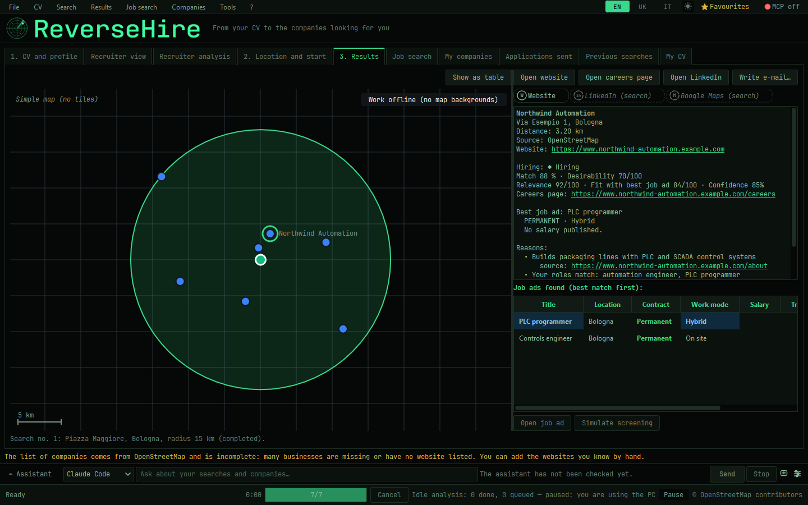

**Show on map** replaces the table with a map of the companies that are shown and have a position; **Show as table** brings the table back. The starting point is marked and the search radius is drawn around it. Click a marker to select the company (its details appear on the right); select a row before switching and its marker is highlighted. Only the first time you open a map is anything created. How the map works, the map background and its settings are in section 12.

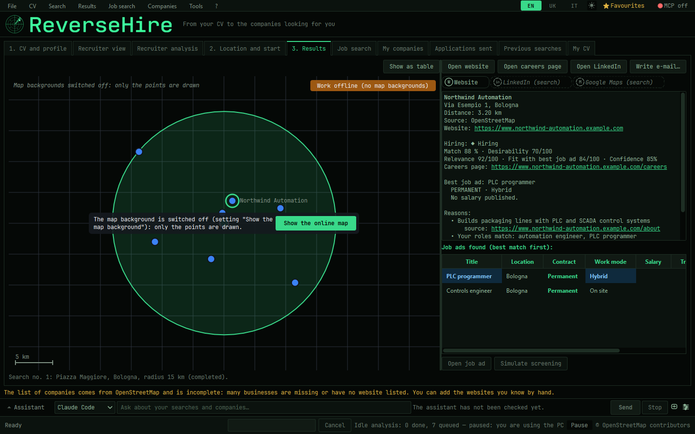

When the map background is switched off (the setting **Show the map background**, ticked by default, is not ticked) or cannot be loaded, a panel is shown in the centre of the map: only the points are drawn on a plain background. The button **Show the online map** switches the background on again; after a failure the button is **Retry**, and **Work offline (no map backgrounds)** switches it off. The first time a map is opened it shows **Loading the map…** for a moment.

#### Exporting the results as a spreadsheet (CSV)

Choose **File > Export CSV…** (or **Results > Export CSV…**), choose where to save the file (suggested name `results.csv`) and confirm. The status bar says **Exported N rows to CSV.**

- Only the **visible** rows are exported, in the order shown: if a filter, a place or the search box hides some companies, they are not exported. With no visible result you see **There are no visible results to export.**
- The columns are the table columns without the star (so including **Affinity**, **Verdict**, **Fits as**, **Type** and **Revenue trend**), plus **Website**, **Address**, **Workplace**, **Careers page**, **Job ad titles** (separated by `|`), **Source**, **Travel**, **Spontaneous application**, **Blocked by a must-have**, **Favourite** and **Why selected** (the note from the ranking, section 7.2). **Workplace** is the location of the best advert when it states one, otherwise the town of the company.
- With the English interface, job titles and salary are written in English as on screen, and two more columns, **Job ad titles (original language)** and **Salary (original language)**, keep them as the company published them.
- The file uses a **semicolon** as separator and UTF-8 encoding, so accented letters are kept. If your spreadsheet shows everything in one column, use its import function and choose the semicolon.
- If you see **The CSV file could not be written: check that it is not open in another program.**, close the file in Excel (or another program) and try again.

The company card and the application as a document are exported differently (section 9).

### 7.4 Previous searches

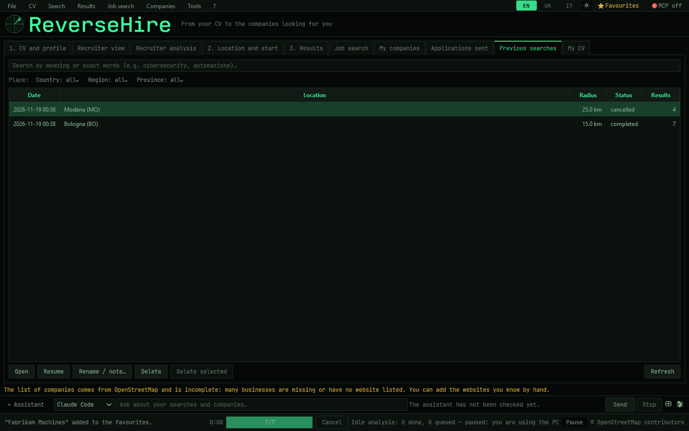

Every company search is saved. The **Previous searches** tab lists them, most recent first, with **Date**, **Location**, **Radius**, **Status** and **Results** (the number of companies saved). The columns sort by a click on the header (section 10), you can filter by place with **Place:** and find a search with the search box (it looks at the place, the CV file name, the sectors, the roles and the names of the companies found, by meaning and by exact words).

The status is:

- **completed** - the search finished;
- **cancelled** - you cancelled it, or it was stopped by an error (for example no company source answered);
- **running / interrupted** - it is running now, or the program was closed in an unusual way while it was running.

Select one or more searches, then:

- **Open** (or double-click the row) shows its results in the **3. Results** tab. The websites are **not** read again, so this is instant and works without Internet.
- **Resume** continues a **cancelled** or **running / interrupted** search (section 7.2). It is not available for a completed search.
- **Rename / note…** opens the window **Name and note of the search**: a **Name** (for example "Cesena, automation, second round") and a **Note**. They are saved while you type (there is no Save button); the name is shown in the **Location** column as "Name (place)" and the note in the tooltip of the row.
- **Delete** deletes the search and all its results after the question **Delete this search and all its results? This cannot be undone.** The cards of **My companies** and your favourites are kept.
- **Delete selected** (several rows selected with Ctrl or Shift) deletes them all after one question, **Delete the N selected searches and their results? This cannot be undone.** The **Delete** key does the same.
- **Refresh** reloads the list.

A right-click on a row opens a menu with the same commands (**Open**, **Resume**, **Rename / note…**, **Delete**, **Delete selected**); they are also in the **Results** menu.

While a search is running, **Resume** and **Delete** are disabled, and you can only open the search that is running (otherwise you see **Wait for the current search to finish (or cancel it).**).

The searches of the **Job search** tab have their own list of previous searches, inside that tab (section 7.5).

### 7.5 The Job search tab: postings and companies for a spontaneous application

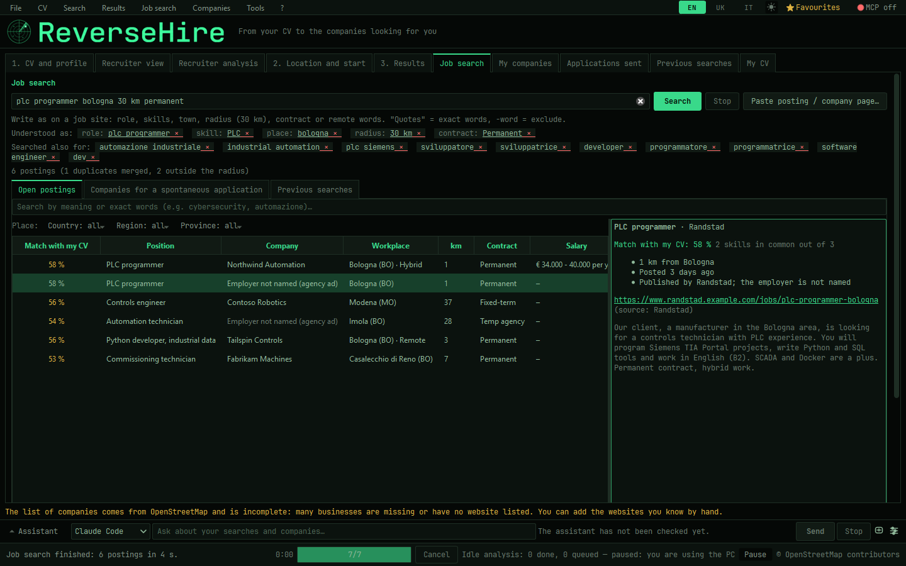

The rest of this step goes from your CV to the companies. The **Job search** tab (and the **Job search** menu, which repeats its buttons and adds **Job search settings…**) lets you also look for **postings** the way you would on a job site: you type what you want, the program asks the sources that allow automated reading and the results come back ranked against your CV. Below the search box there are **three lists**, as tabs inside the page:

1. **Open postings** - the postings found;
2. **Companies for a spontaneous application** - companies the program already knows that match what you typed even without an open posting (see below);
3. **Previous searches** - your earlier job searches.

The two ways of searching work together: from a posting you can create a company card with one click, and the postings your company searches already found are included in the results.

#### Writing the search

Type in the box as you would on a job site, for example `plc programmer bologna 30 km permanent`, and press **Search** (or Enter). The program understands:

- the **role** and **skills** (`plc programmer`, `python sql`);
- a **place** and a **radius** (`bologna 30 km`). With a town and no radius it uses 30 km; with `provincia di Modena` it uses the province and 40 km; a region or a country name (`Lombardia`, `Svizzera`) filters by area and has no radius;
- a **contract** (`permanent`, `tempo indeterminato`...), **working time** (full time, part time), **work mode** (`remote`, `smart working`...) and **seniority**;
- `"words in quotes"`, which must appear in the posting, and `-word`, which must not.

The contract, working time and work-mode words work as filters only on postings that state something different: a posting that does not say its contract is kept. Postings dated in the past (past their expiry date) are dropped.

**Honest limit on places.** The program recognises a town only from a short built-in table of well-known towns (69, mostly in Emilia-Romagna, plus the larger Italian cities), and provinces, regions and countries by name. It does not look the town up online when you type it. A town that is not in the table is not recognised: its name stays in the role words and no place chip appears. In that case search for the province (`provincia di Mantova`) or the nearest larger town, and read the **Understood as:** line before you press **Search**. The place of the postings found, on the other hand, is looked up online (at most 25 postings per search).

Under the box, **Understood as:** shows what the program made of your words, as small chips: **role**, **skill**, **place**, **radius**, **contract**, **hours**, **work mode**, **seniority**, **exact words** and **excluded**. The chips follow what you type, and the **role** chip shows the words **as they will be searched**: a typo that the program corrected appears already corrected (the line **Searched also for:** below says which). Click the value of a chip to correct it (type the new value and press Enter; an empty value removes the chip) or its **×** to remove it. The search then uses the chips as you left them.

**Searched also for:** shows the other ways the program will look for your words, each as a chip you can remove with its **×**: synonyms (`sviluppatore` for `developer`), the Italian and English names of the same thing (`sicurezza informatica` and `cybersecurity`), and mistyped words it **corrected** (shown as **cybersecurty (corrected)**; words shorter than five letters are never corrected). This works with local tables only, with no Internet. Removing a term ranks the postings already found again without asking the sources once more, and refreshes the list of companies for a spontaneous application.

#### Searching, stopping, and what the program does with the answers

**Search** starts the search; **Stop** cancels it and keeps what was found until then. The bottom bar shows the progress (done out of about so many steps, one for each source and then the ranking). When it ends, the status bar says **Job search finished: 6 postings in 4 s.** or **Job search stopped: … postings kept.**, and the line under the chips counts the postings found.

When the language model is installed, the postings are ranked **by meaning as well as by the exact words** (a posting whose words do not match but whose subject is close is kept, with the reason **Close in meaning to your search (estimate of the language model)**). A line above the list says which mode was used: **Ranked by meaning with the language model (an estimate) and by the exact words of the search.** or **Without the language model: only the exact words, the corrected typos and the synonyms are matched.**

At most 300 postings are kept. The same posting found on several sources is merged into one row (**Also on:** in the details).

#### The sources and their terms of use

Only sources whose **terms of use allow automated reading** are used. For each one the terms were read on **18 November 2026** (the date is recorded in the program), and the verdict is kept and shown in **Settings > Job search** next to the source (section 13). The sources:

| Source | What it is | Default |
|---|---|---|
| **Postings already found by company searches** | Postings saved by your latest ten company searches. Nothing is requested from the Internet. | On |
| **Pasted by you** | The postings you saved with **Paste posting / company page…** (see below). They are searched together with the other saved data, no request is made, and the **Source** column of a row says **Pasted by you**. | Always included |
| **My companies (job boards and careers pages)** | For the companies on your cards (up to 60): the public job-board interfaces of nine applicant-tracking systems (Greenhouse, Lever, Ashby, Workable, Recruitee, SmartRecruiters, Personio, Workday, BambooHR), when the card already holds the link to the board, and the careers page, only where `robots.txt` allows it. | On |
| **Randstad**, **Manpower**, **Synergie** | Staffing agencies: the program reads the agency's public sitemap (once a day, then conditional requests) and the structured job data that each posting page publishes for search engines, at most the number of pages set in **Limits** (20 by default) per search, slowly, honouring `robots.txt`. Their terms do not address automated reading (Randstad, Synergie) or forbid only harmful automation and unauthorised reproduction (Manpower): slow reading for your own search is neither. | On |
| **Adecco**, **Gi Group**, **Umana** | Staffing agencies whose terms forbid extracting content "by any means" (Umana: "including automatic" without written consent). | **Never**: listed greyed out, they can never be switched on and no request is ever made to them, whatever the settings say |
| **Adzuna**, **Jooble**, **Careerjet** | Official job-search services. They need **your own key** (request it from the service; Adzuna asks for an app id and a key), and their own terms apply. Adzuna requires the credit "Jobs by Adzuna", which the program shows. | Off, until you enter a key and tick them |

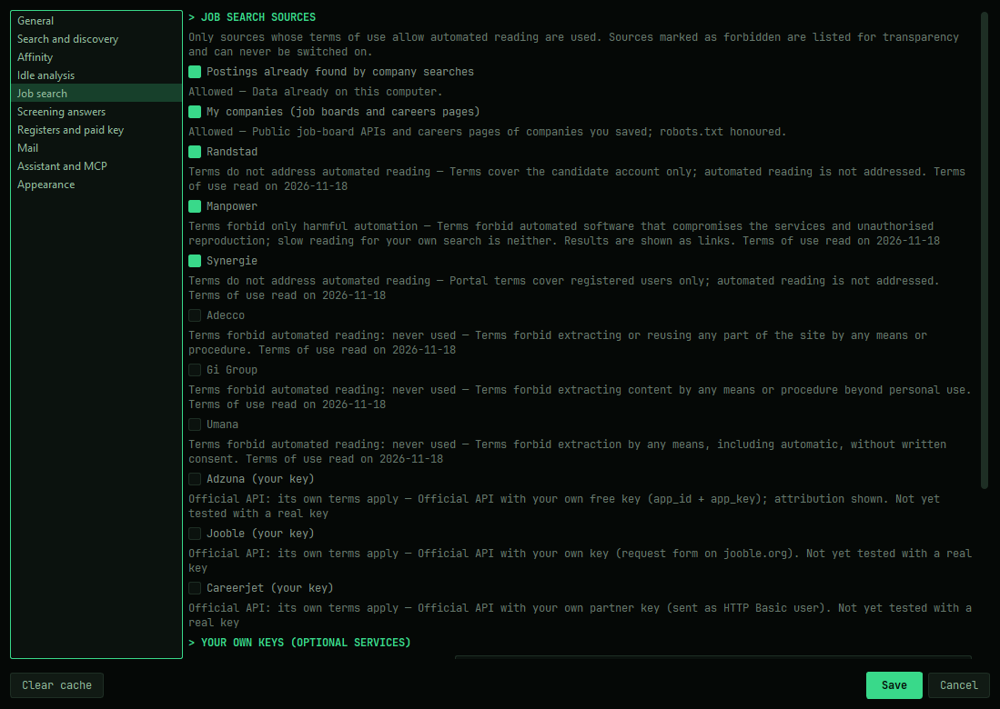

Below the sources, **Your own keys (optional services)** holds the Adzuna app id and key and the Jooble and Careerjet keys (hidden; tick **Show the key** to see them). The keys are kept in plain text in the settings file of this computer, never written to the log, and sent only to that service, together with your search words and the place. **Limits** sets the **posting pages read per agency and search** (1 to 100, default 20) and the time after which a slow source is stopped (10 to 900 seconds, default 120; what it found until then is kept).

**Two honest limits.** The keyed services have **never been tested with a real key**: they were written from the services' public documentation and checked with invented answers only, and the settings page marks them **Not yet tested with a real key**. The agency readers depend on those sites' public pages, which can change at any moment; a source that fails shows its state in the list below the postings and the search goes on without it.

#### List 1: open postings

Each posting is a row with **Match with my CV**, **Position**, **Company**, **Workplace**, **km**, **Contract**, **Salary**, **Posted** and **Source**; the table scrolls sideways and every header sorts it (first click ascending, second descending, section 10). A ★ before the title marks a posting you added to your favourites. In the **Company** column you read **Employer not named (agency ad)** when a staffing agency published the ad without naming its client (the agency is named in the details). Above the table you find the search box of the list (by meaning and exact words, with the sentence that matched shown as for companies, section 7.3) and the **Place:** filters (section 10).

- **Match with my CV** is the number described below. It is green from 60, amber from 35 and red below. Hover it for the skills in common and missing. While the numbers are being computed the cell shows **…**. Without a CV (tab 1) the postings are ordered by how well the title answers your search.
- **The default order** puts first the postings that are not blocked and have a known place, then orders them by a score made of: the match with your CV (65 %; without a CV, how well the posting answers your words), how well the posting answers your words (10 %), the distance (15 %, falling quickly beyond a few tens of kilometres; remote postings count as near) and how recent it is (10 %). Postings whose place cannot be worked out are listed after the others.
- The line above the table says how many postings were found, how many duplicates were merged and how many were left out because they are outside the radius.
- **The details** (right) show the position and the publisher, the match, the link, the first lines of the description and **why it is listed**: the skills in common, the title that matches, the distance, remote work, how recent it is, the salary when one is stated and a **Blocking requirement** when your CV contradicts a must-have.
- **The sources box** (bottom right) has one line per source, for example **Randstad: 1 found, 1 kept**, **Synergie: nothing found**, **Adecco: not used, its terms of use forbid automated reading**, **Adzuna (your key): needs your API key (Settings)**, or the reason a source failed or was too slow (**too slow, stopped after … s (… found)**).
- **Show on map** / **Show as table** switches the list to a map of the postings that have a place; markers can be clicked to select the row (section 12).

#### "Match with my CV"

The **Match with my CV** number (0 to 100) appears next to every posting: in this tab, in the list of job ads of the detail panel in tab 3 and in **Recruiter analysis** (section 8). It is computed on your computer from the text of the ad and the CV in use: **the more of the ad's skills your CV shows, the higher the number.** Each skill the ad names counts by its importance (must-have more than nice-to-have), by how clearly the CV proves it (named inside a dated job counts most, only in the skills list less, a related skill partly) and by how recent that experience is; a smaller part of the number rewards CV skills that the ad uses. A must-have that your CV explicitly contradicts (for example a language level) caps the number at 20. Hover a value for **n skills in common out of m** and the lists **In common**, **Partly** and **Missing**.

It is a different number from the **Match** of a company in tab 3: that one rates the *company* (fit, desirability and relevance); this one rates one *posting* against your CV. Without a CV the cell says **Read a CV (tab 1) to see the match with it.** It is an indication from a text comparison, not a verdict: an ad that does not list its skills gives few to compare, and then the cell may show **–** (**The match could not be computed for this posting.**).

#### Actions on a posting

Select a row, then use the buttons under the list (the same commands are in the **Job search** menu and in the right-click menu of the row):

- **Open the ad** (or double-click the row) opens it in your browser.
- **Create company card** builds a company card from the posting in **My companies**: the employer when the ad names it, otherwise the agency (tagged as an agency card), with the website found in the ad, and starts building the full card in the background (section 6). When the ad names neither an employer nor an agency no card is created and a notice says so.
- **Who might be behind this ad?** - only for agency ads without a named employer; see below.
- **Add to favourites** / **Remove from favourites** marks the posting: it keeps its ★ when you see it again in this list. (There is no separate list of favourite postings.)
- **Simulate screening** opens the **Recruiter analysis** tab with this posting as the target (section 8).

#### Previous job searches

The third tab, **Previous searches**, lists your earlier job searches (**Date**, **Search**, **Postings**, **Status**: running, completed, cancelled or failed, and **Note**). Choose one and click **Open search** (or double-click it) to see its postings again without asking the sources; **Rename / note…** gives it a title and a note, saved as you type; **Delete** removes the selected search and its postings after a question, **Delete selected (n)** removes several at once; the **Delete** key and the right-click menu do the same. They do not touch the company searches of section 7.4.

#### List 2: companies for a spontaneous application

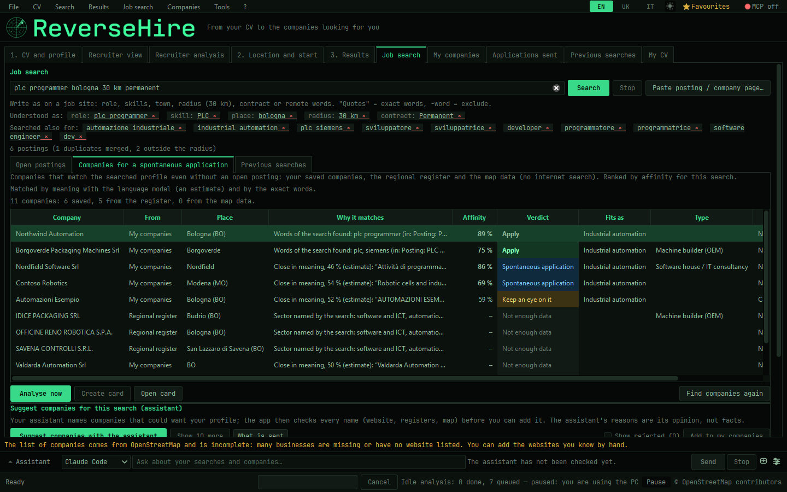

A posting is not the only way in: many companies would need your profile and never publish an advert. This list shows **companies the program already knows** that match the profile you typed, so that you can send them a spontaneous application. It uses no Internet search at all. The companies come from three places:

- **My companies**: every card you saved (whatever its place);
- **Regional register**: the register companies of the province or region of your search (section 11): the ones whose name or description has a word of your search (up to six words of at least four letters, with their equivalents, at most 60 companies per word) and the ones whose activity code falls in the sectors your words name (for example `plc` or `automation` name mechanical and electronic industry; `software` and `cybersecurity` name information technology), at most 150;
- **Map data (OpenStreetMap)**: the local map data, **only if it is already downloaded** (section 7.1), within the radius of your search (40 km when none was typed) or in the whole region when the search has no place; only entries whose name or tags contain a word of your search are looked at.

A company that is a card already is listed once, as a card. The companies are matched with the same engine as the search boxes: **the words of your search (or their equivalents) found in the stored text rank above a similarity of meaning, which is an estimate** (a meaning-only match counts from 45 % of relevance; a register company found only through its sector is kept with the reason **Sector named by the search**). At most 150 companies are listed.

Then the program judges each company with the **affinity** of section 5, for the career direction your search is closest to (the direction of **Settings > Affinity** whose name, roles or skills match your words; when none does, every direction counts). The list is ordered by that verdict first (**Apply** and **Spontaneous application** by value, then **Keep an eye on it**, **Not a fit**, **Not enough data**), then by exact words, then by relevance; until the affinity is ready you see **…**.

The columns are **Company**, **From** (**My companies**, **Regional register** or **Map data (OpenStreetMap)**), **Place**, **Why it matches** (**Words of the search found: plc, siemens (in: …)**, **Close in meaning, 46 % (estimate): “…”**, or **Sector named by the search: …**, always with its source), then **Affinity**, **Verdict**, **Fits as**, **Type** (section 7.3) and **Data**:

- **Card built** - the saved card has its data collected;
- **Not analysed yet** - the card exists but its data were never collected;
- **Not saved yet** - the company comes from the register or the map and has no card;
- **Analysis running…** - the card is being built.

Above the table the program says how many companies were found and from where (**11 companies: 6 saved, 5 from the register, 0 from the map data.**) and how they were matched (by meaning and exact words, or exact words only when the language model is missing). If nothing matches you read **No company known to the app matches this search. Try other words, or ask the assistant below.**

Buttons: **Analyse now** (creates the card when needed, then builds it), **Create card** (saves the company with where it came from and builds the card), **Open card**, and **Find companies again** (computes the list again; it also runs by itself after every search and after you remove a **Searched also for** term; if you only edit a chip, press **Find companies again**). A double-click opens the card or, when there is none, creates it. A right-click shows the same commands. A card created here carries the note **Found by the job search “…” in: … (date)** and the tags **job search** and **spontaneous**; the tax code, VAT number and activity code are copied from the register when it has them. Building the card reads the company website, so it needs the Internet and follows the rules of section 6.

**Suggestions from your assistant.** Under the list, **Suggest companies for this search (assistant)** asks your own assistant for companies that might want this profile; the app then checks every name (website, registers, map) before you can add it with **Add to my companies**, and the assistant's reasons are labelled as its opinion, not facts. What is sent first goes through the anonymised brief of section 4 (**What is sent** shows it before anything leaves your computer); the connection to the assistant is in section 16.

#### Sites the app does not read

Under the buttons, **Sites the app does not read:** has **Same search on LinkedIn** and **Same search on Indeed**. They only **open your browser** on that site's own search page with your role and place filled in. ReverseHire does not read, download or interpret anything from those sites and sends nothing there (Indeed is searched on its Italian site). This is not the same as the optional **Also search job boards (Indeed/LinkedIn)** setting of the company search (section 13), which is experimental and off by default.

#### "Paste posting / company page…"

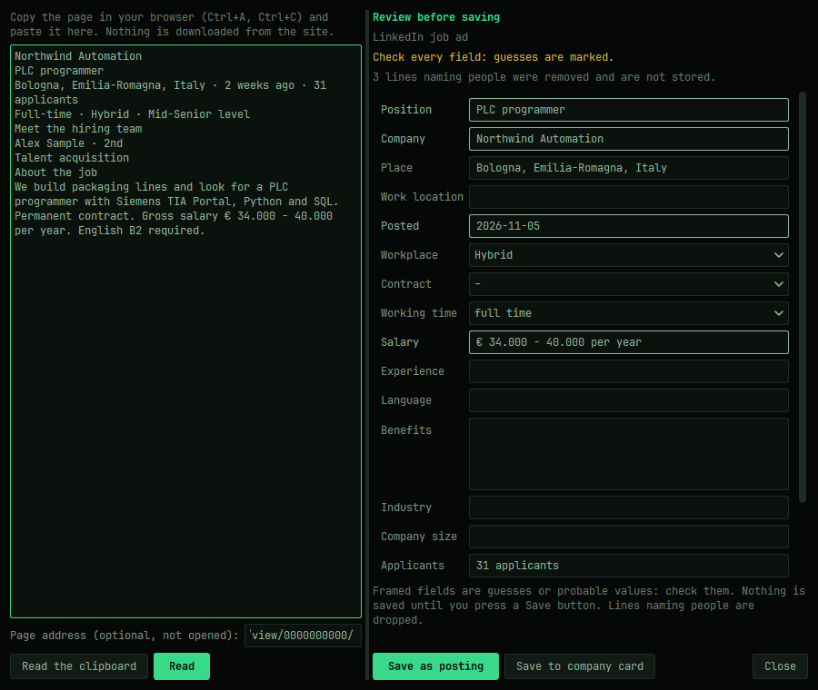

For a posting or a company page found on a site the program does not read, copy the page in your browser (**Ctrl+A**, **Ctrl+C**) and click **Paste posting / company page…** (in the tab, or **Paste a job ad or company page…** in the **Job search** menu). **Nothing is downloaded from the site**: you give the program the text.

1. Paste the page into the box (**Ctrl+V**), or click **Read the clipboard** (it also takes the formatting when the browser provides it). The **Page address** is optional and is **never opened**; it only helps to recognise the layout.
2. Click **Read**. The program recognises a LinkedIn job ad, a LinkedIn company page, an Indeed job ad or any other ad, and fills in the form on the right: position, company, place, date, work mode, contract, working time, salary, description and, for a company page, industry, size, website, headquarters and so on.
3. **Check every field.** A field framed in colour is a guess or a probable value (**read from a label** is reliable; **probable** and **guess, please check** are not). Correct what is wrong.
4. **Save as posting** stores the ad (it needs a position); **Save to company card** stores the company in **My companies** (it needs a company name), with a note saying it was pasted by hand and where from. **Nothing is saved until you press a Save button.**

**Lines that name people** (for example "Meet the hiring team" with the names under it, or connection lines such as "· 2nd") are **dropped and never stored**; the window says how many were removed.

**Honest limits:** the layouts of these sites were written into the program from knowledge of the sites' interfaces, not from real pastes, and the sites change them: expect to correct fields, especially the position and the place of a LinkedIn ad. The saved company card appears in **My companies** at once.

**Your pasted postings.** A posting saved with **Save as posting** is stored in the program's data folder and appears in the list of postings as a source, **Pasted by you**, when your search matches it. The button **Pasted postings (N)**, under the list of saved searches, shows all of them (it is greyed out while there is none). With one selected, **Edit pasted posting…** opens the paste window again with its fields, and **Delete pasted posting** removes it after the question **Delete this pasted posting? It cannot be undone.** Nothing is requested from the Internet to show them.

#### "Who might be behind this ad?"

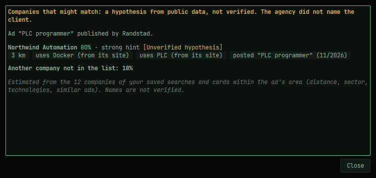

Many ads are published by an agency without naming the company that is hiring. For such an ad **Who might be behind this ad?** estimates which of the companies *you already have* could be the client, and always as a **hypothesis from public data, not verified**.

It looks only at data on your computer: the companies of your last five saved company searches and your company cards (technologies seen on their own sites and ads, similar job titles they published). For each company within about 25 km of the ad (40 km when only the province or the region is known; staffing agencies and the publisher are excluded) it adds up clues: **distance**, **same sector** or a compatible one, **uses the same technologies** (from its site), **posted a similar title** recently, a **CCNL** (collective contract) consistent with its activity, **size** and **similar wording** to its own ads. The result is a short list, each company with a percentage, a label (**strong hint**, **plausible**, **possible**), the clues as chips and the tag **Unverified hypothesis**, and always a line **Another company not in the list: …%**: the program keeps most of the probability for the unknown whenever only the distance speaks. It shows at most five companies, each at 10 % or more; when none reaches it, it says **No company of the local list stands out (each below 10%).** Without a place in the ad it says it cannot estimate. After this window the hypotheses also appear on the map of the postings, as a different kind of marker.

It never states a name as a fact, and the more companies you have saved around the ad, the better it can do. Use it to decide which companies to look at, not to contact anyone as if you knew.

## 8. Step 5 - Simulate the screening

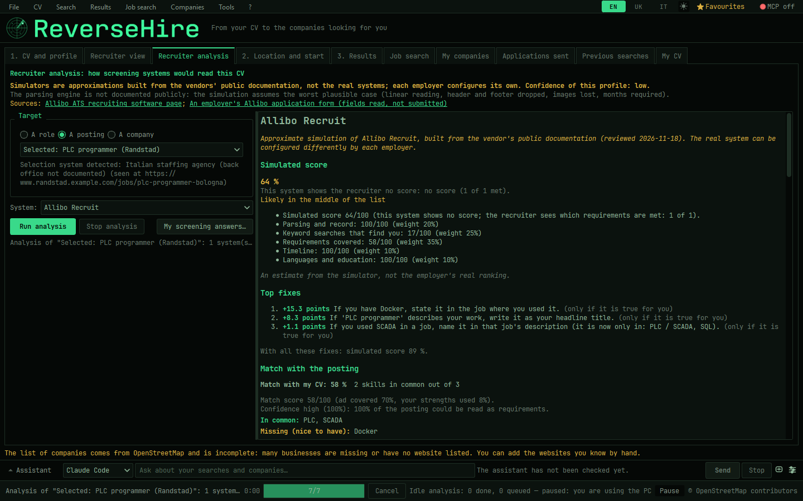

Many companies do not read your CV first: an applicant-tracking system (ATS) or a CV parser reads it, fills a candidate record, applies screening questions and sometimes puts a score or a rank on it. The **Recruiter analysis** tab runs **simulators** of those systems on the CV you loaded in tab 1, against a role, a posting or a company that you choose, and shows what each step would do with your file. It tells you what to expect and what to fix. Everything runs on your computer; nothing is sent anywhere.

The tab is different from the **Recruiter view** tab (section 3), which gives general advice on how a recruiter reads your CV. **Recruiter analysis** is about one named screening system and one target.

**Please read this first: the simulators are approximations.** They are built from what the vendors publish (documentation, help pages, public application forms), not from the real systems, and every employer configures its own system differently. The banner at the top of the tab says so, and shows the **confidence of the profile**, a short note on what is and is not documented, and the sources it was built from (the links under **Sources:** open in your browser). Of the 20 profiles that come with the program, **none has high confidence**: 7 are medium and 13 are low. A low profile rests on little public documentation (for example the Allibo profile: the parsing engine is not documented publicly, so the simulation assumes the worst plausible case). Use the result as a checklist of things that *can* go wrong, not as a prediction of what a given employer will do. The profiles are kept in a data file (`recruiter_sim/data/profiles.json`, reviewed on 18 November 2026) so that they can be corrected without changing the program. Each result page repeats the reminder: **Approximate simulation of ..., built from the vendor's public documentation (reviewed ...). The real system can be configured differently by each employer.**

### 8.1 Choosing the target and the system

1. **Target** - what the CV is screened against:
   - **A role**: type the role (for example `PLC programmer`) in **Role:** and, optionally, the **Skills asked:** separated by commas. The field is filled with the first role of your CV.
   - **A posting**: choose one from the list. It holds the postings of the search shown in **3. Results**, those of **Job search**, and the ones you pasted (the entries start with **Results:**, **Job search:** or **Pasted:**); with nothing to choose the list says **No postings yet: run a search, a job search or paste an ad**. You can also arrive here with the **Simulate screening** button of a posting (in **3. Results** and in **Job search**), which fills in the target for you and says **Recruiter analysis prepared: press Run analysis.**
   - **A company**: choose a company card of **My companies**. The tab shows **Selection system detected: ...** when the card says which system the company uses, and screens the CV against the first posting on the card that has a text to compare (the tab says **Screened against its posting "..."**). When the card has no posting with a text, the first role of your CV is used and the tab says so. The company card also has a link, **Simulate this system on my CV**, that opens this tab with the detected system already chosen.
2. **System** - the simulator to use: the **detected** one (when there is one, shown as **Detected: ...**), any of the 20 profiles, or **Compare all systems**. The profiles are: Allibo Recruit, Zucchetti InRecruiting (Inda), Textkernel family, RChilli family, Workday Recruiting with HiredScore, SAP SuccessFactors Recruiting, Oracle Recruiting Cloud / Taleo, SmartRecruiters (Winston Match), Greenhouse (Talent Matching), Ashby, Workable, Personio, Teamtailor, iCIMS, Recruitee, Bullhorn Amplify (staffing agencies), an Italian staffing agency, Arca24 Skillskan, **E-mail to HR (no ATS)**, and a **Baseline literal ATS** that reads the text literally, with no synonyms. When the target gives no detected system, the tab says **No known selection system detected for this target: choose one, or use the baseline.**
3. **My screening answers...** opens the page of the settings where you save your truthful answers to the usual knock-out questions (section 13). The simulators use them instead of guessing from the CV.
4. **Run analysis** starts it; **Stop analysis** cancels it (**Analysis stopped.**). The progress is shown in the bar at the bottom of the window (**Recruiter analysis N/M steps ...**); one system takes ten steps, so **Compare all systems** takes twenty times as many. If you change the CV or the target afterwards, the tab only says **The CV or the target changed: press Run analysis to update the result.**: the old result is kept until you run it again. Messages when something is missing: **Read a CV first (tab 1).** and **The target is incomplete: type a role or choose a posting or a company.**

### 8.2 One system: what you see

For one system the result is a page, with these parts from top to bottom.

- **Simulated score.** A big percentage, for example **64 %**, **always from 0 to 100 %**, whatever the system shows to the recruiter. Under it, a note on **the system's own scale** (**This system shows the recruiter grades A-D: grade B.**, **...a rating out of 5 (stars): rating 3.2 of 5.**, **...High / Medium / Low**, **...a percentage**, or **...no score: ... 1 of 1 met**: some systems show no score, only the requirements that are met), and a **rank band**: **Likely near the top of the list** (70 % or more), **Likely in the middle of the list** (45 % or more), **Likely near the bottom of the list**, **At risk: a recruiter checking the screening points would likely reject** or **Likely rejected automatically by a knock-out question**. Then the explanation: five parts with their weights (**Parsing and record**, **Keyword searches that find you**, **Requirements covered**, **Timeline**, **Languages and education**; the usual weights are 20, 25, 35, 10 and 10 %, and a profile may change them; a part that cannot be assessed is left out and the others are scaled up). A knock-out that the system would apply automatically can cap the score, and the page says so. The part ends with **An estimate from the simulator, not the employer's real ranking.**
- **How the percentage is made.** The program always computes one score from 0 to 100 and shows it first. The system's own scale is then only a different way of showing the same number: letters A-D use the middle of each band (A is 87.5 %, B 65 %, C 45 %, D 17.5 %), stars are the points times 20, High / Medium / Low are 85, 55 and 20 %. A system that shows no score (or only the criteria met) still gets a simulated percentage here, with the note that the recruiter does not see it.
- **Top fixes.** Up to five edits of your CV, each with the **points** it would add to the simulated score, for example **+15.3 points If you have Docker, state it in the job where you used it.** Fixes that depend on a fact about you are marked **only if it is true for you**: ReverseHire never suggests writing something false. A line sums up **With all these fixes: simulated score ... %.** When nothing would raise the score you see **No edit of the CV would raise the simulated score.**
- **Match with the posting.** The same skills comparison as the **Match with my CV** column (section 7): the score, then the skills **In common**, **Partly**, **Missing (must-have)**, **Missing (nice to have)**, **Not stated in the CV** and **Your other strengths**.
- **The screening steps, in order.** One card per step, in the order a recruiter's tool goes through them: **Reading the file**, **Fields filled automatically**, **Knock-out questions**, **Findability in keyword searches**, **Match with the role**, **Timeline**, **Seniority and recency of skills**, **Languages, degrees, certifications**, **Format for this system** and **Generated-text estimate**. Each card says **What recruiters do:**, **What we found:** (with the CV line, the posting line, the file or your answer it is based on) and **Fix:**, and is marked with a status: ✓ **OK**, ▲ **Check**, ✗ **Problem**, ● **Not determinable** (not enough information to judge). The **Generated-text estimate** is a statistical guess about the style of the writing, not proof, and the card says that no major ATS documents such a detector.
- **What the recruiter sees.** The candidate record as the system would fill it **from your file (simulated)**: name, e-mail, phone, town, current title, current employer, job dates, degree, languages, skills, the CV file and the professional area. Each field is marked **read**, **garbled**, **missing** or **lost by the parser**, followed by the positions and skills read and the start of the text as parsed. It is the quickest way to see, for example, that a two-column layout or a table loses your dates, or that a scanned page is not read at all by a system without OCR.

If the local language model is not available, the page says **No embedding model available: the semantic match was replaced by a lexical match with synonyms.** The result is then rougher, but it is still produced.

**The knock-out step.** The questions are inferred from the posting (years of experience, language, degree, licence, own car, travel, right to work, distance, relocation, availability, salary, shifts, must-have skills). For each one the program uses **your saved answer** first, then what the CV shows. When neither says anything the step reports **unknown** and advises you to save an answer in the settings: **silence is never counted as a failure.**

### 8.3 Compare all systems

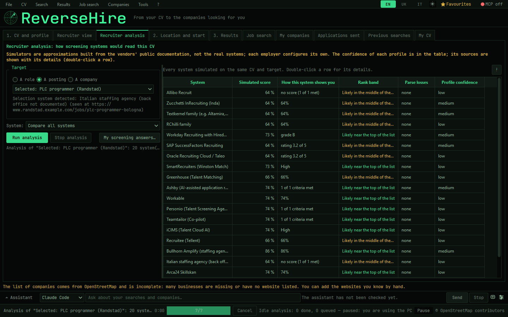

With **Compare all systems** the result is a table, one row per simulator, all run on the same CV and target. The columns are:

- **System**;
- **Simulated score** - the percentage from 0 to 100, **the same measure for every system**, so that the rows can be compared and sorted. It is still a simulation (point at the cell for the explanation);
- **How this system shows you** - what the recruiter actually sees on that system, on its own scale: a percentage, grade A-D, stars, High / Medium / Low, **N of M criteria met**, or **no score (N of M met)**. Point at a cell for a plain-words tooltip, for example **This system uses letters A-D (A is the best).**;
- **Rank band**;
- **Parse losses** - **none**, or the number of fields of the record the system would lose or garble (the tooltip lists them);
- **Profile confidence** - **low** or **medium**.

The **?** button above the table opens a short help window, **What the two score columns mean**. A click on a header sorts the table (section 10), and every column has a filter. **Double-click a row** to open the page of that system as described in section 8.2. The table is most useful for spotting what *every* system penalises: that is where an edit pays off most. Remember that the rules behind each profile differ and that the profiles with low confidence rest on little documentation, so do not read much into differences of a few points between two systems.

### 8.4 What this tab cannot tell you

- It cannot say what a particular employer's configuration does. Vendors document what their products *can* do, and employers switch features on and off.
- The profiles with **low** confidence rest on little public documentation; take their output as a rough hint. No profile has high confidence.
- The semantic and "AI-assisted" systems are simulated with ReverseHire's own rules and its local embedding model (word matching with synonyms when the model is not available), not with the vendors' models.
- It uses your **truthful** answers to the knock-out questions; without them the questions that the CV does not settle stay "unknown".
- A better simulated score does not mean you will be invited to an interview, and a low one does not mean you will be rejected. The percentages are an aid for deciding what to fix first, not a promise.
- The profiles were last reviewed on 18 November 2026. Vendors change their products; a profile can be out of date.
- The program does not compare the simulation with the real decisions of a real system: no real ATS was available to check it against.

## 9. Step 6 - Apply and track

The last step is to send your application and to remember what you sent. ReverseHire helps with three things: it prepares a **draft e-mail** (section 9.1), it produces a **document** with the letter, your CV and a private reminder card (section 9.3), and it keeps a **record of each application** in the **Applications sent** tab (sections 9.4 to 9.9). **ReverseHire never sends anything.** You press Send in your own mail program, or upload your CV on the company's site yourself; the program only prepares and remembers.

### 9.1 Writing an application e-mail

ReverseHire prepares a **draft** e-mail to a company, with your CV attached when the mail program allows it. **It never sends anything**: it opens a draft in your mail program, you read it, and you press Send yourself.

**First, in the settings (once).** Open **File > Settings...**, page **Mail** (section 13):

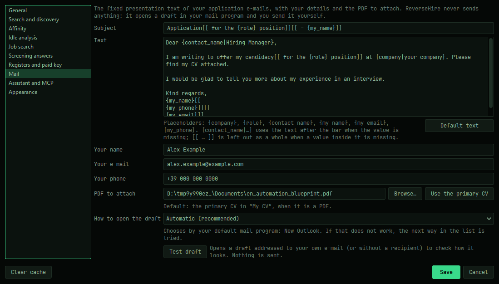

1. Check the fixed text of your application e-mail: **Subject** and **Text**. They contain placeholders in braces that are filled in for each company: `{company}`, `{role}`, `{contact_name}`, `{my_name}`, `{my_email}`, `{my_phone}`. `{contact_name|Hiring Manager}` uses the text after the bar when the value is missing; `[[ ... ]]` is left out as a whole when a value inside it is missing. A placeholder that does not exist is removed and listed (**Unknown placeholders, removed from the message: ...**). **Default text** puts back the standard text of the interface language (English, Italian and Ukrainian have their own).
2. Fill in **Your name**, **Your e-mail** and **Your phone** (used only in the draft; an e-mail that does not look like an address is refused).
3. **PDF to attach** is the CV that goes with the draft. By default it is the primary CV of **My CV**, when that is a PDF; **Use the primary CV** puts it back (the page says **There is no PDF version in "My CV".** when there is none), **Browse...** chooses another file. The page warns if the file does not exist (**File not found: ...**).
4. **How to open the draft** (see below). **Automatic (recommended)** chooses by your default mail program.
5. **Test draft** opens a draft to your own e-mail address (or with no recipient) with an example company, to check how it looks. Nothing is sent.

**A note on `{role}`.** The window that writes the e-mail does not know which job you are applying for, so `{role}` is **left empty** and the parts of the text between `[[` and `]]` that need it disappear (in the standard text, "for the ... position" and the same words in the subject). If you apply for a specific posting, type the job title into the subject or the text of that message yourself.

**Then, for each company.** Select the company in **Results**, **Favourites** or **My companies** and click **Write e-mail...** (it is also in the **Results** and **Companies** menus, in the detail panel of a result and in the Favourites window). The window **E-mail to ...** opens:

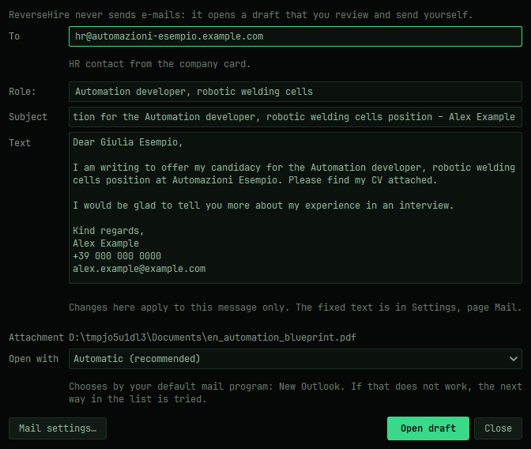

- A line at the top says **ReverseHire never sends e-mails: it opens a draft that you review and send yourself.**
- **To** is filled in from the card: the **HR contact** first, then another contact, then the company's e-mail address; a privacy mailbox is never chosen. A line under the field says where the address comes from (**HR contact from the company card.**, **Contact from the company card.**, **E-mail address of the company.**), or **No address found: write it, or leave it empty and add it in your mail program.** You can edit it; an address that does not look like an e-mail address is refused (**"..." does not look like an e-mail address.**).
- **Role** is filled in for you: the title of the posting when the e-mail answers a posting, otherwise the first role of your profile. You can edit it; it is the {role} of the texts, and while the subject and the text are as they were produced they follow the role you type here.
- **Subject** and **Text** come from your fixed text; you can change them here **for this message only** (**Changes here apply to this message only. The fixed text is in Settings, page Mail.**). If you use the **Into the e-mail** button of the affinity box on the card (section 5), its talking points are inserted here as a paragraph before the closing lines.
- **Attachment** shows the PDF that will be attached (**No PDF set (Settings, page Mail).** when none, with a warning if the file is missing).
- **Open with** chooses how the draft is opened. **Open draft** opens it (opening a mail program can take some seconds: **Opening the draft...**); the window then says what happened and what you still have to do, for example **Check the message in ... and press Send yourself.** A company with no saved card can still get a draft.
- **Mail settings...** opens the Mail page of the settings. **Close** closes the window. Only one such window is open at a time.

**The ways to open the draft.** The list shows only what your computer has; if the way you chose fails, the next one is tried automatically, and the last one always works.

| Way | What it does | Attachment |
|---|---|---|
| **Classic Outlook** (Windows) | Opens a new message in the Outlook program, with recipient, subject, text and the PDF. | Attached automatically |
| **New Outlook** (Windows) | Creates a draft file with the text and the PDF and opens it **with new Outlook itself**. The draft is also kept in the **Drafts** folder of your account: if you close the message without sending it, you find it there. | Attached automatically |
| **Thunderbird** | Opens a new message with the PDF. | Attached automatically |
| **Apple Mail** (macOS) | Opens a new message with the PDF; the first time macOS asks whether ReverseHire may control Mail: allow it. | Attached automatically |
| **Desktop mail program** (Linux) | Opens a new message in the default mail program. | Attached if that program supports it (Thunderbird, Evolution and KMail do; webmail does not) |
| **Default mail program** | A `mailto:` link: recipient, subject and text only. The folder with the PDF opens so you can drag the file in. | By hand |
| **Gmail in the browser** | Opens the Gmail compose window (you must be signed in). A Gmail link cannot carry an attachment: the folder with the PDF opens so you can drag the file in. A very long text is shortened in the link and copied in full to the clipboard. | By hand |
| **Draft file (.eml)** | Creates a draft file and opens it with the program set for `.eml` files (classic Outlook, new Outlook and Thunderbird open it as a draft with the PDF). | Attached by those programs |
| **Copy the text and attach by hand** | Copies the text to the clipboard and opens the folder with the PDF selected; you open a new message, paste and drag the file in. | By hand |

Classic Outlook needs the Windows component **pywin32**, which is installed with the program on Windows. If a way needs a step from you, the window lists it, for example **Attach the PDF: drag ... from the folder window that opened into the message.**

**What was tried and what was not.** The ways to open a draft were written against the documentation of each program, and the tests of the project replace the mail programs with stand-ins, so none of them has been checked automatically against the real program. As far as this documentation can say, they have **not been tried on every combination of Windows, macOS, Linux and mail program**; the Apple Mail way and the Linux desktop way in particular have not been confirmed on a real Mac or a real Linux desktop. If one fails, choose **Copy the text and attach by hand**: it always works.

### 9.2 What the program does and does not do with an e-mail

- it only **opens** a draft; it has no way to send anything, and no account or mailbox is read;
- the log records the way used, the **domain** of the recipient and the **file name** of the attachment, never the text of the message;
- the draft file that some ways create (and the PDF inside it) stays in a temporary folder of your computer, because the mail program reads it later (section 18);
- once a draft was opened, the program writes a **draft record** in **Applications sent** (section 9.5). That record is also made when the way used was only "copy the text": the program cannot know whether you will send the message, so the record starts as **Draft** and **you** mark it as sent.

### 9.3 Exporting: the results, a company card or an application

**The results as a spreadsheet (CSV)** are described in section 7.3 (File > Export CSV).

**A company card or an application.** **File > Export** has two entries:

- **Export company card...** - the whole card of a company (the nine sections of section 6.4) as a document;
- **Export application...** - a ready-to-send **application**: the **letter** (the same text as the e-mail of section 9.1, for that company, with your name, e-mail and phone as the sender lines), then your **CV** (the PDF set in the Mail page of the settings; its pages follow the letter), and the company card as a **private appendix** marked **PRIVATE REMINDER: NOT TO BE SENT**, so that you keep the notes about the company next to the application without sending them. The letter has the same limit as the e-mail: `{role}` is left empty (section 9.1).

Select a company first in **Results**, **My companies** or **Favourites** (otherwise you see **Select a company in Results, My companies or Favourites first.**). The entries are greyed out when no company is selected.

A **Preview** window opens first, so you see exactly what will be produced:

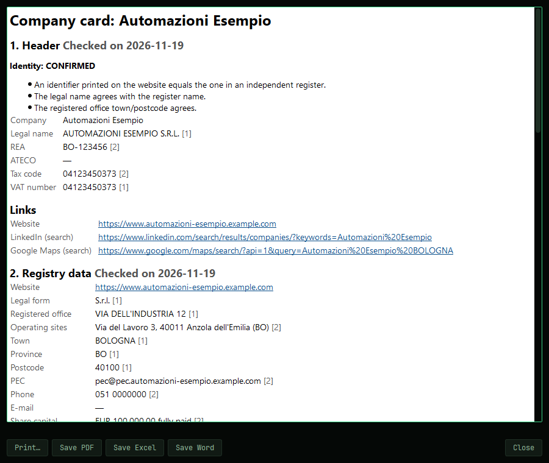

- **Print...** - sends the document to the default printer (**Sent to the printer.**; without a printer you see **No default printer is available.**). For an application the CV pages are printed after the letter.
- **Save PDF** - one PDF file. In the application, the letter pages come first, then the pages of your CV as they are, then the private appendix.
- **Save Excel** - an `.xlsx` workbook, one sheet per section (columns **Field**, **Value**, **Source**, **Link**) and a **Sources** sheet with the numbered notes. For an application there are also the sheets **Letter** and **CV**. A value that starts with "=" is stored as text, never as a formula.
- **Save Word** - a `.docx` document.
- **Close** closes the preview.

A file dialog asks where to save (the suggested name is `company-card-` or `application-` followed by the company name, with the extension of the format). The status line says **Saved: ...**, or **Export failed: ...** with the reason. In every format each value that has a known source carries a numbered note with the source name and link, a field that is unknown stays blank (**-**), and the footer says **Created with ReverseHire on ...**. The chart of the financials is included as a picture in the card.

**Recorded as a draft application.** When you **save** an application in any format, or **print** it, the program also writes a **draft record** in **Applications sent** (section 9.5). Saving the same application as PDF and then as Word does not make two records. Exporting a company card does not record anything.

### 9.4 The "Applications sent" tab

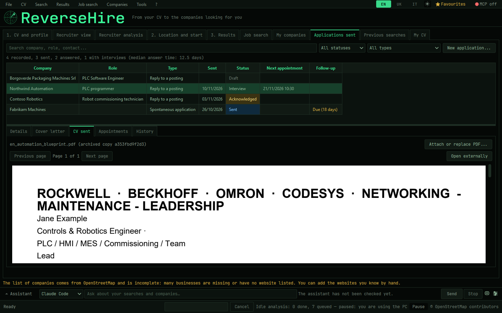

**Applications sent** is your own logbook of the CVs you sent: to whom, when, with which letter and which file, what happened next, and when you should ask again. It is **a notebook that you keep**: the program cannot see your mailbox or the company's site, so it does not know whether an e-mail was sent or answered. Statuses change only when **you** change them (or when you press **Mark as sent**).

The tab opens its own file when the program starts; for a moment it can say **Opening the applications file...**. Everything is kept on your computer (section 18): a small database, `applications.sqlite`, and the copies of the CV files you sent, in the `applications` folder of the data folder. If the file cannot be opened the tab says so (**The applications file could not be opened (...)**) and the rest of the program works as usual.

**The list.** One row per application, with the columns **Company**, **Role**, **Type** (**Reply to a posting** or **Spontaneous application**), **Sent**, **Status**, **Next appointment** and **Follow-up**. A header click sorts the list (dates by their value, statuses in their natural order, blanks last; section 10). Above the list: a search box (**Search company, role, contact...**), a filter for the status (**All statuses**) and one for the type (**All types**), and **New application...**. Under them a summary line: **N recorded, N sent, N answered, N with interviews (median answer time: N days)**. These numbers count only what you recorded. The statuses are coloured. With no record the tab says **No applications recorded yet. Use "New application" to add the first one.**

**The search box** finds applications by **exact words** (case and accents do not matter; every word you type must appear somewhere in the company, role, recipient, contact, subject, letter or notes). Unlike the other lists of the program (section 10) it does **not** search by meaning.

**The statuses** are **Draft**, **Sent**, **Acknowledged**, **Interview**, **Offer**, **Rejected**, **No answer** and **Withdrawn**. A new record made by the program is a **Draft**. **Mark as sent** (right-click menu, **Companies > Applications** menu) sets the status to **Sent** and, when the record has no date yet, the date to today; setting the status to **Sent** by hand without a date does the same. **Change status** in the right-click menu offers all eight.

**Below the list**, five tabs show and edit the selected application. What you type in **Details** and **Cover letter**, and every change of status, is saved automatically a moment after you stop typing. **Undo last change** (in the **Companies > Applications** menu) takes back the last of these changes, up to fifty in a row.

### 9.5 How a record is created

There are three ways.

1. **From the e-mail window** (section 9.1). When **Open draft** works (or only the "copy the text" steps were done), the program records a **Draft** for that company with the recipient, the subject, the text as it stands in the window and a **copy of the PDF** that was attached. The note in the e-mail window says **Recorded in Applications sent as a draft: ... Mark it as sent once you have sent the e-mail.** The record's **Role** is empty (the window does not know the job) and its **Type** is **Spontaneous application**: open the **Details** tab and fill in the role, the link and the type when you reply to a posting.
2. **From "Export application..."** (section 9.3), when you save or print it: a **Draft** with the letter text and the CV, **Sent through** set to **Other**, and no recipient.
3. **By hand**, with **New application...** (or **New application for this company...** in the box on the company card). The window asks for the **Company** (pick one of your cards or type a name; a name is required), **Reply to a posting** or **Spontaneous application**, **Role / posting title**, **Posting link**, **Sent through** (**E-mail**, **Company site / form**, **Agency**, **LinkedIn**, **Other**), **Recipient e-mail**, **Contact person**, **Date sent** (today), **Status** (**Sent**), the **CV PDF sent** (pre-filled with the PDF of the Mail page; **Browse...** changes it), **CV language**, **Subject**, **Cover letter** (paste it exactly as sent, or **Load letter from a text file...**) and **Notes**. Use this for applications you made outside the program, for example through a company form.

**You never get two records for the same thing by mistake.** When the program records a draft and finds an earlier record for the **same company and the same role** within the last **60 days**, it keeps the earlier one and tells you **Already in Applications sent: ... (no second record created).** Because the e-mail and the export leave the role empty, a second e-mail to the same company within 60 days is therefore **not** recorded separately (opening the very same draft again just updates the first record). If you really want a second record, create it with **New application...**: the window asks **There are already N application(s) to ... for the same role in the last 60 days. Record this one anyway?**

On the company card, the box **Applications to this company** lists up to six of its records (**sent on ...** or **not sent yet**, and **next appointment ...**) with **Open in Applications sent** and **New application for this company...**.

### 9.6 The five detail tabs

- **Details** - **Company** (with **Open company card** when it is one of your cards), **Role / posting title**, **Type**, **Posting link** (with **Open link**), **Sent through**, **Recipient e-mail**, **Contact person**, **Date sent**, **Status**, **Follow up on** (a date, **Clear the date** empties it), **CV language**, **Notes**, and **Record**: **Entered by hand**, **From an e-mail draft** or **From an exported application**.
- **Cover letter** - the **Subject** and the text. For an application that is no longer a draft the text is **locked**, because it is **the text exactly as it was sent**; press **Edit** to change it. **Copy** puts the text on the clipboard.
- **CV sent** - the name of the PDF and the first twelve characters of its fingerprint (**archived copy ...**), and an embedded **preview** of the archived PDF with **Previous page** / **Next page** (**Page 1 of 3**) and **Open externally**. The preview shows **the file exactly as it was when the record was made**, so later changes to your CV, or deleting the original, do not change what you see here. **Attach or replace PDF...** replaces the archived file; for an application already sent it first asks **This application was already sent. Replace the archived CV with another file?** The preview messages are **No preview.**, **The archived file was not found.** and **The PDF cannot be shown.**
- **Appointments** - see section 9.7.
- **History** - a table **When / Who / What / Change** of the changes of status, date sent, type, channel, follow-up date, CV file and cover letter (for the letter only that it changed and its length, not the text). **Who** says **You**, **Program**, **E-mail draft** or **Import**.

### 9.7 Appointments, the calendar file and follow-ups

**Appointments.** In the **Appointments** tab (or with **Add appointment**), **Add** creates an appointment tomorrow at the next full hour; you then edit it: **Type** (**Phone call**, **Video call**, **On-site interview**, **Technical test**, **Other**), **Start** (date and time, with the time zone as a UTC offset, preset to your own), **Duration** (in minutes), **Place or link**, **People met**, **Notes**, **Outcome** (**Pending**, **Positive**, **Neutral**, **Negative**, **Cancelled**) and **Reminder** (**none** or a number of minutes before). The next appointment of each application appears in the list, in the column **Next appointment**. **Delete** removes the selected appointment after a question.

**The calendar file.** **Add to my calendar (.ics)** saves a standard calendar file (`.ics`) for the appointment, with the type and the application as title, the place, the people, the notes, the posting link and the reminder. Open the file and your calendar program (Outlook, Google Calendar and others) adds the event. **ReverseHire never talks to a calendar service:** it only writes the file, and a later change of the appointment in ReverseHire does not change the event that you already imported.

**Follow-ups.** The **Follow-up** column tells you which applications to chase:

- an application with the status **Sent**, no answer, and **10 working days** (Monday to Friday, public holidays are not counted) since the date sent shows **Due (N days)**;
- if you set a date in **Follow up on**, the column shows that date, and the application is due from that day (an application with such a date is not flagged earlier).

Only the statuses **Sent**, **Acknowledged** and **Interview** are watched. The 10 days are fixed in the program and cannot be changed in the settings. When the program starts, a notice in the status bar says how many follow-ups are due and how many appointments are today or tomorrow (**Applications sent: follow-ups due: 2, appointments today: 1. Click here to open them.**); a click opens the tab. The program does not remind you while it is closed and does not send e-mails or notifications by itself.

### 9.8 Exporting, importing, deleting

- **Export this application...** (right-click menu, **Companies > Applications** menu) asks for a folder and creates a new sub-folder in it, named after the company, the role and the date, with: `cover_letter.txt` (subject and letter), `notes.txt` (the details, the notes and the appointments), the **CV PDF as sent**, any further archived files, and `appointments.ics` when there are appointments.
- **Export all to CSV...** writes the whole logbook (without the files) as a spreadsheet file with a byte-order mark so that Excel reads the accents. Text that would start like a formula is protected.
- **Import from CSV...** adds the rows of a file made by **Export all to CSV...** (or by hand with the same column names). Rows without a company name, and rows identical to an existing record (same company, role, date sent and recipient), are skipped; unknown values are replaced by defaults. The status bar says **CSV imported: N added, N skipped.**
- **Delete...** (right-click menu) deletes the application with its appointments and history, after the question **Delete the application "...": ... The archived CV and attachments are removed too if no other record uses them. This cannot be undone.** **Undo last change** does not bring back a deleted application, and it does not cover appointments or the CV file.

All the actions are also in the **Companies > Applications** submenu, with one entry for every button of the detail tabs.

### 9.9 Limits of the logbook (honest)

- **The program does not know what you really sent.** A **Draft** made from the e-mail window only means that a draft was opened (or that you used the copy-the-text way). Whether you pressed Send, and whether the text was changed in your mail program afterwards, is only what you tell it.
- **The record from the e-mail window keeps the text as it stood in that window** at that moment, with the PDF that was attached then. Changes you made in the mail program are not seen.
- **The role stays empty** in the records made from the e-mail and from the export, and a second application to the same company within 60 days is not recorded separately (section 9.5). Fill in the role yourself.
- **No answer is detected.** Answers, interviews and offers appear only when you change the status; the summary line and the median answer time are computed from what you entered.
- **No calendar, no mailbox, no reminders outside the program.** The follow-up rule is fixed (10 working days, Monday to Friday) and ignores public holidays; the notice appears only at start-up.
- **The search of this tab is by exact words**, not by meaning.
- **The data model can keep further archived files** per application (a certificate, a portfolio) and exports them, but **there is no button in this version to add them**.
- **The calendar file follows the iCalendar format but has not been verified against every calendar program**; appointments across time zones and daylight-saving changes in particular were not checked in a real calendar.

## 10. Tables: sorting, search by meaning, right-click menus, Country / Region / Province selectors

Almost everything in ReverseHire is a table: the results, your companies, your favourites, the postings of the **Job search** tab, your previous searches, the **Applications sent** tracker and the lists of the Register manager. They all behave in the same way, because the same code gives them the same four helpers: **sorting by the column header**, **one search box that understands meaning**, **a right-click menu** and, for the lists of companies and postings, **place filters** (Country, Region, Province).

### 10.1 Sorting: click a column header

1. Click the header of a column: the table is sorted by that column, **ascending**, and a small arrow appears in the header.
2. Click the same header again: the order is reversed (**descending**).
3. Click another header: the table is sorted by that column, ascending.

How values are compared (the same rules everywhere):

- **Numbers are compared as numbers**, not as text: "9 %" comes before "10 %", which comes before "100 %"; "2 km" before "10 km". A range such as "30.000–40.000 €" is placed by its lower value. Both "12,5" and "12.5" are read as a decimal number.
- **Dates are compared as dates**: both `2026-11-18` and `18/11/2026` are understood, and an older date comes first in ascending order.
- **Text is sorted alphabetically**, ignoring capital letters and accents ("Élite" lies between "Delta" and "Fabbro").
- When one column mixes the three kinds, numbers come first, then dates, then text.
- **Empty cells always go last**, in both directions (a dash, "?" or "n/a" counts as empty). So sorting by **Salary** never hides the postings with a salary under the ones without.
- Rows with the same value keep their previous relative order.
- A column that only holds an icon (for example the star of the favourites) has nothing to sort and ignores the click.

Some more things you will notice:

- **The selected row stays selected**: after the table is re-ordered, the same company or posting is still the current one, and buttons such as **Open card** keep working on it.
- **The order survives refills.** While a search is running and new companies arrive in **3. Results**, the table keeps your chosen order and puts the new rows in their place. The program remembers the order of each table **until you close it** (it is not saved to disk).
- **The default order is still there.** Before you click any header, each list uses its own default order (for example **3. Results** is ordered by the affinity verdicts when they exist, else by the match score; a search by meaning orders **My companies** by relevance). Clicking a header replaces it for that table. One exception to remember: in **3. Results** the tick box **Hiring companies first** (ticked by default) keeps the companies that are hiring on top *whatever column you sort by*; untick it to sort strictly by the column.
- Every click on a header is written to the log as "Table … sorted by column …", with the table name and the column number only (no content).

**Why there is sorting and no filter row.** Earlier versions had a filter field above every column. The current program has **no per-column filter row**; the plan of the project records it as a deliberate change ("sort by clicking the header; no filter row", `docs/PLAN.md`). What a filter row did is now done by three simpler things: sorting (to bring what you want to the top), the **search box** (10.2) and the **place filters** (10.4). A few lists keep their own simple tick boxes where they make sense (for example **Hiring only** and **With website only** in **3. Results**, section 7). The code does not state a longer reason, so none is given here.

### 10.2 The search box: meaning and exact words together

Above **My companies**, **Favourites**, **3. Results**, the postings of **Job search** and **Previous searches** there is one field with the same name and the same behaviour: **Search by meaning or exact words (e.g. cybersecurity, automazione)…**. It looks for what the *texts* are about, not only for the letters you typed, and it works with **Italian and English**: a search for "sicurezza informatica" also finds a text that says "cybersecurity", and the reverse.

Two small differences to know about:

- In **My companies** the field reads **Describe the company you are looking for…** and has a **Search** button next to it (pressing Enter does the same). The list then shows only the matching companies, **ranked by relevance** (at most 200), with the line "7 companies ranked for “cybersecurity”". Clicking a column header afterwards re-sorts those results; emptying the field brings back the whole list.
- In the **Job search** tab, the box above the postings already found only **filters those postings**. It is not the field where you type the words of a new job search (section 7), which starts a search of the sources.

**How to use it**

1. Click in the field and type a word or a few words, for example `cybersecurity`, `industrial automation` or `PLC Siemens`.
2. The list reacts **at once** to the exact words: rows whose texts do not contain them are hidden.
3. A moment later (about half a second after you stop typing) the search by meaning joins in, and rows that talk about the same thing in other words appear too. The line under the field says what is going on.
4. Empty the field (or click the small cross in it) to see the whole list again.

**What the line under the field says**

| You see | It means |
|---|---|
| **Searching…** | The search by meaning has started. |
| **Preparing the search: 12 of 40 texts read…** | The texts of the list are being read for the first time; the figures are remembered, so the next search of the same list is fast. |
| **5 of 40 contain the words · the search by meaning follows…** | Exact words found, meaning not yet added. |
| **7 of 40 match · search by meaning and exact words** | The normal final state. |
| **7 of 40 match · keyword mode: the language model is not available, only exact words are found** | The language model could not be used (see below). |
| **The search failed: see the log.** | An unexpected error; the list is not changed. |

**How the order is decided.** Every row gets a relevance from 0 to 100 %, taken from its best matching passage:

- the **whole phrase you typed found as words** in a text (or its Italian/English variant): **75 to 100 %**;
- **all your words found** in one text, not as a phrase: **60 to 85 %**;
- **meaning only**, the words are not there but the topic is close: **0 to 59 %**.

So **an exact hit never ranks below something that is only similar in meaning**: a technology name you typed is always found before an unrelated neighbour. A row that matches by meaning alone needs at least 35 % to count; below that it is hidden.

**What is searched.** Short passages (sentences grouped to about 280 characters, at most 60 per item):

- **A company card** (My companies, Favourites): its name and legal name, sectors, the ATECO category title, tags, the presentation and history sentences of its website, products and services, technologies, the website text, the quoted reasons of the assessment, up to 30 of its postings (title, description, skills) and **your notes**.
- **A result of a search** (3. Results): the name, sectors, ATECO title, description, address, the reasons and the postings.
- **A posting** (Job search): title, publisher, description, skills, industry and place.
- **A previous search**: the place, the CV file name, sectors, ATECO categories, roles, status and the names of the companies found.

**Where you see the matching sentence.** The sentence that matched, with its relevance and its source ("Presentation", "Posting: …", "My notes", "Website"…), is shown

- in **My companies**, in the column **Matched text** (and in full in the tooltip, with the matching words in bold);
- in **3. Results**, in the tooltip of the company cell (hover over the name).

The Job search tab explains the hit in its own **Why** text ("Close in meaning to your search…", section 7).

**What needs the language model, and what happens without it.** The search by meaning uses the same local model as the scoring (`multilingual-e5-small`, about 470 MB; it runs on your computer and nothing of your texts is sent anywhere). It is loaded **the first time a search by meaning is run**; if it is not yet on the PC, the program tries to download it from the model hub (section 17 and 19). When it cannot be used:

- the exact-word search **keeps working** (it needs no model);
- the status line says **keyword mode**, and the program falls back to a simpler comparison of word fragments instead of meaning (so near-spellings of the same word may still match, but "same topic, different words" will not work reliably);
- the program tries the real model again after a while, and goes back to it as soon as it loads (for example after you copy the model files into place).

The numeric fingerprints of the searched texts are stored in the database (`store.sqlite`) so that a card whose text did not change is not read again. They are not removed by **Clear cache** (they are keyed by the text itself, so they never go out of date).

### 10.3 Right-click menus

Right-click a row: the program first selects it (if you right-click inside a multiple selection, the selection is kept) and then shows a menu. The entries are **the same commands as the buttons** under the table and the entries of the menu bar, so they are greyed out or left out when they do not apply to the row. Pressing **Delete** on the keyboard, with the table in focus, does what the table's delete command does (always asking for confirmation) in the lists that have one.

| Table | Entries of the right-click menu |
|---|---|
| **3. Results** | **Open website**, **Open careers page**, **Open LinkedIn**; **Write e-mail…**, **Open job ad**, **Simulate screening** |
| **My companies** | **Create full card** (or **Refresh full card**), **Write e-mail…**; **Open website**, **Open LinkedIn**, **Find similar**; **Save**, **Delete** (also with the **Delete** key) |
| **Favourites** (the window opened from the corner button) | **Open card**, **Write e-mail…**; **Open website**, **Open careers page**, **Open LinkedIn**, **Open job ad**; **Remove star** |
| **Previous searches** | **Open**, **Resume**; **Rename / note…**; **Delete**, **Delete selected** (also with the **Delete** key) |
| **Job search**, postings | **Open the ad**, **Create company card**, **Who might be behind this ad?**; **Add to favourites** (or **Remove from favourites**), **Simulate screening** |
| **Job search**, previous job searches | **Open search**, **Rename / note…**; **Delete search**, **Delete selected** (also with the **Delete** key) |
| **Job search**, companies for a spontaneous application | **Analyse now**, **Create card**, **Open card**; **Find companies again** |
| **Who could be interested in my profile**, companies of the fast pre-screen (section 4) | **Open company card**, **Open website**; **Analyse selected now**, **Analyse when the PC is idle** |
| **Who could be interested in my profile**, assistant suggestions (section 4) | **Add to my companies**, **Open website**; **Show 10 more**, **Show rejected (n)** |
| **Applications sent** | **Open**, **Mark as sent**; **Change status** (a sub-menu with every status); **Add appointment**, **Open company card**; **Export this application…**; **Delete…** |
| **Register manager**, tab Companies | **Add company…**, **Unlock field**, **Hide**, **Show again**, **Delete…**, **Undo**, **Possible duplicates**, **Export CSV…** (section 11) |

The tables of the Register manager's other tabs, the CV analysis tables and the small tables of some dialogs sort by header but have no right-click menu. Every menu use is logged as "Context menu of … opened (n entries)", with no content.

### 10.4 Country, Region and Province selectors

Above the lists of **My companies**, **Favourites**, **3. Results**, **Job search** (postings) and **Previous searches** there is a line **Place:** with three buttons: **Country: all**, **Region: all** and **Province: all**. They show only the rows whose place you choose.

1. Click **Country: all**. A menu lists the countries found in the list, each with a count, for example **Italy (38)**; the entry **all** is ticked at the start.
2. Tick the countries you want (several are possible). The button now reads **Country: Italy**, or **Country: 2 chosen**, and the table hides the rest.
3. The other two buttons are **linked** to the first. **Region** and **Province** work only for **Italian** rows, so they are greyed out when you chose only other countries. **Region** offers only the regions of the countries chosen, with counts such as **Emilia-Romagna (12)**; **Province** offers only the provinces of the regions chosen, written like **Forlì-Cesena (FC)**. If you narrow a higher level, the choices below that no longer belong to it are dropped.
4. Choose **all** in a menu to remove that level's filter. The most numerous places come first, and **Unknown place** (rows whose place the program could not work out) is always last.

Good to know:

- The same three choices are also in the menu bar, in a sub-menu called **Filter my companies by place** (Companies menu), **Filter results by place** and **Filter previous searches by place** (Results menu) and **Filter job ads by place** (Job search menu). The button and the menu entry are the same command.
- The place of each row is worked out **only from data the program already has**: the address and the province code of the company, the town of a posting, the regions of your map data. **Nothing is sent online to do it.** A foreign town is kept with its country only; San Marino counts as a country of its own.
- The place filters **combine** with the search box and with each other (a row must pass all of them). Rows are hidden, never deleted, and the count line under the table ("12 of 40 companies…") follows the filters.
- These selectors filter **a list you already have**. The place you want to **search** is chosen in tab **2. Location and start** (**Radius around the point**, **Whole province** or **Whole region**, section 7).


## 11. The regional register and the Register manager

The **regional register** is ReverseHire's own list of Italian companies, kept **on your computer**. It is a **discovery source** of tab **2. Location and start**, next to the map data (section 7): when you search a province or a region, the companies of the register are candidates too, which helps to find companies that have no map entry or no website listed. There is **one** register and **one** window to look after it, the **Register manager**. It holds three kinds of content together, merged by tax code, so that a company that two lists mention is **one row**:

- the **four free official sources** (11.2), which you download when you decide to;
- **company lists you imported or bought** (11.6), for example a "Registro Imprese" list;
- **the companies you added or corrected by hand** (11.4).

Open it with **Search > Register manager…** or with the **Register manager…** button of tab 2. The window is not modal: you can keep it open while you work.

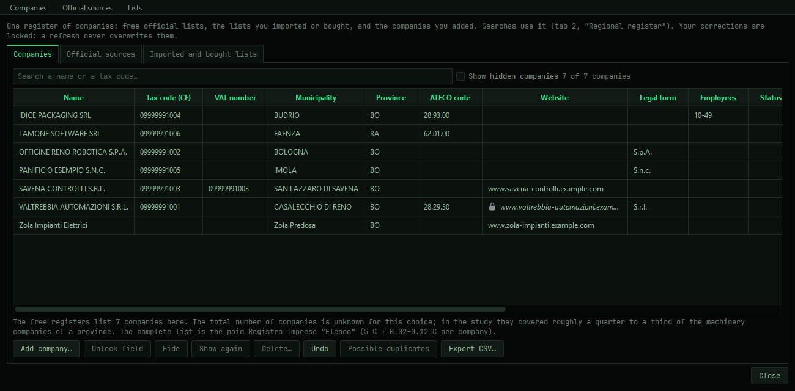

### 11.1 What the register is good for, and what it is not

Be clear about what you get before you build expectations on it.

- **It helps to find candidates; it is not a complete business register.** The four free sources list companies that appear in a public data set: companies that received public aid, a cohesion-fund project or a legality rating, or that have a Legal Entity Identifier (LEI). A small company that did none of these is **not in them**. The program's own text states the measured coverage honestly: in the study behind the feature, the free registers covered **roughly a quarter to a third of the machinery companies of a province**. For other kinds of companies and other places the coverage is unknown. (The code can compare the register with official company counts for a few places, but the program does not display that comparison, so do not expect to see a percentage on screen.)
- **The province is sometimes presumed.** When a source gives no province for a company, the program guesses it from the three digits of the tax office in the VAT number. Such a value is marked "**presumed, from the tax office code**", and when the office code is shared by several provinces the company may be offered under any of them. A search of one province includes these presumed companies; they can be wrong.
- **For most companies there is no exact ATECO code.** Only **OpenCoesione** (and a list you buy or import) carries a full 6-digit ATECO code. **RNA** gives only a sector *hint* taken from the aid ("**indicative: sector declared for an aid**"), which is never shown as the company's ATECO; **GLEIF** and **AGCM** give none. A search narrowed by ATECO categories therefore matches by the hint when there is no code, and keeps the rows of your own imported lists instead of discarding them.
- **Sole traders are not stored.** Only companies with an 11-digit tax code are kept; the 16-character code of a natural person is dropped.
- **A search makes no network request for the register.** After the download, the register is read from your disk. In a radius search a company is placed by its **town** when the sources give no coordinates (so it can be a few kilometres off); a company with no position at all cannot be used in a radius search. At most **3 000** companies are taken from the register in one search (the status line then says "first 3000 companies (choose ATECO categories to narrow)").
- **The complete alternative is paid.** The complete list of the companies of an area is the **"Elenco" of the Registro Imprese** (the Italian business register). The program's text says it costs "5 € + 0.02–0.12 € per company" (a figure written in the program, which may change). You buy it from the Chambers of Commerce, not from ReverseHire, and import it (11.6). It is a different thing from the paid single-company lookup of a company card (**Fetch from paid register**, section 6), which asks for **one** company with your own key.

### 11.2 The four free official sources

All four are **open data of Italian public bodies** (the data of the Global LEI Foundation for GLEIF). Nothing is downloaded until you ask for it (11.3). The licence of each is in the **Licence** column; the complete attribution lines are in `ATTRIBUTIONS.md` and in the tooltip of each source row.

| Source (name in the program) | Licence | What it lists | What it gives for a company | Updates |
|---|---|---|---|---|
| **RNA – Registro Nazionale Aiuti di Stato (open data)** (Incentivi Italia) | CC BY 4.0 | Companies that received state aid, de minimis aid, guarantees or tax credits | Name, region of the aided unit, small-or-large flag, a **sector hint**, number of aids, date of the latest aid and, as a dated signal, **hiring incentives** | updated monthly |
| **GLEIF golden copy (LEI register)** | CC0 1.0 | Companies that have a Legal Entity Identifier | Legal name, registered address, postcode, legal form, founding date, status, the LEI | updated monthly |
| **OpenCoesione – soggetti (cohesion funds)** | CC BY 4.0 | Recipients of cohesion-fund projects (public bodies are left out) | Municipality, address, **full 6-digit ATECO code**, employee class, size class | updated about twice a year |
| **AGCM – companies with a legality rating** | CC BY 4.0 | Companies with a **legality rating** from the Italian competition authority | Municipality and province, the stars of the rating and the date until which it is valid | updated weekly |

Things to know about each:

- **RNA**: by default only the **last 24 months** of files are read; the setting "months of state-aid records" changes this (13.7). The hiring incentive is a **fact about a past incentive** ("**Hired with incentives (latest 2026-05-04)**"), not an open vacancy.
- **GLEIF**: Italian companies are selected by their postcode, and the tax code is taken from the registry entry when it is an 11-digit number. Only companies **with an LEI** are in it, which favours the larger ones.
- **OpenCoesione**: the exact ATECO code comes from here. The file is large and is read one line at a time.
- **AGCM**: the file itself says that the data has **statistical value only** and that later revocations must be checked on later lists. The program shows the rating as a badge with its expiry date ("**Legality rating …, valid until …**") and flags a revoked, annulled or suspended one ("**revoked or suspended**"). It respects the site's crawl delay (10 seconds between requests).

**How big are the downloads?** The program **asks the servers and tells you before it downloads**: "**Download about N MB from 4 official sources now? It can take a while; you can stop it and resume later.**" If a server does not announce the size, the question says that the size is unknown and that it "can be several hundred MB". The developer's notes in the source code give the order of magnitude: the GLEIF file about 490 MB zipped; the RNA archive 1 to 2 GB for all years (24 months are much less); the OpenCoesione file contains a CSV of about 2.3 GB once unpacked. Those notes were written on the day they were checked and the files change, so rely on the estimate the program shows. The files can be **stopped and resumed**, and are checked for damage (size and checksum) when the server provides one.

### 11.3 Download, check and refresh

1. In **Settings > Registers and paid key**, choose the **Regions to keep** (the default is **Emilia-Romagna**) and the **Official sources to download** (all four by default): see 13.7.
2. Open **Search > Register manager…** and click the tab **Official sources**. For each source the table shows **State**, **Companies**, **Last refresh**, **Downloaded files**, **Updates** and **Licence**.
3. Click **Check for updates**: the program asks each enabled source whether something changed and how much would be downloaded. **Nothing is downloaded.** The state of each source becomes **new data available**, **update available**, **up to date**, **unknown**, **check failed** or **not downloaded**.
4. Click **Download / update**. The program tells you the size and asks you to confirm. During the download the window and the shared progress bar at the bottom of the main window show "**… (done of total MB)**", then "**reading … (n companies kept)**" and "**merging n companies into the register**". Only the companies of **your chosen regions** are kept. When it ends, the result of the RNA source says **which months were loaded** (for example **Months loaded: 12/2024–11/2026 (24).**) and, if some months are not published yet, **n month(s) not available yet and skipped: …**.
5. **Stop** interrupts it: "**Stopped. Downloaded parts are kept and resumed next time.**" **Closing the Register manager window also stops a running download** (the parts already downloaded are kept), so leave the window open until it finishes; you can work in the main window meanwhile.
6. **Delete downloaded files** frees the disk space of the raw files after confirmation; **the register keeps its companies**. A line at the bottom of the tab says how many MB the downloaded files and the register take.

Errors are written in plain words and never stop the program: "the server could not be reached", "the server asked to slow down", "the downloaded file … is damaged (size or checksum differs) and was discarded", "the file … could not be read", "Not enough disk space or the data folder cannot be written".

**Start-up check (optional).** If **Check for updates at start-up about once a month (never downloads by itself)** is ticked (default: **on**), the program looks, at start-up, at when you last downloaded. If you **never downloaded**, it does nothing and uses **no network**. If the last download was **30 days ago or more** (and no check was made in the last 30 days), it asks the four sources whether they changed and, if they did, shows a notice ("**The regional register can be updated: …**"). It **never downloads by itself**.

### 11.4 Reading and correcting the companies (locked fields)

The tab **Companies** shows one row per company. The columns are the company's **Name**, **Tax code (CF)**, **VAT number**, **Municipality**, **Province**, **ATECO code**, **Website**, **Legal form**, **Employees**, **Status**, **E-mail**, **Phone**, the **Sources** that list it and its **Signals** (the legality rating, public aid, hiring incentives). Click a header to sort (section 10). **Search a name or a tax code…** narrows the list; **Show hidden companies** brings back the ones you hid. A line above the table says "**n of N companies**"; at most **2 000** rows are shown at once, so search to narrow. Under the table a **coverage note** says how many companies the free registers list for the province you chose in tab 2 and roughly what share of the active companies that is (**The free registers list N companies here. Official counts suggest about … active companies (…), so this covers roughly … %.** or, when the total is unknown, the rough figure of the study); it is hidden while the register is empty.

**Correct a value.** Double-click a cell, type the right value and press Enter. The change is **saved at once** and **the cell gets a padlock**. A locked field is **never overwritten** by a later download or refresh ("**Changed by you: a refresh never overwrites it.**"). The tax code (the company's identity) and the aid facts, which belong to their source, cannot be edited. To go back to what the sources say, select the cell and click **Unlock field**.

The buttons under the table (the same ones are in the window's menu bar and in the right-click menu, section 10.3):

| Button | What it does |
|---|---|
| **Add company…** | Asks for a name and adds a company you know that no list has. It has no tax code; fill in what you know by hand. |
| **Unlock field** | Forgets your value of the selected cell: the sources' value is used again. |
| **Hide** / **Show again** | Hides the company from searches. A refresh **will not bring it back**. |
| **Delete…** | After confirmation: a company **you added** is deleted; a company **that an official source lists** is only hidden (otherwise it would return at the next refresh). **Undo** restores it. |
| **Undo** | Undoes your last change in the register (the last 200 are remembered). |
| **Possible duplicates** | Lists companies with a similar name. They are **never merged automatically**: only the same tax code merges two rows. Check the tax code yourself. |
| **Export CSV…** | The whole register as a CSV file (hidden companies flagged), which you can open in a spreadsheet. |

**Which value wins when sources disagree?** For every field the program keeps each source's value with its date and shows the first of a fixed order: **your own correction**, then **a bought list**, then the official sources (the order depends on the field; for example an exact ATECO code only ever comes from your corrections, a bought list, OpenCoesione or an imported list), then **the lists you imported**. Between two imported lists the newest wins.

### 11.5 What the register adds elsewhere in the program

- **Discovery.** In tab 2 the checkbox **Regional register (official lists and your imported lists)** is **on by default** (section 7). Untick it to search without the register.
- **Signals on a company.** When a company is found in the register by its tax code or VAT number, dated facts can appear next to it: "**Received public aid (n, latest …)**", "**Hired with incentives (latest …)**" and "**Legality rating …**", each marked with its source. The affinity box uses them as *opportunity signals* (section 5). They are hints about the company's history, not job openings.

### 11.6 Imported and bought lists

The tab **Imported and bought lists** shows every list you brought in, with its **File**, **Source**, **Date of the list** and number of **Rows**. They are **part of the register**: the same company in an official source and in your list is one row.

- **Import list (CSV/XLSX)…**: any company list that has a name column (a start-up register, a list of local companies, an export from another tool). The program reads the file, **shows a preview with the columns it recognised** (name, website, address, town, province, postcode, tax code, VAT number, REA, ATECO, PEC, e-mail, phone, employees) and lets you correct which column is which, the kind of list (**Registro Imprese list**, **Innovative start-up register** or **Generic list**) and its source and date. A row without a tax code gets a stable identity made from its name and town.
- **Import bought Registro Imprese list…**: for the "Elenco" you bought (CSV or XLSX), with the same column preview. Its values **rank right after your own corrections**, above the free sources. Rows **without a usable 11-digit tax code** (or VAT number) are **skipped and counted**, because a name alone does not identify a company; sole traders (natural persons) are skipped too.
- **Refresh list from file…**: replaces the chosen list with a **newer file of the same list**. Your corrections stay locked, rows you added by hand stay, and companies the new file no longer lists go away ("**… refreshed: n new, n no longer listed**").
- **Delete list**: after confirmation removes the chosen list; companies that another source also lists **stay**.
- The button **Import company list…** of tab 2 does the same import: the list ends up here.

The lists stay on your computer: nothing is uploaded and the program never redistributes them. **A bought list is for your own use, under the terms of the Chambers of Commerce** (`ATTRIBUTIONS.md`). If you used an older version, the lists you had imported there were **copied** into the register at the first start of this version (once, without deleting the old copy), and a message says how many.

### 11.7 Settings of the register

On the page **Registers and paid key** of the settings (13.7): **Regions to keep**, **Months of state-aid records (RNA) to read**, **Check for updates at start-up…** and **Official sources to download**. At least one region and one source are required.

### 11.8 What is stored where

| Where (inside the data folder, section 18) | What |
|---|---|
| `registers/register.sqlite` | The register: every company, each source's value with its date, **your corrections and their locks**, hidden companies, signals and the undo history. Your imported lists live here too (rows and details of each list). |
| `registers/raw/<source>/` | The files downloaded from each official source and a small manifest of what was downloaded (so that a download can be resumed). **Delete downloaded files** empties them. |

The older copies of imported lists in `store.sqlite` are kept as a backup. To start the register from scratch, close the program and delete the `registers` folder; the rest of your data is not touched.

### 11.9 What was and was not verified

The register is covered by the program's automatic tests, which use small invented files and no network. The developer's notes in the code say the file formats were checked on real files (for example the GLEIF golden copy of 18 November 2026, Emilia-Romagna subset), but the downloads were **not** tried for every region, on another PC, or with a list really bought from the Registro Imprese: that import was written from the format of the "Elenco" files and is tested with invented lists only. The public files can change their structure: if a download fails with "the file … could not be read", the format may have changed.

## 12. Maps


Three places can show their content on a map:

- **3. Results**: the button **Show on map** (above the table) replaces the table with a map of the companies found; **Show as table** brings the table back. The starting point is marked and the search radius is drawn around it.
- **Job search**: **Show on map** shows the postings that have a known place, the starting point and, after **Who might be behind this ad?**, the hypotheses as a different kind of marker (section 7).
- **2. Location and start**: **Show on map** / **Hide map** shows the starting point and the radius you chose, and follows them when you change them (the line under the map repeats the place and the radius).

Click a marker to select the same row in the table; select a row to bring its marker into view. Use the mouse wheel or the **Zoom in** / **Zoom out** buttons to zoom and drag to move. The scale is shown in kilometres (or metres when very close).

A map is created **only the first time you show it**. While the map is being built it shows **Loading the map…**. (Shortly after start-up, about 20 seconds, when you are not typing or clicking, the program starts the map engine in the background so that the first map opens faster; that step does not ask any map server for anything.)

### 12.1 The map backgrounds ("tiles")

The background pictures are the standard **OpenStreetMap** tiles from `tile.openstreetmap.org`. They are downloaded **only while a map is on screen**, and only the tiles of the part you are looking at: nothing is fetched in advance and no area is stored for offline use. The program follows the OpenStreetMap tile usage policy: it identifies itself with a stable name (the same one it uses for all its requests, with the project address), keeps the credit **© OpenStreetMap contributors** visible on the map at all times, and lets the normal web cache (the folder `cache/map` of the data folder, up to 200 MB) avoid repeating requests. The map page may contact **only that one tile host**: every other request, and any file outside the program's own map files, is blocked. The map library (Leaflet and its marker-grouping add-on) is part of the program, not loaded from the Internet. The public OpenStreetMap servers are meant for light use; if you need more, use a tile server of your own (12.3).

### 12.2 When there is no background: the message on the map and "Show the online map"

The map can work **without backgrounds**: the markers, the starting point and the radius are drawn on a plain background. This happens in three situations, and in each one a panel in the centre of the map says what is going on and offers a button.


| Message on the map | When | Button |
|---|---|---|
| **The map background is switched off (setting "Show the map background"): only the points are drawn.** | The map backgrounds are switched off: by the setting (12.3) or by the **Work offline** toggle below. **No map server is contacted.** | **Show the online map** switches the backgrounds on again, for all three maps, and saves the choice. |
| **The map backgrounds could not be loaded: …** with the reason: "no connection to the map server (…)", "the map server answered with error 4xx/5xx" or "the map server did not send any background" | The backgrounds are on, but none could be loaded: no Internet, the server refused, or your own tile server does not answer. The markers are still correct. | **Retry** asks for the backgrounds again. |
| **The full map could not be started: …** (with the reason, also written in the log), and a **Simple map (no tiles)** drawn by the program itself | The interactive map component (Qt WebEngine) cannot start on this PC, or its page does not become ready in time (about 25 seconds). | **Retry** tries to start the full map again. |

Other ways to control the backgrounds:

- **A small toggle in the top-right corner of every map**, **Work offline (no map backgrounds)**: one click switches the backgrounds off (and the message above appears); click it again to switch them on. It changes the same setting as the one in **Settings > Appearance** (12.3), applies to **all three maps at once** and is **saved**, like a change in the settings.
- **Search menu**: **Show the online map** (available while the backgrounds are off), **Work offline (no map backgrounds)** (a tick box) and **Retry loading the maps** (available while the backgrounds are on). They are the same commands as the buttons on the map.
- If a background cannot be loaded, the program makes **one test request** for the world tile (the smallest picture of the map server) to find out *why*, and writes the cause once in the log. The environment variable `REVERSEHIRE_MAP_FALLBACK=1` forces the simple map (used by the tests).

The simple map and the plain-background map show the same markers, the radius and the scale; they just have no street picture. **Everything else in the program works the same without map backgrounds.**

### 12.3 Settings: Appearance > Map

**Settings > Appearance**, group **Map** (section 13.10):

- **Show the map background (downloaded from OpenStreetMap; when unticked only the points are drawn)**: **ticked** by default. When it is not ticked, **no tile is ever requested**; the maps show only the points on a plain background, with the message of 12.2.
- **Custom tile URL:** a tile server that you choose, written with `{z}`, `{x}` and `{y}`, over `https`, or a local `http` address (`localhost`, `127.0.0.1`) or a `file` folder. Empty (the default) means OpenStreetMap. A plain `http` address to another host, or an address without the three marks, is refused when you click **Save** with the message "The tile URL needs {z}, {x} and {y} and must use https (or a local http or file address)." The OpenStreetMap credit is always shown with the OpenStreetMap tiles; the credit of a custom server is that server's own business.

### 12.4 What leaves your computer

- **Only** the requests for the tiles of the **area on screen** go to the tile server (`tile.openstreetmap.org`, or the one you set): the server learns that area and your Internet address, as any website would. **No marker, company name, posting or CV text is sent.**
- Nothing is sent if the backgrounds are off, or while no map has been shown.
- The pictures of this manual were made without map backgrounds, so that no map server was contacted.

## 13. Settings

Open **File > Settings…**. The window has **ten pages**, listed on the left, in this order: **General**, **Search and discovery**, **Affinity**, **Idle analysis**, **Job search**, **Screening answers**, **Registers and paid key**, **Mail**, **Assistant and MCP** and **Appearance**. Click a page to see its options.

- **Save** (bottom right) checks the values of **all** the pages and saves them. If a value is invalid, a message names it (for example "**Pages per site must be a whole number between 1 and 50.**") and **nothing is saved**.
- **Cancel** closes the window without saving.
- **Clear cache** (bottom left) is described in 13.11.

Some buttons of other windows open the settings directly on the right page (for example **Assistant settings…** or **Mail settings…**). The settings are stored in `config.json` in the data folder (section 18). The defaults below are the values of a new installation; "empty" means nothing is set.


### 13.1 General

| Option | What it does | Default |
|---|---|---|
| **Interface language** | English, Українська or Italiano. It changes the running session at once (section 14). | English |
| **Start-up language** | The language every start begins in: English, Українська, Italiano or **Language of the last session**. | English |
| **Prefer permanent contracts** | Permanent contracts (and "permanent possible") raise the **Desirability**, and therefore the **Match**, of the next searches. | ticked |
| **Prefer remote or hybrid work** | Remote and hybrid adverts raise the desirability. | ticked |
| **Minimum gross yearly salary (0 = not set)** | A published salary below this amount lowers the desirability. Monthly salaries are converted to yearly ones. It must be a whole number from 0 to 10 000 000. | 0 |
| **Also search job boards (Indeed/LinkedIn)** | Adds Indeed and LinkedIn to the *company* search (see below). | not ticked |

**Text recognition (OCR).** Under the preferences the page shows whether the **advanced reader** is installed (with its size and whether it runs on the CPU or the graphics card), the buttons **Download**, **Cancel download** and **Remove**, and the choice **Advanced reader**: **Ask once before downloading it** (default), **Use it automatically when a scan reads poorly** or **Never use it** (section 3).

**Job boards (experimental).** This extra of the *company* search is different from the **Job search** tab (section 7). The switch works only after the optional component has been installed (see the [Installation guide](INSTALLATION.md)); otherwise a message during the search says how to install it. Only your role titles, the town of the starting point and its country and the radius are sent to those sites, never your CV. The page warns: "**Off by default. Automated access to these sites may violate their terms of use and can be blocked; your CV is never sent, only the role and the place.**" If they do not answer, the search goes on without them.

### 13.2 Search and discovery

| Option | What it does | Default |
|---|---|---|
| **Website reading engine** | `local`, `playwright` or `firecrawl` (below). | local |
| **Firecrawl key** | Your own key for the Firecrawl service; needed only for the `firecrawl` engine. Hidden; tick **Show the key** to see it. It cannot contain spaces. | empty |
| **Delay between requests to the same site (s)** | Pause between two pages of the same website: 0.5 to 60 seconds. | 2 |
| **Maximum pages per site** | How many pages are read on each website at most: 1 to 50. | 5 |
| **Maximum companies (0 = no limit)** | Stops after this many companies (the first of the ranking are kept). | 0 |
| **Include companies without a website (evaluated from OpenStreetMap data only)** | Also lists companies without a website, with a low confidence. | ticked |
| **Pause between requests to the same service (s):** | The minimum pause between two requests to the same online service when discovering companies and checking registers: 1 to 60 seconds. Lower values are refused to protect the public services. | 2 |

The region, the sources and the area to search are chosen in tab **2. Location and start**, not here, and so is the number of **Companies in parallel** (default 8, from 1 to 16) and the radius.

**Website reading engines.** **local** reads pages directly (fast and private, but it cannot see adverts that a website loads with JavaScript). **playwright** uses an automated browser on your computer and also sees content loaded with JavaScript; it needs an optional installation (see the [Installation guide](INSTALLATION.md)). **firecrawl** uses the external Firecrawl service with your own key: only company website addresses are sent, never your CV, and the key is saved **in plain text** in `config.json`.

### 13.3 Affinity

The page **Affinity** (title "**Affinity with your CV**") sets how the verdicts of section 5 are formed.

| Option | What it does | Default |
|---|---|---|
| **Career directions** | A tick box for each direction: **Industrial automation**, **Software development**, **Cybersecurity and industrial networks**, **Technical coordination**. Untick a direction you do not want to be judged in. **Remove** deletes a direction you added. | all ticked |
| **New direction: name** + **Keywords of roles and skills, separated by commas** + **Add direction** | Adds a direction of your own, with the words that define it. | none |
| **Companies outside every chosen direction are "Not a fit"** | Turns the directions into a strict filter. | not ticked |
| **Kinds of company** | A percentage for each type: **Machine builder (OEM)**, **System integrator**, **Manufacturer with its own technical staff**, **Software house / IT consultancy**. **100 % = no preference; a lower value moves the type down in the lists; 0 % excludes it ("Not a fit").** | 100 % each |
| **Distance limit** | Off: you can work anywhere and the distance is only shown. On: companies farther than the limit (1 to 2000 km) get a capped affinity. | off (50 km when switched on) |
| **Personal calibration** | **Calibrate from my judgements** needs at least 8 judgements recorded with **Agree** / **Disagree**. It shows the weights now and the calibrated ones, and how many past verdicts would change. **Apply these weights** saves them at once and every affinity is recomputed; **Default weights** goes back. | default weights |

### 13.4 Idle analysis


The page has two groups (section 4).

**Analysis while the computer is idle.** Companies queued by "Who could be interested in my profile" are analysed (website, registers, affinity) **only while you do not use the PC**; any key or mouse movement pauses the work at once.

| Option | What it does | Default |
|---|---|---|
| **Analyse companies when the computer is idle** | The master switch. | ticked |
| **Start after this long without input:** | Minutes without keyboard or mouse before it starts (1 to 240). | 5 min |
| **Web requests per day at most:** | The daily budget of web requests (25 to 20 000). | 600 |
| **Only when the PC is plugged in (never on battery)** | Never runs on battery. | ticked |

**What is queued.** The first time **Analyse the best now** would queue the rest of the list, the program asks you first (section 4.5); it queues **200 companies at most** at a time.

The **Pause** / **Resume** switch is not here: it is in the status bar at the bottom of the window and in the **Tools** menu. Besides these options the program also waits when the computer is busy (CPU load above half by default), when there is no network connection or while a search is running, and it limits itself to 60 requests a day to the same website; the reason it is not running is written in the status bar (section 19).

**Assistant suggestions.** "Your own assistant (Claude Code or Codex) names companies; the app verifies each one before it can be added. Each request uses your own plan."

| Option | What it does | Default |
|---|---|---|
| **Allow web search (slower, uses more of your plan; the app still verifies every company)** | Lets the assistant use its own web-search tool for that request. It never gets any tool that could read your files or run commands. | not ticked |
| **Show what is sent and the cost notice before the next request** | Shows the brief preview and the cost notice again. | ticked (the notice has not been accepted yet) |

### 13.5 Job search


The sources of the **Job search** tab, each with its **terms-of-use verdict** and the date the terms were read. Untick a source to stop using it; the choice applies from the next search.

| Source | Verdict shown | Default |
|---|---|---|
| **Postings already found by company searches** | Allowed | on |
| **My companies (job boards and careers pages)** | Allowed | on |
| **Randstad** | Terms do not address automated reading | on |
| **Manpower** | Terms forbid only harmful automation | on |
| **Synergie** | Terms do not address automated reading | on |
| **Adecco**, **Gi Group**, **Umana** | Terms forbid automated reading: never used | greyed out, can **never** be switched on |
| **Adzuna**, **Jooble**, **Careerjet** | Official API: its own terms apply | off until you enter a key and tick them |

**Your own keys (optional services):** **Adzuna app_id**, **Adzuna app_key**, **Jooble key**, **Careerjet key**. They are hidden (tick **Show the key**), kept in `config.json`, never written to the log and sent only to that service. A key cannot contain spaces. The services marked **Not yet tested with a real key** may behave differently from their documentation (section 20).

**Limits:** **Posting pages read per agency and search:** (1 to 100, default **20**) and **Stop a source after (s):** (10 to 900 seconds, default **120**).

### 13.6 Screening answers

Application forms often ask yes/no **knock-out questions** before anyone reads the CV. On this page you save **truthful** answers, and the simulators of the **Recruiter analysis** tab use them instead of guessing from the CV (section 8). Every answer starts as **not answered**, and you may leave any of them so:

- **Allowed to work in the job's country**, **Needs visa sponsorship**, **Willing to relocate**, **Own a car**, **Shifts and weekends acceptable**: **yes**, **no** or **not answered**;
- **Longest commute (km)**, **Notice period (weeks)**, **Minimum gross salary per year**, **Business-travel days per year accepted**: a number, or empty;
- **Driving licences**: for example `B, C`.

These answers stay on this computer (in `config.json`) and are used **only by the simulators**: they are never put in an e-mail, an export or a search. A text where a number is needed is refused when you click **Save**.

### 13.7 Registers and paid key

This page has two groups.

**Paid company register (optional).** **Provider:** (`openapi.it`, `openapi.com` or `openapi`) and **API key:** (your own, hidden; **Show the key**). Both are empty by default. "**Used only when you press the paid-register button on a company card and confirm the cost shown. No request is ever made with this key otherwise.**" Without both, the button **Fetch from paid register** of the company card stays greyed out (section 6).

**Regional register (free official lists)** (section 11): "Free official company lists (state aid, LEI register, cohesion funds, legality rating) kept on this computer and used by the search. Nothing is downloaded until you ask in Search › Register manager…"

| Option | What it does | Default |
|---|---|---|
| **Regions to keep:** | A list of the 20 Italian regions with a tick box each. Only companies of the ticked regions are kept in the register. At least one is required. | Emilia-Romagna |
| **Months of state-aid records (RNA) to read (0 = the whole archive):** | 0 to 120. More months mean larger downloads. | 24 |
| **Check for updates at start-up about once a month (never downloads by itself)** | See 11.3. | ticked |
| **Official sources to download:** | A tick box for each of the four sources. At least one is required. | all four |

### 13.8 Mail


The fixed presentation text of your application e-mails, with your details and the PDF to attach. ReverseHire never sends anything: it opens a draft in your mail program and you send it yourself (section 9).

| Option | What it does | Default |
|---|---|---|
| **Subject** and **Text** | The templates, with placeholders in curly braces that the page lists (for example `{contact_name|Hiring Manager}`: the text after the bar is used when the value is missing; a part between double square brackets, `[[ for the {role} position]]`, is left out as a whole when a value inside it is missing). Unknown placeholders are removed from the message and listed. **Default text** puts back the text of the interface language. | the default text of the language |
| **Your name**, **Your e-mail**, **Your phone** | Put into the message. An e-mail that does not look like an address is refused at **Save**. | empty |
| **PDF to attach** | The CV file attached to a draft (**Browse…**). **Use the primary CV** takes the primary version of **My CV** when it is a PDF; the window warns when the file is missing. | empty (the primary CV, if it is a PDF) |
| **How to open the draft** | **Automatic (recommended)**, **Classic Outlook**, **New Outlook**, **Default mail program**, **Gmail in the browser**, **Draft file (.eml)**, **Thunderbird**, **Copy the text and attach by hand** and, on other systems, the desktop program or Apple Mail. Each way has an explanation. | Automatic |
| **Test draft** | Opens a draft addressed to your own e-mail (or without a recipient). Nothing is sent. | – |

### 13.9 Assistant and MCP

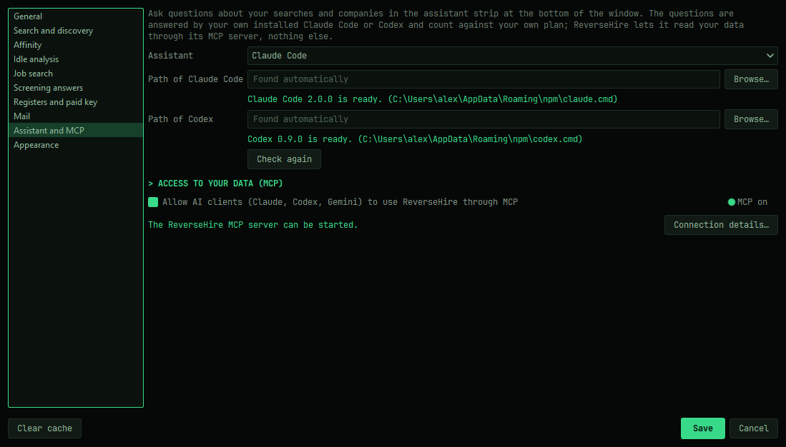

Here you choose which assistant answers in the assistant strip and see whether it is ready (section 16):

- **Assistant**: **Claude Code** or **Codex**, the one installed on your computer. Default: **Claude Code**.
- **Path of Claude Code** and **Path of Codex**: leave them empty (**Found automatically**) unless the program is in an unusual place; **Browse…** chooses the file.
- **Check again**: runs the check. It starts the program only to read its version and sign-in state, never to ask a question. The result is written under each path, for example "**Claude Code 2.0.0 is ready.**", "**Codex was not found on this computer. Install it, or set its path in the settings.**" or "**… is installed but not signed in. Open a terminal, run … and sign in, then try again.**"
- **Allow AI clients (Claude, Codex, Gemini) to use ReverseHire through MCP**: the same switch as the red or green dot at the top right of the window. **Off** by default. **Connection details…** opens the MCP connection window (section 16.2).

### 13.10 Appearance

| Option | What it does | Default |
|---|---|---|
| **Interface theme** | **Dark**, **Light** or **Same as system**. | Dark |
| **Show the map background (downloaded from OpenStreetMap; when unticked only the points are drawn)** | When not ticked, no map picture is ever requested (section 12). | ticked |
| **Custom tile URL:** | A map tile server of your own, with `{z}`, `{x}` and `{y}`, over `https` or a local `http` or `file` address. Empty means OpenStreetMap. | empty |

### 13.11 Buttons

- **Clear cache**: after confirmation ("**Clear the cache of pages, OpenStreetMap searches, addresses and scores? Saved searches are kept.**") it deletes the saved copies of **web pages**, **Overpass searches**, **addresses**, **ESCO answers**, **scores**, the **Overture** and discovery downloads, the **job-search files** (sitemaps, posting pages, job boards, `cache/jobsearch`) and the **map picture cache** (`cache/map`). It **keeps** your profile, saved searches and their results, company cards, your applications, your imported lists and the register, the downloaded map data and the models.
- **Save** and **Cancel**: as at the top of this section.

## 14. Language and appearance

### 14.1 Language

Click one of the three chips **EN**, **UK**, **IT** at the top right of the menu bar, or choose the language on the **General** page of the settings. The interface changes at once, without restarting, including the menus and the standard buttons of the file dialogs. The choice lasts **until you close the program**: **every start begins in the Start-up language** (**Settings > General**; English by default; **Language of the last session** brings back the language you left). The MCP server and the assistant follow the language of the running session.

### 14.2 Theme

Click the small **sun or moon** button next to the language chips, or choose **Tools > Switch to the light theme** / **Switch to the dark theme** (shortcut **Ctrl+Shift+L**). The button switches between **dark** and **light** and shows the theme you would get (a sun in the dark theme, a moon in the light one). **Same as system** (follow the system's light or dark setting) is chosen on the **Appearance** page of the settings; from **Same as system** the button goes to the opposite of what is shown. The change is immediate and remembered. The default is **Dark**.

### 14.3 Hover and keyboard focus

Buttons, tabs, the language chips, table rows and boxes are highlighted when the mouse is over them or when the keyboard focus is on them, in both themes. Buttons also grow by about 5 % for a moment, without moving anything around them. If the system setting that shows animations is off (Windows: **Show animations in Windows**), nothing grows and only the highlight stays. You can also switch the growth off with the environment variable `REVERSEHIRE_REDUCED_MOTION=1`.

### 14.4 What the English interface shows

With the English interface the program shows no Italian or Ukrainian words in its own texts. The profile of a non-English CV is shown in English, and texts that come from company websites or job adverts are translated into English **on your computer**, if the local translation models are installed; otherwise the text stays in its original language, marked "**(original language)**", and **one notice** explains how to install the models (from a terminal, once: `python -m reversehire.cv.translate download it uk`; nothing is sent online afterwards). With the Italian or the Ukrainian interface these texts are shown as they are, because there are no translation models from English into those languages. The CV and the websites can be in English, Italian or Ukrainian whatever the interface language.


## 15. The "?" menu, the log and the safety net

### 15.1 Diagnostics

**? > Diagnostics…** opens a window that runs checks on your PC. It takes up to a minute. Each check is marked as passed, warning, failed, skipped or information. The checks are:

- the **version and build** of the program, and the **data folder** with the rule that chose it (section 18; whether it is writable, the database and its journal mode);
- on Windows: whether an **older packaged copy** of the program is installed, the **Visual C++ runtime** files and the state of **Smart App Control**, which can block the program's libraries;
- the **scoring engine** (onnxruntime), the **embedding model** (whether a complete copy was found and where), the model folders, and whether the model **loads without Internet**;
- **text recognition (OCR)**: the normal engine and the advanced reader;
- how the program trusts **HTTPS certificates**;
- **the online services**: one small request each to the model hub (Hugging Face), the address service (Nominatim), ESCO and the map-data server (Overpass) to see whether they answer. These requests carry no personal data (section 17).

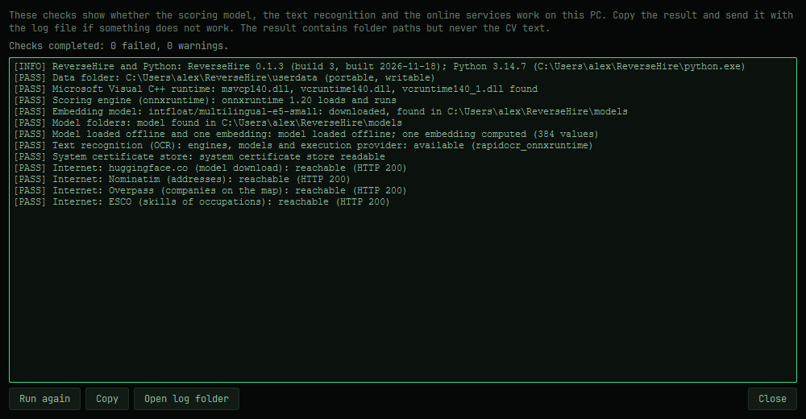

**Copy** copies the result so you can send it to someone who helps you; **Run again** repeats the checks; **Open log folder** opens the folder of the log. The result contains folder paths and versions, never the text of your CV.

**? > Open log folder** opens the data folder in your file manager, where the log file `reversehire.log` is.

### 15.2 About

**? > About** opens the **About ReverseHire** window.

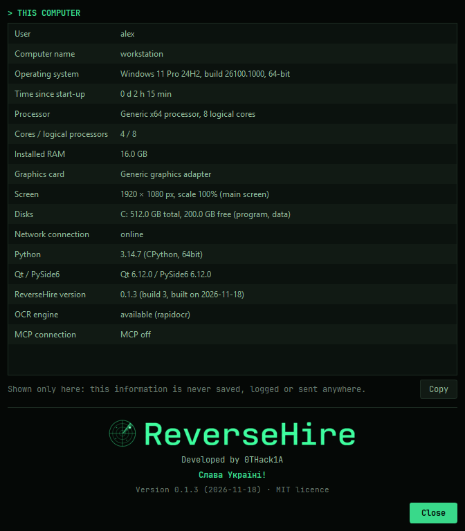

At the top, **> THIS COMPUTER** lists information about your PC and the program: **User** (the user of the operating-system session, asked to the system), **Computer name**, **Operating system** (for Windows with its edition and feature update), **Time since start-up**, **Processor**, **Cores / logical processors**, **Installed RAM**, **Graphics card**, **Screen** (every screen, with its size and scale, the main one marked), **Disks** (each fixed disk with its total and free space, and which one holds the program and which the data), **Network connection** (**online** or **offline**), **Python**, **Qt / PySide6**, **ReverseHire version**, **OCR engine** and **MCP connection**. It is useful when you ask someone for help.

**The version and the build.** **ReverseHire version** reads for example "**0.1.1 (build 1, built on 2026-11-18)**". The third number of the version is the **build number**: it grows by one every time the program is built (section 11.2 of the [Installation guide](INSTALLATION.md#112-building-the-disc), a maintainer procedure). A copy run directly from the source code that was never built says "**source copy, not built**".

This information is **shown only on your screen**: "**Shown only here: this information is never saved, logged or sent anywhere.**" The **Copy** button copies it to the clipboard so that you can paste it into a message yourself; remember that it then includes your user name and computer name. At the bottom: the logo, "Developed by 0THack1A", the line "Слава Україні!", the version and the MIT licence. **Close** closes the window.

### 15.3 The log file

ReverseHire writes a log in the data folder, `reversehire.log`, useful for troubleshooting. One entry per line:

```
[2026-11-18][14:03:21][WORKSTATION]: INFO gui.activity [MainThread]: Button "Start search" in SearchPanel
```

The fields are the **date**, the **time**, the **name of the computer**, the **level** (INFO, WARNING, ERROR…), the **module** that wrote the line (without the `reversehire.` prefix), the **thread** in square brackets (**MainThread** is the window; the others are background work) and the message. A multi-line entry, such as an error with its traceback, repeats the same prefix on every line.

- **Your clicks in the window are logged.** Each button you click (a check box with its new state), each menu entry, each choice in a list, each tab you open and each window that opens or closes is written with the **label shown on screen** ("Button …", "Menu item …", "Choice in …", "Tab shown in …", "Dialog opened: …"). The program also logs in a few words that you sorted a table or clicked a table header (table name and column number), opened a right-click menu or changed a place filter. **What you type is never logged**: not the CV text, nor notes, addresses or e-mail text; the choice of a CV file logs only its extension and size.
- **Secrets are hidden.** Keys (Firecrawl, paid register, the job-search services) are replaced by `***` wherever they could appear. For the application e-mail the log has only the way used, the **domain** of the recipient and the **file name** of the attachment.
- **Other things you will see:** the sources used by a search and how many companies each returned, errors with their details, the addresses (URLs) of websites the program had trouble with, the map and register events.
- **Size limit.** The log is rolling: the current file and up to nine older ones (`reversehire.log.1` to `reversehire.log.9`), each at most 10 MB, **100 MB at most in total**. When the current file is full, the oldest file is deleted. If the system does not let the program rename the file (another program has it open), the oldest half of the current file is cut away instead, so the limit holds. A problem with the log file (full disk, locked file) is ignored: it never stops the program.
- **Read the log before you share it.** Send the log, together with the Diagnostics result, **only to whoever helps you** and **never paste it into a public place** (an issue on GitHub, a forum) without reading it first. Every line contains the **name of your computer**; an error message can contain **folder paths that include your Windows user name**, and the log can contain company names, website addresses and place names from your searches. Remove what you do not want to publish.

### 15.4 What happens when something goes wrong

- **The window does not wait for the database.** Every part of the program has its own connection to the database, so a long operation in the background does not block the window. If the window ever has to wait for the database, it waits at most about 2 seconds; then it shows "**The database is busy (another operation is writing to it): try again in a moment.**" instead of freezing.
- **A safety net for errors.** An error inside a button, a menu entry or a background job is written to the log with its details and shows the notice "**Unexpected error: the program goes on; details are in the log.**" in the status bar. The program does not close and does not open an error box from a background job.
- **A watchdog for freezes.** If the window stops answering for more than 5 seconds, the program writes in the log where the window was stuck (the stack of the window thread and the lines the other threads were running) and, when the window answers again, how long it lasted. Send that part of the log if a freeze happens.

## 16. The assistant strip and the MCP connection

### 16.1 The assistant strip

The **assistant strip** is the row above the status bar, visible on every tab. It lets you **ask questions in your own words about your searches and companies**, for example "Which companies did my last search find, and which ones are hiring?", "Show the card of Northwind Automation: is the identity confirmed?" or "Which postings suit my profile best?". The answer comes from **your own Claude Code or Codex** program, installed on your computer.

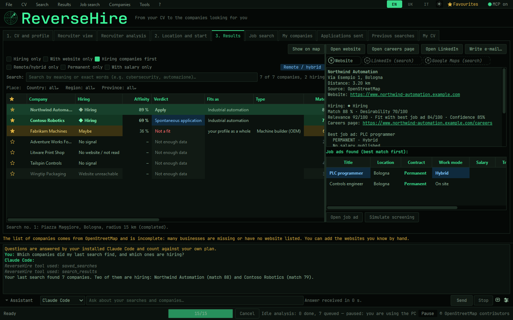

**Before the first question** (once):

1. **Install and sign in** to Claude Code or Codex on your computer (ReverseHire does not install them and has no account for them).
2. **Switch MCP on** with the red dot at the top right (16.2): the assistant reads your data only through ReverseHire's MCP server, so with MCP off it cannot answer.
3. In **File > Settings…**, page **Assistant and MCP**, choose the **Assistant** and click **Check again** (13.9).

**Asking.** Type the question in the field (**Ask about your searches and companies…**) and press Enter or click **Send**. The first time, the program checks the assistant ("**Checking the assistant…**"); then the question goes ("**Claude Code is answering…**"). The conversation opens above the strip: your question (**You:**), a grey line for each ReverseHire tool the assistant uses ("**ReverseHire tool used: …**"), and the answer as it arrives. The status line ends with "**Answer received in … s.**" Follow-up questions continue the same conversation.

- The drop-down next to **Assistant** chooses **Claude Code** or **Codex** (the same choice as in the settings).
- **Stop** stops the answer being written.
- **New conversation** (the first small button on the right) starts again from nothing.
- The triangle on the left (**Show conversation** / **Hide conversation**) opens or closes the conversation; the choice is remembered. The **Tools > Assistant** menu has the same entries, and **Assistant settings…** (the last small button) opens the settings page.
- The answer is written in the language of the interface.

**When the assistant cannot answer**, a line under the strip says why, with a button that opens the settings page: the program was not found ("**… was not found on this computer. Install it, or set its path in the settings.**"), it is not signed in ("**Open a terminal, run … and sign in, then try again.**"), or MCP access is switched off ("**MCP access is switched off: the assistant cannot read your ReverseHire data. Turn it on with the dot at the top right of the window.**"). If the ReverseHire server does not start inside the assistant, a notice says that the answer cannot use your data. A question that takes more than **15 minutes** (900 seconds) is stopped.

**What it costs and what it sees.**

- **Questions count against your own plan** with Claude or OpenAI: they are answered by your installed program, under your own subscription. ReverseHire pays nothing, has no key of yours and never sees your login. A notice tells you so, once.
- The assistant is **restricted to ReverseHire's own MCP tools** (16.3): it has **no other tool**; it cannot read your files, run commands or browse the web, it ignores project files and the settings of your own program (plugins, hooks, other servers), and it works in an empty folder owned by ReverseHire. If it starts with more permissions than that, ReverseHire stops it and says so.
- What the tools return (profile values, companies, job adverts, scores, saved searches, company cards, without your notes, contacts and tags) is sent to the online model of the program you chose, so the rules of section 17 and [MCP.md](MCP.md) apply: by default the CV text, the file path, your name and contact details are not returned.
- The assistant strip is **not** the same as the suggestions of section 4: that function asks your assistant **once, for a list of company names**, with an anonymised brief that you see first (section 17), and does not use MCP.

**What was tested.** On a real PC, both Claude Code and Codex answered through ReverseHire's MCP tools. Other combinations (other versions of those programs, other systems) have not been tested. The assistant strip is not available if the optional `mcp` package is not installed (see the [Installation guide](INSTALLATION.md)).

### 16.2 The MCP connection

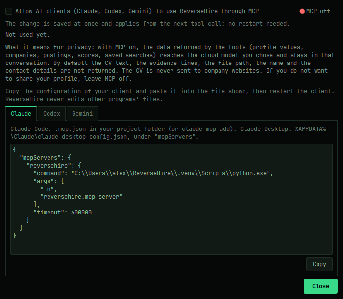

ReverseHire includes an optional **MCP server** that lets AI assistants such as **Claude**, **Codex** or **Gemini** use the same functions (to read your CV, discover companies in an area, look into one company or read a company card). The assistant strip uses it, and you can also connect an assistant program yourself; that second use is meant for advanced users.

**It is off by default.** The dot at the top right of the window shows its state: **red dot, MCP off** or **green dot, MCP on**. Click it to open the **MCP connection** window (also **Tools > MCP server…**, or **Connection details…** in the settings):

- the switch **Allow AI clients (Claude, Codex, Gemini) to use ReverseHire through MCP**: the change is saved at once and applies from the next request, with no restart;
- when it was **Last used** and how many calls it served (or **Not used yet.**), kept in `mcp_usage.json` (only a time and a counter);
- a short explanation of what it means for privacy;
- three tabs, **Claude**, **Codex** and **Gemini**, each with the configuration to paste into that program, the name of the file it goes into and a **Copy** button. ReverseHire never changes other programs' files: you paste the text yourself.

The server is started by the client program as a child process and talks to it through the standard input and output (**no network port is opened**). With the switch off, every tool answers with a message that says so.

### 16.3 The tools

The server has **nine tools**. All return plain data; an expected problem becomes a readable message, never a crash.

| Tool | What it does |
|---|---|
| `analyze_cv` | The summary profile of a CV file (roles, skills, languages, degrees, years, seniority, work experiences, gaps, mobility, sectors). The CV text, evidence lines, home town, path, name and contacts are returned **only** if you ask with `include_personal_data`. |
| `geocode` | An address, a city or coordinates to latitude and longitude. |
| `list_sectors` | The available business sectors (keys with Italian and English names). |
| `find_companies` | Companies within a radius of a place (radius 0.1 to 50 km, 1 to 100 companies), from the same discovery sources as the app (including the regional register), ranked before any site is read. |
| `analyze_company` | Reads a company website: hiring status, careers page and postings; with a CV also the scores and the requirement checks. |
| `saved_searches` | The searches made with the app, with their ids (no CV path). |
| `search_results` | The results of a saved search, hiring companies first, with the scores. |
| `company_card` | A company card saved in the app, with the identity status and the source of every value; with `build` it builds or refreshes the card first. Your notes, contacts and tags are never returned. |
| `list_company_cards` | The saved company cards: name, website, identity status, VAT number, REA, ATECO, hiring status. |

**What MCP does not give.** The job search, the recruiter analysis, the maps, the affinity verdicts, the "Who could be interested in my profile" suggestions, the idle analysis, the Register manager and the **Applications sent** tracker are **not** exposed through MCP. The full description of each tool, the setup for every program, the examples and the privacy details are in [MCP.md](MCP.md).

With MCP on, the data returned by ReverseHire reaches the online AI model you use. By default the CV text, the lines quoted from the CV, the file path, your name and contact details are not returned; the work experiences (job titles, employers, dates) are. If you do not want to share your profile, leave MCP off. The MCP server has been tested with the Python MCP client library and, through the assistant strip, with Claude Code and Codex on a real PC; **Claude Desktop and Gemini CLI have not been tried** (section 20).

## 17. Privacy: what leaves your computer

**The short version**

- **Your CV stays on your computer.** It is read and analysed locally, text recognition (OCR) and translation included. The CV file, its text, your name, your contacts, your notes, your screening answers, your applications, the figures you paste and your register data are **never sent** to company websites or to any service named below.
- **No online artificial-intelligence service is used** for scoring, for the recruiter view, for the AI-written-text estimate, for the recruiter analysis, for the match with your CV, for the affinity verdicts, for the search by meaning, for translation or for text recognition: it is all computed on your computer. **The only exceptions are the two functions that use your own assistant program** (Claude Code or Codex): the **assistant strip** (section 16) and the **assistant suggestions** of "Who could be interested in my profile" (section 4). Both are off until you set them up and ask.
- ReverseHire **never sends an e-mail**: it opens a draft in your mail program (section 9).
- Everything that goes out is an ordinary web request, identified with the program's name and its project address, made **at a pace** that spares the public services, and **only when the feature that needs it is used**. Nothing is sent when the program starts, except the optional register check of 11.3 (never the first time, and only about once a month) and the idle analysis of companies **you** queued yourself, which runs only while the PC is idle (section 4).

### 17.1 Every online destination the program can reach

| Sent to | What is sent | When |
|---|---|---|
| **Nominatim** (`nominatim.openstreetmap.org`, OpenStreetMap address search) | The address you typed | When an address is checked (**Check**, or **Start search**). Not when you type coordinates or use **Set starting point…**. |
| **OpenStreetMap-France download server** (`download.openstreetmap.fr`) | A download request for the map data file of your region | Only when you click **Download / refresh map data** (tab 2). |
| **Overpass** (OpenStreetMap data service; the public servers `ovp.dresel.systems`, `overpass-api.de`, `maps.mail.ru` and `overpass.private.coffee`, tried in turn, or the server you wrote in `config.json`) | The coordinates or the area, and the kinds of companies | Only when the local map data did not answer a search (it is not downloaded yet, or you switched it off in tab 2). |
| **Wikidata** (`query.wikidata.org`, `www.wikidata.org`) | A query for the companies of your region (the region identifier only); for a company card, a search or a read by the QID, LEI or VAT number of that company; when the assistant's suggestions are verified, a search by the suggested company name | During a search, when the source is ticked (answers are kept for 30 days); when you click **Create full card** (or refresh the identity or the financials); when a suggestion is verified. |
| **Overture Maps places** (the public files of the Overture Maps project, read by an optional component) | A read of the places of your area | Only if you ticked **Overture Maps places** and installed the optional component. |
| **ESCO** (`ec.europa.eu/esco`, European classification of occupations) | The job titles found in your CV, then the ESCO identifier of your occupation to read its essential skills | When the CV is read, and when a search checks the coverage of your role. |
| **VIES** (`ec.europa.eu`, EU VAT number check) and **GLEIF** (`api.gleif.org`, legal entity identifiers) | A VAT number, a tax code, a LEI or the legal name found for the company | When you click **Create full card** (or refresh the identity), at most one request every 2 seconds per service; when a suggestion of the assistant is verified; when the deep analysis or the idle analysis of "Who could be interested in my profile" builds a card (section 4). |
| **filings.xbrl.org** (ESEF annual reports) | The LEI of the company, to list its filings, then the figures files of the latest filings | When you click **Create full card** (or refresh the financials), or when a deep or idle analysis builds the card, for a company with a LEI. |
| **The four register sources**: `www.incentivitalia.gov.it` (RNA), `goldencopy.gleif.org` (GLEIF golden copy), `opencoesione.gov.it`, `dati.agcm.it` (AGCM) | A request for a list of files, then for the files themselves; nothing about you | Only when you click **Check for updates** or **Download / update** in the Register manager, and, if the option is on, the start-up check (11.3, never the first time). |
| **Company websites** | Ordinary page requests, as from a browser, identifying the program (`robots.txt` and delays respected); never any word of your CV | During a search; when you click **Create full card**; when a deep or idle analysis runs; when a suggestion is verified. |
| **The public job-board interfaces of company websites**, when a company's site links to one: Greenhouse, Lever, Ashby, Workable, Recruitee, SmartRecruiters, Personio, Workday, BambooHR | The request for that company's published postings | During a search or a job search, and when a card is built (also by a deep or idle analysis), for the companies whose pages point to them. |
| **Openapi** (`company.openapi.com`, paid register, optional) | The VAT number or tax code of one company, with **your own key** | Only if you set a provider and a key, press **Fetch from paid register** and confirm the cost. |
| **Firecrawl** (`api.firecrawl.dev`) | Company website addresses only | Only if you selected the `firecrawl` engine. |
| **Indeed and LinkedIn** (job boards, through an optional component) | Your first three role titles, the town of the starting point and its country, and the radius | Only if you installed the component and ticked **Also search job boards (Indeed/LinkedIn)**. |
| **The AI model behind your assistant** (Anthropic or OpenAI, through your own Claude Code or Codex) | For the **assistant strip**: your question and the data returned by the ReverseHire tools it uses (section 16). For the **assistant suggestions**: the **anonymised brief** you can read first (17.2) and a list of the company names you already know | Only if you press **Suggest companies with the assistant** and confirm, or MCP is switched on and you ask a question in the assistant strip, or you connect an assistant yourself. |
| **Model hub** (`huggingface.co`) | A download request. Your CV is never sent. | The first time a search or a search by meaning needs the scoring model and it is not on the PC (about 470 MB); when you download the translation models; when you download the advanced reader of the text recognition. Diagnostics also asks it for one small description page. |
| **Staffing-agency sites** (Randstad, Manpower, Synergie), their sitemaps and posting pages, and the job boards and careers pages of the companies on your cards | Ordinary page and sitemap requests, as from a browser, identifying the program; no word of your CV | When you run a **Job search** with those sources switched on. **Adecco, Gi Group and Umana are never contacted.** |
| **Adzuna, Jooble, Careerjet** (optional, with your own key) | Your key, the role and quoted words of your query, the place and the radius | Only if you entered a key and ticked the source in **Settings > Job search**. |
| **The map tile server** (`tile.openstreetmap.org`, or the one you set) | Requests for the map pictures of the area on screen (so the server learns the area you look at and your Internet address, as with any website); once, if no picture can be loaded, a request for the world tile to find out why | Only while a map is shown and the backgrounds are not switched off (section 12). |
| **Diagnostics** (**? > Diagnostics…**): the model hub, Nominatim, ESCO and an Overpass server | One small request to each, to see whether it answers | Only when you open Diagnostics (and not offline). |

Your **own assistant program** (Claude Code or Codex) talks to its provider by itself: how it does so and what the provider keeps are governed by your own contract with it, not by ReverseHire. If you ticked **Allow web search** (13.4), the assistant may also search the web on its provider's side for that request.

**Nothing is sent by ReverseHire** when you click **Open Google Maps**, **Open LinkedIn**, **Same search on LinkedIn**, **Same search on Indeed**, the LinkedIn people links, **Open Registro Imprese**, **Open company-information sites** or one of the links of a company card: **your browser** opens that page. What you do there is between you and that site. Two details to know: **Open company-information sites** opens a **web search** (DuckDuckGo) that contains the company's VAT number, tax code or name, and for **Open Registro Imprese** the program copies the name or number to your clipboard. If you choose **Gmail in the browser** to open an application draft, the text of the draft is in the address that opens in your browser and goes to Google, because you are then using Gmail.

The pages you paste into **Paste posting / company page…** or **Paste figures…** are read on your computer, never fetched (the optional page address is not opened), and the names of people in them are dropped.

### 17.2 What exactly goes to your assistant for the suggestions

When you ask the assistant for company names (section 4), the program first shows **What will be sent to your assistant** and you confirm with **Send and ask for companies**. The preview contains an **anonymised summary** built only from the structured fields of your profile: your **roles**, **skill families with years**, **sectors** of your experience, **spoken languages**, **seniority**, the **career directions and company types** you want and the **area** to search (a region, a province, the country, or a radius around a **town**). It never contains your name, e-mail, phone, address, home town, the names of your employers (each becomes "undisclosed employer"), dates (only durations), your date of birth or any CV text; a final check drops any line that still holds such a string.

**The preview also shows the list of company names that is sent:** the **names of the companies you already know** in the area (companies already suggested and your saved companies; 60 names at most in the preview, and the program never sends more than 300 in a conversation) so that the assistant does not name them again. A line gives their number and **Show the names** lists them. If that list is sensitive to you (for example a company you keep as a favourite for a private reason), do not use this function.

### 17.3 What stays on your computer

**Your settings and keys** (in plain text in `config.json`, section 18), your **screening answers**, the **postings you save**, the **company lists you import**, the **register data** you type, the **financial figures** you type or import and the **contacts of a card**, your **applications** (letters, archived CV files, appointments) and your **notes** stay on your computer. When you open an e-mail draft, the message text and a copy of your CV PDF may be written to a temporary file in a folder of the system's temporary folder named `reversehire-mail-…` (the way using a draft file); ReverseHire does not delete these files, so delete them yourself if you wish.

**The log file** does not contain the text of your CV or of your e-mails. Keys are hidden in it. It does contain the name of your computer and, at times, folder paths and website addresses (section 15).

## 18. Where your data is stored

Everything is stored in one **data folder**. The program picks it when it starts, with these rules (the first that applies wins):

1. the folder named in the environment variable `REVERSEHIRE_HOME`, if it is set;
2. a folder called **`userdata`** inside the program folder, if the program folder can be written. This is the normal case: your data sits next to the program;
3. otherwise the per-user folder of your system: `%LOCALAPPDATA%\ReverseHire` on Windows, `~/.local/share/reversehire` on Linux (or under `$XDG_DATA_HOME`), `~/Library/Application Support/ReverseHire` on macOS;
4. as a last resort, a folder in the system's temporary folder; the program then warns you in the log and in Diagnostics, because the system may delete it.

No administrator rights are needed. **? > Diagnostics…** shows the folder in use and which rule chose it; **? > Open log folder** opens it. Do not put the data folder inside a folder that OneDrive, Dropbox, Google Drive or iCloud keeps in sync: the sync program can damage the database (see the [Installation guide](INSTALLATION.md) for how to move it).

Older versions kept the data in `%APPDATA%\ReverseHire` (Windows) or `~/.reversehire`. On the first start with a new, empty data folder the program **copies** the settings, the database and the log from the old folder (it never moves or deletes them) and writes a note `migrated_from.txt`.

| File or folder (inside the data folder) | Contents |
|---|---|
| `config.json` | Your settings: language and start-up language, theme, reading engine and Firecrawl key, paid-register key and the Adzuna, Jooble and Careerjet keys (**all in plain text**), delays, limits, companies in parallel, preferences, the job boards switch, the job-search sources and limits, your screening answers, the map settings, the advanced-reader choice, the MCP switch, the region and sources of the company discovery, the text and details of your application e-mails, the assistant and its program paths, **the affinity directions, weights and preferences, the idle-analysis settings, the suggestion options and the register settings** (regions, months, sources). |
| `store.sqlite` (schema version 5) | Saved searches and their results; your **company cards** (status, notes, contacts, tags, register data, identity, presentation, people, financial figures); your **job searches** and the postings found, pasted or starred; the **affinity results** and your Agree / Disagree judgements; the titles and notes of searches; the **current profile** restored at start-up; and the caches of pages, addresses, scores, translations and search fingerprints. It includes a copy of the profile **with the CV text**, needed to resume searches. |
| `applications/` | The **Applications sent** tracker: `applications.sqlite` (records, cover letters, notes, appointments) and `files/` with the exact copies of the CV files you sent (named by their checksum, stored once). |
| `cv/` | The copies of the CV files kept in **My CV**, their index (`library.json`) and the photos found in them. |
| `registers/` | The regional register: `register.sqlite` and `raw/<source>/` (section 11.8). |
| `osm/` | The map data file of a region (`.osm.pbf`) and the index built from it. |
| `cache/` | `cache/jobsearch` (agency sitemaps, posting pages and job boards read by the job search, kept from hours to about a week) and `cache/map` (the web cache of the map pictures, 200 MB at most). **Clear cache** empties them. |
| `models/` | The scoring model if it was downloaded (about 470 MB), the local translation models in `models/translation` if you installed them, and the advanced reader of the text recognition in `models/ocr/advanced-v1` if you downloaded it. The program also looks for models in other folders: the one named by `REVERSEHIRE_MODELS`, a `models` folder next to the program and the old data folders (see the [Installation guide](INSTALLATION.md)). |
| `assistant/` | What the assistant strip needs: an empty working folder for the assistant program and the connection file it is given. No conversation is stored by ReverseHire. |
| `idle_analysis.json` | The queue of companies waiting for the idle analysis and its counters of the day. |
| `mcp_usage.json` | Only the time of the last MCP call and a counter. |
| `reversehire.log` | The activity log (section 15.3). Older logs are kept as `reversehire.log.1` to `.9`; 100 MB at most in total. |

**On a new PC.** Copy the whole data folder (with the program closed) to keep everything. Without it, a new installation starts empty and **downloads again** what it needs: the scoring model (about 470 MB, on first use), the map data of your region (about 205 MB for Emilia-Romagna, when you click the button), the register files (when you ask), the translation models and the advanced reader (if you want them). The caches, the map index and the search fingerprints are **rebuilt on demand**.

To start from scratch, close ReverseHire and delete or rename this folder. Deleting `store.sqlite` deletes all saved searches, company cards and your restored profile; deleting `applications/` deletes your applications; deleting `registers/` deletes the register with your corrections.

## 19. Troubleshooting and frequently asked questions

Whatever happens, two tools help: **? > Diagnostics…** (what works on this PC) and the log (section 15). Nothing in this list loses your data: the program keeps running after an error.

### 19.1 Starting a search

**The Start search button is greyed out, or nothing happens when I click it.**
Read the lines next to the button in tab **2. Location and start**; the program always says why it did not start:

- "**Before searching, tab 1 needs: analysed CV (choose a CV first).**" or "**… job role (at least one is needed).**": the search ranks companies by your roles. Go to tab 1, choose a CV or add a role (section 3). Clicking **Start search** with the profile incomplete shows "**The search cannot start: the profile in tab 1 has no job role.**" with a button **Go to tab 1**.
- "**Enter an address or a pair of coordinates.**": in **Radius around the point** mode with no address, the program starts from the chief town of the chosen province or region; this message appears only when no such centre is known. In **Whole province** and **Whole region** the address is optional.
- "**“…” was not found and is ignored.**" followed by "The search covers the whole province, starting from …": the address could not be found, so the search starts from the chief town instead.
- "**The radius must be a number of kilometres greater than zero.**"
- The button is also greyed **while a search is running**; use **Cancel** first (section 7).

**"Location not found (or network unavailable)."**
Check your Internet connection, then write the address more precisely (street, number, town), or enter coordinates, or use **Set starting point…**.

**The first search stays on "Loading the scoring model…" for a long time.**
The first time, the program downloads its scoring model (about 470 MB) from the model hub, unless it was installed with the program. This can take a few minutes. It happens only once; afterwards the model is loaded from your computer. If the model cannot be loaded, the search still goes on with a simpler word-matching method: a notice "**Reduced accuracy (no scoring model).**" appears above the results, and **Why?** explains the cause and what to do. The model is tried again at every new search.

**The search says "Local map data: not available" or it is slow at the start.**
The map data of the region is not downloaded yet, so the program falls back on the public Overpass service, which is often busy. Click **Download / refresh map data** in tab 2 once (about 205 MB for Emilia-Romagna), then search again.

**"No company source could answer".**
Every source failed or was not available. Check your Internet connection, download the map data (tab 2), or add the websites you know by hand. The search was saved as cancelled: resume it from **Previous searches** once something works.

**The search is very slow.**
Use a smaller radius and fewer sectors; set **Maximum companies** (for example 50) or accept **Limit to N companies** in the confirmation window; increase **Companies in parallel** (up to 16); lower **Maximum pages per site**; untick **Include companies without a website**. The pause between requests to the same site cannot be set below 0.5 seconds (1 second for the discovery services), and some websites ask for longer pauses; this protects the websites and the public services.

### 19.2 Results and companies

**No companies are found, or very few.** Increase the radius a little, or use **Whole province**; tick more sectors or categories, or untick all of them; check that **Maximum companies** is 0 or large enough and consider ticking **Include companies without a website**. Open data is incomplete, especially outside cities and for large companies: download the **regional register** (below) or add the websites you know by hand.

**A big company I know is missing or ranked low.** Large companies often have few or no map tags, so the map-based ranking cannot recognise them. The **regional register** (section 11) or a company list you import may contain them; or add their website by hand and they are analysed first.

**Many companies show "No website / not read".** Map data often has no website for a company. Untick **Include companies without a website** to hide them, or tick **With website only** in the results.

**A row I expect is not in the list.** Look above the table for a **filter you left on**: the search field, a **Place:** choice (**Country**, **Region**, **Province**), **Hiring only**, **With website only**. A hidden row is not deleted; choose **all** in the place menus and empty the search field (section 10).

**The order of the table is not what I clicked.** In **3. Results** the tick box **Hiring companies first** keeps hiring companies on top whatever column you sort by; untick it (section 10.1).

**The Salary, Contract or Work mode column is empty.** The job advert does not state it. Many adverts do not; the program never guesses a salary.

**Many fields of a company card are blank.** That is normal: the program shows only what it finds in free sources and leaves the rest blank. The exact ATECO code and the REA appear only if a register source gave them (OpenCoesione, a list you imported or bought), you typed them (for example from the free Registro Imprese search) or you used the paid lookup; the REA can also be printed on the company's site. Small companies often publish no legal notice, so no VAT number is found and the identity stays **UNVERIFIED**.

**The Financials section is empty, or says "Not a listed company".** Free figures exist only for listed companies (ESEF annual reports, which need the company's LEI) and, rarely, on Wikidata. For any other company use **Open company-information sites** and **Paste figures…** (section 6), add the figures of a balance sheet you bought, or use the paid lookup. The card says why nothing was found, for example "**No LEI known for this company**" or "**The data services could not be reached.**"

**Paste figures… does not find my figures.** The window only reads **the text you paste** (the program never visits those sites, whose terms forbid automated reading). It looks for a **year with a figure**, for example "Fatturato 2023: € 12.345.678". If it says "**No figure with a year was found in the pasted text.**", copy more of the page (the lines with the years) or fill the grid by hand with **Add a year**. A range such as 10000000–50000000 is kept as a range. If **Save…** is refused, read the message: "**Write where the figures come from.**" (the field **Source** is required), "**Year 2023, Revenue: not readable (…).**" (correct that cell) or "**There is no figure to save.**" Check every figure before saving; the window reminds you that the program only reads what you paste.

**The card has no HR contact.** The program takes only what the company publishes. Many companies, large ones above all, publish no contact and take applications through their careers portal. Use the **Search on LinkedIn** links of the card (your browser opens; ReverseHire reads nothing there), or write the address in the **To** field of the e-mail window yourself.

**A company shows "Website unreachable".** The website did not respond, blocked automated reading, or was offline at that moment. Open it in your browser with **Open website**. You can try again later (after **Clear cache**) or try the `playwright` engine. Some sites refuse automated requests on purpose, and the program respects their `robots.txt` rules instead of working around them.

**A company I know is hiring shows "No signal" or "Maybe".** Its adverts may be loaded with JavaScript, published on a separate site, or only on job portals. Try a higher **Maximum pages per site**, the `playwright` engine or the optional job boards, and always check the careers page yourself.

### 19.3 Search by meaning

**The line under the search field says "keyword mode".** The language model is not available: only exact words are found (with a weaker comparison of word fragments). Run one search of tab 3 or open **? > Diagnostics…**: the line **embedding model** says whether the model was found and where. Once the model is on the PC (download it by running a search with a connection, or copy it into the `models` folder, see the [Installation guide](INSTALLATION.md)), the search by meaning is used again by itself.

**A search by meaning finds companies that do not contain my word.** That is the purpose: it also shows texts about the same topic. The relevance (and the sentence that matched) tells how close each one is; exact words always rank first.

### 19.4 The regional register

**The register is empty ("the regional register is empty", "nothing downloaded yet").** Nothing is downloaded until you ask. Open **Search > Register manager…**, tab **Official sources**, click **Check for updates**, then **Download / update** (section 11.3). Choose the right **Regions to keep** first (**Settings > Registers and paid key**): only companies of those regions are kept. Do not close the Register manager window until the download ends: closing it stops the download (the parts already downloaded are kept).

**The register gives few companies, or not the ones I know.** The four free sources cover only a part of the companies (section 11.1). For the complete list buy the "Elenco" of the Registro Imprese and import it with **Import bought Registro Imprese list…**. Check also that the checkbox **Regional register (official lists and your imported lists)** is ticked in tab 2, that the region is among the **Regions to keep**, and that your ATECO categories are not too narrow.

**A download failed ("the server could not be reached", "asked to slow down", "damaged").** Try again later; the downloaded parts are kept and resumed. A damaged file is discarded and fetched again. "The file … could not be read" can mean that the public file changed its structure.

### 19.5 Maps

**The map shows "The map background is switched off…".** The background is off (the setting **Show the map background** is not ticked, or the **Work offline** toggle in the map's corner was used). Click **Show the online map** on the panel in the centre of the map, or tick the setting.

**The map shows "The map backgrounds could not be loaded: …".** No picture came from the map server: check the Internet connection and, if you set one, the **Custom tile URL** (it must be empty for OpenStreetMap). Click **Retry**. The markers and the radius are correct even without the backgrounds.

**The map shows "The full map could not be started: …" and "Simple map (no tiles)".** The interactive map component (Qt WebEngine) could not start on this PC (the log says why). The markers, the radius and the scale are still correct; click **Retry** to try again.

### 19.6 Job search

**The Job search finds nothing, or fewer postings than a job site.** The tab reads only the sources that allow it (section 7): the postings already found by your company searches, the companies on your cards, three staffing agencies and, if you entered keys, the three keyed services. Try fewer words, a larger radius or another town. The line of each source below the table says what it did. For the big job sites use **Same search on LinkedIn** / **Same search on Indeed** (they open your browser) and **Paste posting / company page…** to bring an ad back into the program.

**A source says "needs your API key", or "not used, its terms of use forbid automated reading".** The first is normal until you enter a key in **Settings > Job search**. The second is deliberate and cannot be changed: that site forbids automated reading, so the program never contacts it.

**"Job boards are on but the optional component cannot run…" or "Job boards did not answer…".** The first message means the optional component is not installed (see the [Installation guide](INSTALLATION.md)). The second means the job boards refused or did not answer; this happens, because the feature is experimental. The search continues with the other sources.

### 19.7 Who could be interested in my profile, and the idle analysis

**The assistant suggestions do not start, or say there is no assistant.** The suggestions use your own Claude Code or Codex. Open **Settings > Assistant and MCP** and click **Check again**: "**… was not found on this computer. Install it, or set its path in the settings.**" (install it, or write its path), "**The path set for … does not exist**" (correct the path) or "**… is installed but not signed in. Open a terminal, run … and sign in, then try again.**" Questions and suggestions count against your own Claude or OpenAI plan.

**The idle analysis does not run.** The status bar at the bottom says why, in one line of the form "**Idle analysis: 0 done, 3 queued — paused: you are using the PC**" (or "**waiting: …**"). The reasons are:

| The line says | What to do |
|---|---|
| **Idle analysis: off** | Tick **Analyse companies when the computer is idle** in **Settings > Idle analysis**. |
| **you are using the PC** / **the PC is not idle yet** | Leave the PC alone for the time set in **Start after this long without input** (5 minutes by default). |
| **waiting for the app to stay in the background** | Idle time cannot be read on this system: put the window in the background and wait. |
| **on battery** | Plug the PC in, or untick **Only when the PC is plugged in**. |
| **the PC is busy** / **no network** / **a search is running** | Wait; it resumes by itself. |
| **paused: by you** | Click **Resume** in the status bar (or in the **Tools** menu). |
| **today's request budget is used up** | Wait for tomorrow or raise **Web requests per day at most**. |
| **per-site daily limit reached** | Wait for tomorrow (60 requests a day per website). |
| **retrying later after an error** | The company is tried again later, up to five times. |
| **nothing in the queue** | Queue companies with **Analyse when the PC is idle** (section 4). |

### 19.8 The assistant strip and MCP

**The assistant strip says it cannot answer.** Read the line under the strip: it says whether the program was not found (install it, or set its path in **Settings > Assistant and MCP**), is not signed in (open a terminal, run the program, sign in), or MCP is switched off (click the red dot). **Check again** in the settings repeats the check. Questions count against your own Claude or OpenAI plan.

### 19.9 Documents, text recognition and language

**A photo or scan of my CV gives "the local text-recognition (OCR) engine is not installed".** The text-recognition component is missing. Run the installation again (see the [Installation guide](INSTALLATION.md)); **? > About** shows "**OCR engine: available**" when it is installed. Meanwhile, use a text PDF or DOCX.

**The text read from my scan has mistakes.** Use **Show extracted text** to see what was read, and correct the profile by hand. A sharper, straight scan (at least 300 dpi) or, better, a text PDF exported from your word processor gives better results. If the program offers the **advanced reader** (or you click **Read again with the advanced reader**), accept: it helps most with photos and rotated pages (section 3).

**The advanced reader could not be downloaded, or says its files are damaged.** Check your Internet connection and start the download again from **Tools > Advanced reader (OCR)**: it resumes where it stopped. If it says the files are damaged, choose **Remove the advanced reader…** and download it again. Without it everything still works with the normal reading.

**The Ukrainian (or another Cyrillic) scan comes out as nonsense.** The normal reading handles Cyrillic. If the page is a photo, try **Read again with the advanced reader**, and always check the text in **Show extracted text**.

**Some entries of my Italian or Ukrainian CV stay in the original language, or texts are marked "(original language)".** The local translation model is not installed. Install it once from a terminal, in the program's environment: `python -m reversehire.cv.translate download it uk` (internet needed; use `it` or `uk` alone for one language). Nothing is sent online after that.

**"Role coverage" says "Not assessed".** The program could not get the essential skills of your occupation from ESCO: there was no Internet connection, or your main role has no ESCO match. Check that the first role in the list is a common job title.

**The program starts in English although I used Italian last time.** By design: every start begins in the **Start-up language** (section 14). Change it in **Settings > General**, or choose **Language of the last session**.

**The recruiter analysis says "low confidence", or I do not trust its score.** It is meant to be taken with care (section 8): the profiles are approximations built from public documentation, most with low or medium confidence. Use it to find what can go wrong in your file (for example a table or a column that loses your dates), not to predict a result.

### 19.10 E-mail

**"Write e-mail…" opened the draft, but there is no CV in it.** Some ways cannot carry an attachment: the default mail program through a `mailto:` link and Gmail in the browser. In those cases the folder with the PDF opens so that you can drag the file in. Classic Outlook and new Outlook attach the PDF by themselves. Also check that a PDF is set in **Settings > Mail** (**PDF to attach**); the window warns when the file is missing. You can choose another way in **Open with**.

**New Outlook did not open the draft, or I closed it without sending.** Choose **New Outlook** or **Automatic** in **Open with** again. Drafts made with new Outlook are also kept in the **Drafts** folder of your account.

### 19.11 Errors and freezes

**The program shows "Unexpected error: the program goes on; details are in the log." or "An unexpected error occurred."** Nothing is lost: the error and its details are in `reversehire.log` in the data folder (sections 15.3 and 18), and the program keeps running. To send information to someone who helps you, use **? > Diagnostics…** and **Copy**, and the log (read it first, 15.3).

**The window froze for a while.** If it stopped answering for more than 5 seconds, the log says where it was stuck (section 15.4). If the status bar says "**The database is busy…**", another program (or a cloud-sync tool) was holding the database file: try again in a moment, and keep the data folder outside synchronised folders.

## 20. Known limits

This is the honest list of what ReverseHire does **not** do well, does not do at all, or has **not been tried** outside the developer's own PC. Read it before you rely on a result.

### 20.1 What was tried on a real PC, and what was not

The program was developed and tested on **Windows**. On a real PC these were tried: **classic and new Outlook drafts with the PDF attached**, **Excel opening the exported files**, and **Claude Code and Codex answering through ReverseHire's MCP tools**. These were **not** tried:

- **Gmail in the browser** (it cannot receive the attachment anyway), **Thunderbird**, **Apple Mail**, the **Linux desktop mail program** and the draft file opened by other programs. The program never sends anything.
- **Printing on a real printer** (the print command sends the PDF to the default printer). The PDF and Word files are covered by automatic tests; opening them in a PDF reader and in Word was not part of the real-PC checks.
- **Linux and macOS.** The launchers `start.sh` and `start.command` have not been tested on real machines, and nothing in this manual was checked on those systems; the automatic tests run on Windows, Linux and macOS but do not open the window on a real desktop. The idle analysis reads the idle time, the power source and the CPU load in system-specific ways (section 13.4); outside Windows those readings are unverified, and where the system cannot tell, the program uses a simpler rule (the window has been in the background for a while).
- **The paid lookup (Openapi).** It was written from the service's documentation and checked with invented answers only, because no key was available. It costs real money and is called only when you press **Fetch from paid register** and confirm.
- **The Adzuna, Jooble and Careerjet services** were written from their documentation and have **never been tested with a real key**.
- **The Claude Desktop and Gemini CLI** setups of the MCP connection are written from those programs' own documentation, not verified in practice.
- **The newer functions** (affinity verdicts, "Who could be interested in my profile" with the assistant suggestions, the idle analysis, the Applications sent tracker, the Register manager) are covered by the program's automatic tests. The documentation of the project does not record trials of them on other PCs, with other versions of the assistant programs or with a list really bought from the Registro Imprese, so none is claimed here.
- The **graphics-card option (DirectML)** of the advanced text reader is Windows only and was tried on a single PC.
- **The pause of the idle analysis when you use the PC** was verified only with **simulated idle signals** (the tests tell the program that you are active or idle); it was not checked with a real person leaving and returning to a real PC for long periods.
- **Two short stalls of the window (about 5 seconds each)** were observed during heavy background work. They are **not fixed yet**. If you meet one, the log (section 15) may hold a line saying that the window was not responding, with where the program was.

### 20.2 The companies and the data

- **Incomplete company lists.** OpenStreetMap and Wikidata are not an official business register: many companies are missing or have no website listed. **Large companies without map tags may rank low or be missing** unless you add them from the register, an imported list or by hand.
- **The regional register covers only part of the companies** (section 11.1). It lists companies that received public aid or cohesion funds, hold a legality rating or have an LEI. In the study behind it, it covered **roughly a quarter to a third of the machinery companies of a province**; for other fields and places the coverage was not measured. The **province is sometimes presumed** from the tax office code and can be wrong; **most companies have no exact ATECO code** (only OpenCoesione and the lists you buy or import give one; RNA gives a hint only); companies are placed in a radius search by their **town**, not by their street; **sole traders are not stored**. The only complete list is the paid **"Elenco" of the Registro Imprese**. Hiring incentives, public aid and a legality rating are facts about the past, **not** job openings. Only the companies of the regions you chose are kept, and the register is as old as its last download.
- **Italy first.** The map data comes as regional files of Italy, the categories are Italian ATECO codes, and the registers are Italian (REA, codice fiscale, partita IVA, Registro Imprese). VIES and GLEIF cover other countries only in part; the place filters (Region, Province) work for Italian places only.
- **Blank means not found.** Company-card fields, contract, work mode and salary stay empty when no source gives them; the program does not guess. The free sources rarely give the REA; contacts are only what the company publishes, and an e-mail address is never built from a name. Many adverts state neither contract nor work mode nor salary, so those columns are often empty.
- **Financial figures are limited and come by paste only.** Free figures exist only for listed companies (ESEF reports, through the LEI) and, when volunteers entered them, on Wikidata. For any other company the figures are those **you paste or type** from a public company-information site or from a balance sheet you bought, because those sites forbid automated reading and ReverseHire never reads them. A figure is only as good as what you pasted: the window reads years and numbers approximately, so check each one. Figures in different currencies are not converted; group and single-company figures are never mixed. The **revenue trend** and its small ranking bonus come only from the years on the card; they are not a forecast.
- **The identity status is a help, not a legal check.** CONFIRMED means that independent sources agree, not that the company is trustworthy.
- **Registro Imprese is manual.** The program opens the free search and checks what you copy; it does not read that site itself.
- **Sites that refuse requests.** Some websites block automated reading or load their content with JavaScript, and appear empty or unreachable. The default `local` engine does not see adverts loaded with JavaScript.

### 20.3 The scores, the verdicts and the simulators

- **Not tuned on real cases.** Weights and thresholds have been calibrated on invented examples only. Read each score with its reasons and its confidence. The **affinity** you can personalise (13.3) needs at least 8 judgements of yours to calibrate, and then reflects only your own taste.
- **What the affinity cannot know.** It is **an estimate computed from the company's public data and your CV**. It cannot know whether a vacancy really exists, what the company will pay, how the team works, its culture or its values, or what the hiring manager prefers. A company with little public data gets the verdict **Not enough data** and a low confidence, not a guess. A company type or a direction found by keywords can be wrong (use **Agree** / **Disagree** to correct it). The verdict **Apply** is a suggestion to look closer, not a prediction that you will be hired.
- **Indicative scores.** Requirements in free-text adverts are recognised approximately, without an AI language model. There is no score for company culture or values. Matching an Italian CV with an English website (or the other way round) is less reliable.
- **The search by meaning is approximate.** It relies on a small local language model and a dictionary of Italian-English terms; it can miss a synonym or accept a near neighbour. Without the model it falls back to exact words and word fragments (section 10.2).
- **The recruiter view and the AI-style signals are advice, not a judgement.** The probability bar is an **estimate from writing signals**, not proof: it was not calibrated against CVs whose authors are known, and text by non-native writers, translated text and templates raise it. It cannot tell who wrote a CV.
- **The recruiter analysis simulates, it does not reproduce.** The 20 profiles are built from the vendors' public documentation; none has high confidence (7 medium, 13 low). Each employer configures its own system, so a simulated score or rank is only an indication of what can go wrong. The simulated score is always shown from 0 to 100 %, which can look more exact than it is.
- **The assistant's suggestions are only candidates, and it may not know small local companies.** In the real check, the assistant never named a well-known local cybersecurity company that the local map data did find: use the fast ordering of box 2 (map and register) together with the suggestions, not instead of them. The assistant names companies from its own knowledge; the program verifies each one from named sources, but "Not verified" never means "does not exist", and an opinion of the assistant is shown as an opinion. A suggestion costs part of your own plan.

### 20.4 Reading, translating, searching

- **Text recognition is approximate.** Photos and scans are read on your computer; blurred or small images give mistakes in names, numbers and dates. At most 10 pages are read with OCR. The **advanced reader** (optional) gains only a little on clean pages and on Cyrillic text, where the normal reading already works; it helps clearly with phone photos. It is slower, and a two-column CV may still come out in the wrong order.
- **Translation is approximate.** The local translation models are small; check the translated profile.
- **Job search sources.** Only the sources whose terms allow automated reading are used; LinkedIn and Indeed are never read by the **Job search** tab (buttons open your browser) and three staffing agencies are blocked by their terms. The agency readers depend on the sites' public pages, which can change. A result list is **not a complete view of the job market**.
- **"Paste posting / company page…" is tolerant but untuned.** The page layouts were written from knowledge of the sites, not from real pastes; fields are marked when they are guesses and need your check.
- **"Who might be behind this ad?" is a hypothesis.** It uses only the companies you already have and public clues; it can be wrong, and it always keeps a share for "another company".
- **Job boards (Indeed, LinkedIn) of the company search are experimental.** They are read only if you switch them on; they may refuse automated access at any time, and such access may violate their terms of use. Glassdoor is never read.
- **Time estimates may be optimistic**, because some websites ask for longer pauses and public services are used politely.

### 20.5 Maps, privacy and the rest

- **Maps.** The OpenStreetMap tile servers are for light use. The map needs the Internet for its pictures unless you switch the backgrounds off or use your own tile server; without them only the points are drawn. The pictures in this manual were made without map backgrounds.
- **Privacy has two conditions.** Data that reaches your assistant (the strip, MCP, the suggestions) is governed by that provider, not by ReverseHire (section 17). The suggestions also send the names of the companies you already know in the area (the preview shows them, 17.2). The keys in `config.json` are stored in plain text.
- **The assistant strip and MCP** need your own Claude Code or Codex, signed in, and MCP on (for the strip). On a real PC both answered through ReverseHire's tools; nothing else has been tried. The tools do not expose the job search, the affinity, the register, the suggestions or the applications.
- **The log** contains the name of your computer, folder paths and website addresses; read it before you share it (15.3).
- **Licences of third-party data and models** are listed in `ATTRIBUTIONS.md`; a few are marked there as "to be verified". Anyone who redistributes a packaged build must comply with them (the LGPL terms for Qt in particular).
